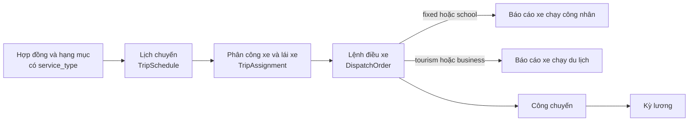
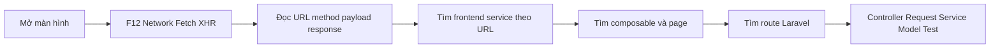
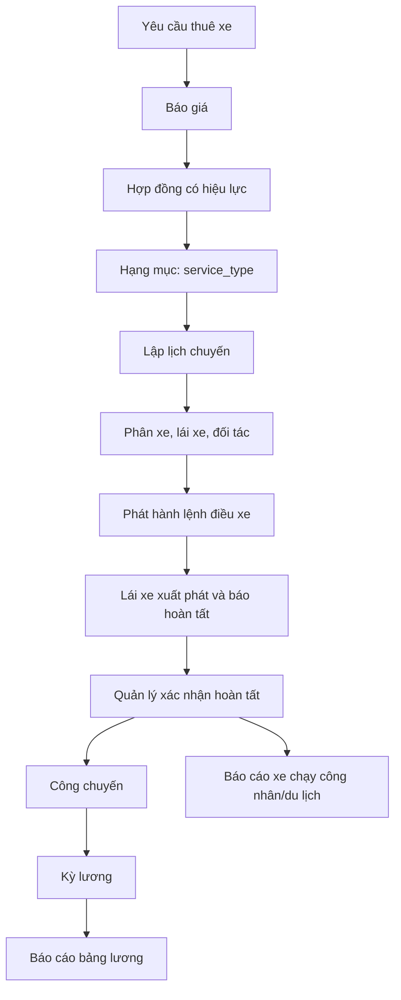
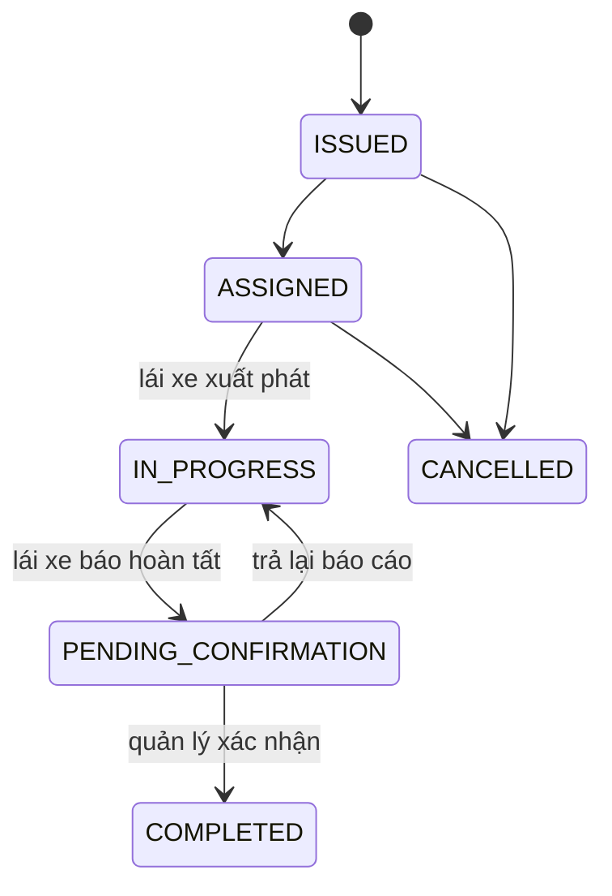
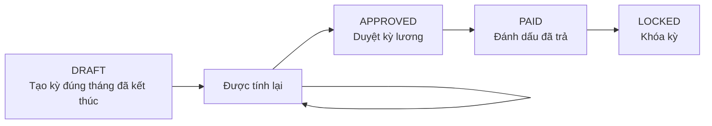
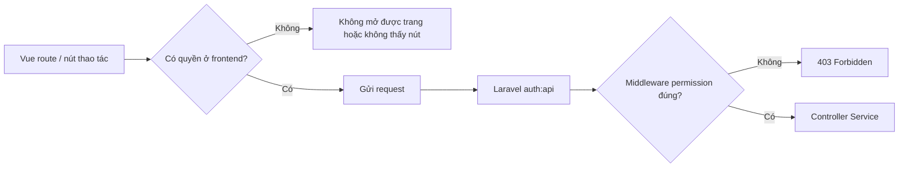
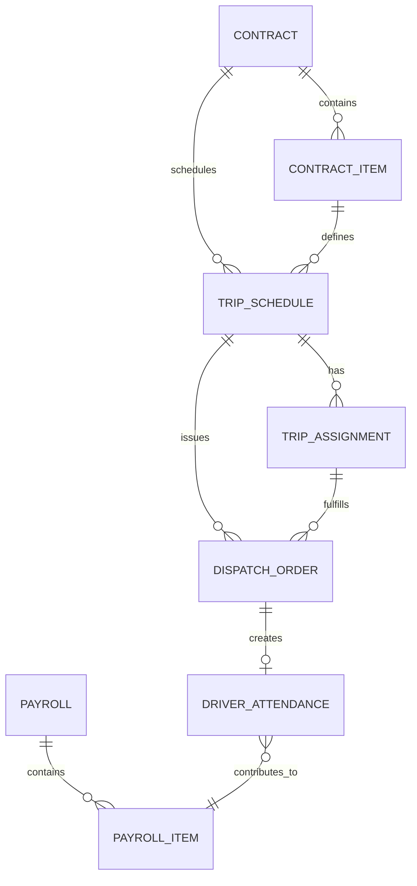

# Sổ tay tự học quy trình nghiệp vụ và lần code — Nguyễn Mạnh Trường

> **Phạm vi phụ trách:** quản lý thuê xe chạy dịch vụ chở công nhân; quản lý thuê xe chạy du lịch; quản lý lương lái xe; báo cáo xe chạy công nhân, xe chạy du lịch và bảng lương trả lái xe; chuẩn bị phần báo cáo đồ án cho các nghiệp vụ trên.
>
> **Đối tượng:** người mới hoàn toàn. Không cần biết Vue/Laravel trước khi mở tài liệu. Mỗi mục đi từ “người dùng bấm gì” đến “số liệu được tính ở đâu”.
>
> **Quy tắc an toàn:** chỉ tạo, sửa, hủy, xác nhận hoặc khóa dữ liệu trên môi trường phát triển đã được phép. Không chạy migration, seeder, `migrate:fresh`, hay thử dữ liệu trên hệ thống thật.

---

## 0. Sự thật cần nói rõ trước khi bảo vệ

File yêu cầu cũ có hai bảng mang tên **Bảng xe chạy công nhân** và **Bảng xe chạy du lịch**. Trong source hiện tại:

- Có **hai báo cáo riêng**: `fixed-trips` (xe chạy công nhân/trường học) và `tourism-trips` (xe chạy du lịch/công tác).
- Có **một luồng vận hành chung**: `TripSchedule` (lịch chuyến) → `TripAssignment` (phân xe/lái xe) → `DispatchOrder` (lệnh điều xe).
- Có trường `service_type` để phân biệt loại dịch vụ; không tồn tại hai bảng CSDL vật lý tách riêng có tên `xe_chay_cong_nhan` và `xe_chay_du_lich`.

Vì vậy, không được trả lời “hệ thống đã có đúng hai bảng trong CSDL” nếu thầy hỏi theo nghĩa bảng vật lý. Câu trả lời trung thực là:

> Hệ thống đã hiện thực hai **nghiệp vụ và hai báo cáo theo loại xe chạy**, nhưng chuẩn hóa phần dữ liệu vận hành vào một mô hình chung. Nếu yêu cầu chấm bắt buộc là có hai bảng vật lý riêng biệt, thiết kế hiện tại chưa đáp ứng phần ràng buộc cấu trúc đó và cần được thầy xác nhận trước khi đổi mô hình.

Đây không phải là điểm yếu để né tránh. Đây là cách phân biệt đúng giữa:

| Câu hỏi | Trả lời hiện tại |
| --- | --- |
| Có theo dõi xe nào, đi đâu, giờ nào, lái xe nào không? | Có, trong lịch chuyến + phân công + lệnh điều xe. |
| Có tách báo cáo xe chạy công nhân và du lịch không? | Có, hai endpoint và hai route báo cáo riêng. |
| Có đúng hai bảng CSDL vật lý như tài liệu cũ không? | Không; hiện dùng một mô hình chung có `service_type`. |
| Có lý do hợp lý để gộp dữ liệu vận hành không? | Có, vì phần lớn vòng đời và trường dữ liệu giống nhau; xem mục 2. |
| Có nên tự ý tách hai bảng ngay không? | Không. Phải xác nhận yêu cầu chấm: “hai bảng vật lý” hay “hai màn/báo cáo nghiệp vụ”. |

---

## 1. Đích đến sau khi tự học

Hoàn thành sổ tay khi tự làm được các việc sau mà không cần ai chỉ file:

1. Từ màn hình **Lịch chuyến**, tìm được API tạo lịch, phân công và phát hành lệnh.
2. Giải thích một chuyến công nhân và một chuyến du lịch giống/khác nhau ở đâu trong dữ liệu.
3. Truy vết một dòng báo cáo xe chạy từ giao diện đến `ReportService`.
4. Tạo công chuyến đúng sau khi lệnh hoàn tất, rồi giải thích công thức lương cố định và hoa hồng du lịch.
5. Giải thích quy trình kỳ lương: nháp → tính → duyệt → đã trả → khóa.
6. Trình bày trung thực lý do gộp mô hình xe chạy, đồng thời nêu rõ giới hạn trước yêu cầu hai bảng CSDL.
7. Tự tìm được nguyên nhân lỗi `403`, `409`, `422` trong một request nghiệp vụ.

---

## 2. Vì sao dự án gộp dữ liệu xe chạy công nhân và xe chạy du lịch?

### 2.1. Điểm giống nhau thực tế

Hai bảng trong file Word đều có các nhóm thông tin giống hoặc gần như giống nhau:

| Nhóm nghiệp vụ | Công nhân | Du lịch | Trong dự án hiện tại |
| --- | --- | --- | --- |
| Khách hàng | Có | Có | `Contract → Customer` |
| Ngày/giờ chạy | Có | Có | `TripSchedule.scheduled_start_at`, `scheduled_end_at` |
| Xe nhà / xe thuê | Có | Có | `Vehicle.ownership_type`, `Vehicle.partner_id` |
| Biển số | Có | Có | `Vehicle.license_plate` qua `TripAssignment` |
| Hành trình/tuyến | Có | Có | `Route`, `pickup_location`, `dropoff_location`, `journey` |
| Lái xe | Có | Có | `TripAssignment.driver_id` |
| Thuê lái | Có | Có | Loại lái xe và `DispatchOrder.external_driver_cost` |
| Tiền thuê xe | Có | Có | `DispatchOrder.partner_vehicle_cost` |
| Cước xe | Có | Có | `DispatchOrder.customer_amount` |
| Lương lái xe | Có | Có | `DriverAttendance.calculated_wage` → `PayrollItem` |
| Ghi chú | Có | Có | `TripSchedule.note`, `DispatchOrder.note` |

Nếu tách hai bảng vật lý có các cột này, phần lớn cột sẽ bị lặp, kéo theo các luồng tạo/sửa/phân công/hủy/lệnh điều xe bị nhân đôi.

### 2.2. Mô hình gộp hiện tại



`service_type` là nhãn phân loại trung tâm. Các giá trị đang có là:

| Giá trị | Ý nghĩa dùng trong dự án |
| --- | --- |
| `fixed` | Dịch vụ chạy cố định; đi vào báo cáo xe chạy công nhân |
| `school` | Dịch vụ trường học; dự án cũng đưa vào báo cáo xe chạy công nhân |
| `tourism` | Dịch vụ du lịch; đi vào báo cáo xe chạy du lịch |
| `business` | Dịch vụ công tác; dự án cũng đưa vào báo cáo xe chạy du lịch |

### 2.3. Lý do gộp có thể trình bày trước thầy

Nói ngắn gọn, không vòng vo:

> Chúng em gộp **dữ liệu vận hành gốc** vì cả hai loại đều đi qua một vòng đời: lập lịch, phân xe/lái xe, phát hành lệnh, lái xe báo hoàn thành, quản lý xác nhận. Chúng em vẫn tách **nghiệp vụ hiển thị và báo cáo** bằng `service_type`: báo cáo xe công nhân chỉ lọc `fixed/school`, báo cáo xe du lịch chỉ lọc `tourism/business`. Cách này tránh hai bảng có nhiều cột trùng, đồng thời một lệnh điều xe vẫn là chứng từ duy nhất để nối chi phí, thu tiền và lương.

Sau đó phải nói ngay giới hạn, không chờ thầy bắt lỗi:

> Tuy nhiên, nếu tiêu chí chấm yêu cầu đúng hai bảng CSDL vật lý riêng, mô hình chuẩn hóa này không thay thế được tiêu chí đó. Khi đó nhóm cần xin xác nhận để hoặc giữ mô hình gộp, hoặc bổ sung hai bảng/bảng trình bày riêng theo yêu cầu.

### 2.4. Khi nào gộp là đúng, khi nào phải tách?

| Tình huống | Quyết định hợp lý |
| --- | --- |
| Hai loại chuyến có cùng vòng đời, khác chủ yếu ở loại dịch vụ và cách tính lương | Gộp bảng gốc, dùng `service_type`, tách report/view. Đây là hiện trạng. |
| Đề bài/giảng viên chỉ yêu cầu hai màn hình hoặc hai báo cáo theo dõi | Giữ mô hình gộp, chứng minh rõ bộ lọc và cột theo dõi. |
| Giảng viên yêu cầu **hai bảng vật lý** để đối chiếu sơ đồ CSDL | Cần bổ sung thiết kế/migration sau khi được duyệt; lời giải thích gộp không thay thế yêu cầu. |
| Hai nghiệp vụ bắt đầu có rất nhiều cột, trạng thái, quy trình khác hẳn nhau | Cân nhắc tách bảng hoặc tạo bảng con 1-1. |

### 2.5. Không được dùng hai “bảng danh sách” làm bằng chứng sai

`ReportService::fixedTrips()` và `ReportService::tourismTrips()` trả hai danh sách dữ liệu khác nhau, nhưng chúng là **kết quả truy vấn/báo cáo**, không phải hai table migration. Nói “hai bảng báo cáo” được; nói “hai bảng CSDL” là sai nếu chưa tạo schema vật lý.

---

## 3. Đối chiếu file Word cũ với source hiện tại

File Word đính kèm mô tả Bảng 2.11 và 2.12. Nó là nguồn để so cột nghiệp vụ, không phải chỉ dẫn buộc source hiện tại phải có cùng tên cột.

### 3.1. Bảng xe chạy công nhân

| Cột Word cũ | Dữ liệu hiện tại ở đâu? | Có sẵn trực tiếp hay tính ra? | Ghi chú quan trọng |
| --- | --- | --- | --- |
| `ID` | `TripSchedule.id` hoặc `DispatchOrder.id` | Trực tiếp | Phải nói rõ đang dùng ID lịch hay ID lệnh; báo cáo dùng lệnh hoàn tất. |
| `MaKhachHang` | `TripSchedule → Contract → Customer` | Quan hệ | Không lặp mã khách trên từng chuyến. |
| `NgayChay` | `scheduled_start_at`; sau chạy có `actual_start_at`, `completed_at` | Trực tiếp | Phân biệt kế hoạch và thực tế. |
| `XeNha` | `Vehicle.ownership_type` | Trực tiếp | Xe công ty/xe đối tác, không dùng một cờ bit riêng. |
| `MaHangVanTai` | `TripAssignment.partner_id` hoặc `Vehicle.partner_id` | Quan hệ | Chủ xe/hãng vận tải. |
| `BienSo` | `TripAssignment → Vehicle.license_plate` | Quan hệ | Xe được chọn khi phân công. |
| `MaTuyen` | `TripSchedule.route_id` | Trực tiếp | Lịch lấy từ hạng mục hợp đồng. |
| `MaLaiXe` | `TripAssignment.driver_id` | Trực tiếp | Có kiểm tra lịch/lái xe giao thời gian. |
| `ThueLai`, `TenLaiThue` | `Driver.type`, `Driver.full_name`; chi phí `external_driver_cost` | Quan hệ/tính nghiệp vụ | Lái xe ngoài là `type = partner`. |
| `GioDon`, `GioVe` | `scheduled_start_at`, `scheduled_end_at` | Trực tiếp | Báo cáo hiển thị `pickup_time`, `return_time`. |
| `TienThueLai` | `DispatchOrder.external_driver_cost` | Trực tiếp sau xác nhận | Cam kết chi phí thuê lái của lệnh; chứng từ chi thực tế là Expense riêng. |
| `TienThueXe` | `DispatchOrder.partner_vehicle_cost` | Trực tiếp sau xác nhận | Cam kết chi phí xe đối tác; chi thực tế ghi bằng PartnerPayment. |
| `CuocXe` | `DispatchOrder.customer_amount` | Trực tiếp sau xác nhận | Doanh thu của chuyến đã hoàn tất. |
| `LuongLaiXe` | `DriverAttendance.calculated_wage` | Tính ra | Chỉ hình thành sau tạo công chuyến. |
| `GhiChu` | `TripSchedule.note`, `DispatchOrder.note` | Trực tiếp | Tùy giai đoạn của thông tin. |
| `CaNoi` | Chưa thấy trường nghiệp vụ tương đương trực tiếp | **Khoảng trống** | Không được nói có nếu không bổ sung source. Có thể dùng `journey`/note để ghi mô tả, nhưng không phải cờ ca nối. |

### 3.2. Bảng xe chạy du lịch

| Cột Word cũ | Dữ liệu hiện tại ở đâu? | Có sẵn trực tiếp hay tính ra? | Ghi chú quan trọng |
| --- | --- | --- | --- |
| `TenKhachHang` | `TripSchedule → Contract → Customer.name` | Quan hệ | Báo cáo trả `customer_name`. |
| `NgayChay`, `NgayVe` | `scheduled_start_at`, `scheduled_end_at`; thực tế có `actual_start_at`, `actual_end_at` | Trực tiếp | Không nên dùng ngày kế hoạch để thay ngày thực tế khi đối soát. |
| `XeNha`, `MaHangVanTai`, `BienSo`, `MaLaiXe` | Như bảng công nhân | Quan hệ | Dùng cùng `TripAssignment`. |
| `HanhTrinh` | `TripSchedule.journey`, tuyến/điểm đón/trả | Trực tiếp/quan hệ | Báo cáo xe du lịch trả `journey`, `route_name`. |
| `ThueLai`, `TenLaiThue`, `TienThueLai` | Driver ngoài + `external_driver_cost` | Quan hệ/trực tiếp | Chi thực tế thuê lái được ghi qua Expense. |
| `TienThueXe` | `partner_vehicle_cost` | Trực tiếp | Chi thực trả có thể xem trong PartnerPayment. |
| `CuocXe` | `customer_amount` | Trực tiếp | Được nhập/xác nhận lúc hoàn tất lệnh. |
| `LaiXeThu` | Tổng Receipt có `driver_direct_collection` theo lệnh | Tính ra | `tourismTrips()` trả `driver_collected_amount`. |
| `CongTyThu` | Tổng Receipt có `standard` theo lệnh | Tính ra | `tourismTrips()` trả `company_collected_amount`. |
| `LaiXeNop` | Tổng `DriverCashRemittance.amount` theo lệnh | Tính ra | Báo cáo trả `driver_remitted_amount`. |
| `LaiXeChi` | Expense `driver_reimbursement` | Có trong lương chi tiết, chưa là cột tour report | Nêu đúng: nguồn có tồn tại, nhưng cột trực tiếp trong `tourismTrips()` chưa có. |
| `PhanTramLuongLaiXe` | `VehicleType.tour_driver_commission_rate` | Quan hệ | Được đổi từ % sang số thập phân khi tính công. |
| `LuongLaiXe` | `DriverAttendance.calculated_wage` | Tính ra | = doanh thu chuyến × tỷ lệ hoa hồng. |
| `GhiChu` | `TripSchedule.note`, `DispatchOrder.note` | Trực tiếp | — |

### 3.3. Những khoảng trống phải biết để không nói quá

| Nội dung tài liệu cũ | Trạng thái hiện tại | Cách trả lời đúng |
| --- | --- | --- |
| Hai bảng CSDL tách riêng | Chưa có | Có mô hình gộp và hai báo cáo; chưa phải hai table vật lý. |
| `CaNoi` là cột riêng | Chưa có | Chưa hiện thực cờ dữ liệu riêng. |
| `LaiXeChi` là cột báo cáo tour | Chưa thấy trong response `tourismTrips()` | Có nguồn Expense quyết toán lái xe, nhưng báo cáo tour hiện chưa trả cột này. |
| Theo dõi hàng ngày từng chuyến | Có qua Lịch chuyến và Lệnh điều xe | Màn hình là chung; lọc/nhãn loại dịch vụ phân biệt hai nghiệp vụ. |

---

## 4. Từ điển nghiệp vụ phải thuộc trước khi mở code

| Khái niệm | Nói đơn giản | Bản ghi gốc |
| --- | --- | --- |
| Yêu cầu thuê xe | Khách đề nghị thuê xe | `RentalRequest` |
| Báo giá | Giá gửi khách trước khi ký | `Quotation` |
| Hợp đồng | Cam kết đã hiệu lực với khách | `Contract` |
| Hạng mục hợp đồng | Một loại dịch vụ/tuyến/xe/đơn giá trong hợp đồng | `ContractItem` |
| Loại dịch vụ | Nhãn fixed, tourism, school, business | `service_type` |
| Lịch chuyến | Kế hoạch một lần chạy cụ thể: lúc nào, đón/trả ở đâu | `TripSchedule` |
| Phân công | Gắn xe, lái xe, đối tác vào lịch | `TripAssignment` |
| Lệnh điều xe | Chứng từ vận hành phát hành sau phân công | `DispatchOrder` |
| Báo hoàn tất | Lái xe nhập dữ liệu thực tế sau chạy | Lệnh chuyển sang `PENDING_CONFIRMATION` |
| Xác nhận hoàn tất | Quản lý xác nhận doanh thu/chi phí và kết thúc lệnh | Lệnh chuyển `COMPLETED` |
| Công chuyến | Dữ liệu lương của một lệnh hoàn tất | `DriverAttendance` |
| Tạm ứng | Khoản ứng trước của lái xe công ty | `DriverAdvance` |
| Kỳ lương | Tổng hợp công, tạm ứng và quyết toán trong trọn tháng | `Payroll`, `PayrollItem` |

---

## 5. Bản đồ workspace: tôi cần mở file nào?

| Gốc | Ý nghĩa | Vùng Trường cần học |
| --- | --- | --- |
| `D:\vue\halinhtravel-client` | Frontend Vue, nơi người dùng thao tác | `src/modules/rental`, `dispatch`, `finance`, `reports`, `src/services` |
| `D:\Laravel\halinhtravel-api` | Backend Laravel, nơi kiểm luật và tính toán | `app/Modules/Rental`, `Dispatch`, `DriverPayroll`, `Other` |

### 5.1. “Tôi đang ở đâu?”

| Muốn tìm | Frontend cần mở | Backend cần mở | Dấu hiệu đã đến đúng |
| --- | --- | --- | --- |
| Tạo yêu cầu thuê/báo giá | `modules/rental/*` | `Rental/Routes`, Controller, Service | Có request/quotation |
| Theo dõi chuyến hằng ngày | `modules/dispatch/DispatchSchedulePage.vue` | `Dispatch/Models/TripSchedule.php` | Có lịch, giờ bắt đầu/kết thúc, điểm đón/trả |
| Phân xe/lái xe | `DispatchSchedulePage.vue` | `TripAssignmentService.php` | Có vehicle/driver/partner và kiểm giao lịch |
| Lệnh điều xe & hoàn tất | `DispatchOrderPage.vue` | `DispatchOrderService.php` | Có customer amount, partner cost, external driver cost |
| Chấm công & lương | `finance/PayrollPage.vue`, `PayrollDetail.vue` | `DriverPayrollService.php` | Có attendance/payroll status |
| Báo cáo chạy xe | `reports/ReportsPage.vue` | `Other/Services/ReportService.php` | Có `fixedTrips`, `tourismTrips` |
| Báo cáo lương | `reports/ReportsPage.vue` | `ReportService::payroll`, `payrollDetails` | Có payroll item/details |

---

## 6. Quy trình lần code chuẩn bằng DevTools



### Sáu bước thao tác

1. Mở đúng màn hình; chỉ làm **một** thao tác để dễ nhận request.
2. Nhấn `F12 → Network → Fetch/XHR`, xóa request cũ.
3. Ghi URL, method, status code, payload và response.
4. Ở frontend, dùng `Ctrl+Shift+F` tìm phần cuối của URL. Ví dụ tìm `trip-schedules`.
5. Ở backend, tìm cùng chuỗi tại `app/Modules/*/Routes/index.php`.
6. Lần theo tên controller, request, service; tìm test tương ứng trước khi nghĩ đến sửa code.

### Phím tắt cần dùng

| Phím | Dùng để làm gì |
| --- | --- |
| `Ctrl+Shift+F` | Tìm endpoint, lỗi, tên hàm trong toàn dự án |
| `F12` | Đi tới định nghĩa class/hàm/type |
| `Alt+F12` | Xem nhanh định nghĩa mà không rời file |
| `Shift+F12` | Xem mọi nơi gọi một hàm |
| `Ctrl+P` | Mở file theo tên |

---

## 7. Luồng nghiệp vụ hoàn chỉnh: từ thuê xe đến báo cáo



### 7.1. Lịch chuyến là nơi theo dõi hằng ngày

Các câu thầy thường hỏi: “Hôm nay xe nào chạy chuyến nào, đi đâu, giờ nào, lái xe gì?” được tách dữ liệu như sau:

| Câu hỏi | Nguồn hiện tại |
| --- | --- |
| Xe chạy ngày nào/giờ nào? | `TripSchedule.scheduled_start_at`, `scheduled_end_at` |
| Điểm đi, điểm đến? | `pickup_location`, `dropoff_location`, `journey`, `route` |
| Xe nào? | `TripAssignment.vehicle` → `license_plate` |
| Lái xe nào? | `TripAssignment.driver` → `full_name` |
| Là công nhân hay du lịch? | `TripSchedule.service_type` từ `ContractItem.service_type` |
| Chuyến đã chạy thật chưa? | `TripSchedule.status` và `DispatchOrder.status` |

Đây là lý do phải phân biệt **lịch chuyến** với **báo cáo xe chạy**:

| Lịch chuyến | Báo cáo xe chạy |
| --- | --- |
| Kế hoạch và tình trạng vận hành, có thể chưa chạy | Số liệu lệnh đã `COMPLETED` trong khoảng ngày |
| Dùng để theo dõi hôm nay/sắp tới | Dùng để đối soát sau hoàn tất |
| Dữ liệu ở `TripSchedule` | Dữ liệu gốc là `DispatchOrder`, có join lịch/phân công |

### 7.2. Các trạng thái không được nói lẫn

| Lịch chuyến | Ý nghĩa | Lệnh điều xe tương ứng thường gặp |
| --- | --- | --- |
| `PLANNED` | Đã lập, chưa phân công | Chưa có lệnh |
| `ASSIGNED` | Có xe/lái xe | Có thể phát hành lệnh |
| `IN_PROGRESS` | Đang chạy | Lệnh `IN_PROGRESS` |
| `COMPLETED` | Đã xác nhận kết thúc | Lệnh `COMPLETED` |
| `CANCELLED` | Đã hủy | Lệnh đã hủy/không có lệnh hiệu lực |

| Lệnh điều xe | Ý nghĩa |
| --- | --- |
| `ISSUED` | Đã phát hành |
| `ASSIGNED` | Sẵn sàng để lái xe xuất phát |
| `IN_PROGRESS` | Đang chạy |
| `PENDING_CONFIRMATION` | Lái xe đã báo hoàn tất, chờ quản lý duyệt |
| `COMPLETED` | Đã xác nhận, được vào công/báo cáo |
| `CANCELLED` | Đã hủy |

---

## 8. Lab mẫu 1 — Lập lịch một chuyến, phân xe rồi phát hành lệnh

### Mục tiêu

Tự lần được một request từ màn hình **Lịch chuyến** đến service backend.

### Các bước trên UI

1. Vào màn hình **Lịch chuyến**.
2. Tạo lịch từ một hợp đồng đang `active` và chọn hạng mục.
3. Điền bắt đầu/kết thúc, điểm đón, điểm trả, ghi chú.
4. Phân xe và lái xe.
5. Phát hành lệnh điều xe.

### Request cần nhận ra

```http
POST /api/dispatch/trip-schedules

{
  "contract_id": 20,
  "contract_item_id": 45,
  "service_type": "fixed",
  "route_id": 3,
  "scheduled_start_at": "2026-10-20 06:30:00",
  "scheduled_end_at": "2026-10-20 08:00:00",
  "pickup_location": "Khu công nghiệp A",
  "dropoff_location": "Nhà máy B",
  "journey": "Ca sáng A - B"
}
```

### Đường code phải lần được

```text
DispatchSchedulePage.vue
  → DispatchService.createSchedule()
  → POST /api/dispatch/trip-schedules
  → Dispatch/Routes/index.php
  → TripScheduleController::store()
  → StoreTripScheduleRequest
  → TripScheduleService::store()
  → TripSchedule::create()
```

### Luật backend cần tự tìm

| Luật | Nơi đọc |
| --- | --- |
| Chỉ tạo lịch cho hợp đồng đang hiệu lực | `TripScheduleService::store()` |
| Không được sửa/ngừng lịch đã có lệnh hoặc không ở planned | `assertEditable()` |
| Xe phải sẵn sàng, đúng loại xe yêu cầu | `TripAssignmentService::create()` |
| Lái xe phải còn hiệu lực bằng, còn làm việc | `TripAssignmentService::create()` |
| Xe/lái xe không được giao hai lịch giao thời gian | `assertNotBusy()` |
| Chỉ phát hành lệnh cho lịch đã phân công | `DispatchOrderService::issue()` |

### Kết quả cần nộp

```text
1. Screenshot/chép lại Network của POST tạo lịch.
2. URL, method, permission cần có.
3. Tên 7 lớp code từ page đến model.
4. Một lý do request phân xe có thể bị 422.
5. Một lý do phát hành lệnh có thể bị 409.
```

---

## 9. Phân loại xe chạy công nhân và xe chạy du lịch

### 9.1. Không phân loại bằng tên report

Loại dịch vụ đi từ **hạng mục hợp đồng** đến lịch chuyến:

```text
ContractItem.service_type
  → TripSchedule.service_type
  → DispatchOrder.tripSchedule.service_type
  → ReportService::tripOrders(..., types)
```

`DispatchSchedulePage.vue` khi tạo lịch lấy `item.service_type` của hạng mục hợp đồng, không để người dùng tự gõ bừa loại dịch vụ.

### 9.2. Hai báo cáo dùng chung một truy vấn nền

```php
// ReportService (rút gọn)
public function fixedTrips(array $filters): array
{
    $orders = $this->tripOrders($filters, ['fixed', 'school']); // (1)
}

public function tourismTrips(array $filters): array
{
    $orders = $this->tripOrders($filters, ['tourism', 'business']); // (2)
}
```

1. Báo cáo công nhân lấy lệnh hoàn tất có loại `fixed` hoặc `school`.
2. Báo cáo du lịch lấy lệnh hoàn tất có loại `tourism` hoặc `business`.

Hàm chung `tripOrders()` chỉ lấy lệnh:

```php
->where('is_active', true)                         // (1)
->where('status', DispatchOrderStatusEnum::COMPLETED->value) // (2)
->whereBetween('completed_at', [$from, $to])       // (3)
->whereHas('tripSchedule', fn ($q) => $q->whereIn('service_type', $types)); // (4)
```

1. Lệnh đã ngừng hoạt động bị loại.
2. Lệnh chưa hoàn tất bị loại.
3. Kỳ báo cáo dùng **ngày hoàn tất**, không dùng ngày lập lịch.
4. Đây là chỗ tách hai nghiệp vụ từ mô hình chung.

### 9.3. Hai endpoint và quyền xem

| Báo cáo | Route frontend | API | Quyền backend |
| --- | --- | --- | --- |
| Xe chạy công nhân | `/reports/fixed-trips` | `GET /api/other/reports/fixed-trips` | `dispatch-orders.view` |
| Xe chạy du lịch | `/reports/tourism-trips` | `GET /api/other/reports/tourism-trips` | `dispatch-orders.view` |

Payload lọc kiểu mẫu:

```http
GET /api/other/reports/fixed-trips?from_date=2026-10-01&to_date=2026-10-31
GET /api/other/reports/tourism-trips?from_date=2026-10-01&to_date=2026-10-31
```

`from_date` và `to_date` là bắt buộc. Request có thể thêm `route_id`, `customer_id`, `vehicle_id`, `driver_id`, `partner_id` để lọc.

### 9.4. Một dòng báo cáo lấy từ đâu?

| Cột response | Nguồn |
| --- | --- |
| `date` | `DispatchOrder.completed_at` |
| `order_no` | `DispatchOrder.order_no` |
| `route_name`, `journey` | `TripSchedule.route`, `TripSchedule.journey` |
| `pickup_time`, `return_time` | thời gian lịch kế hoạch, format `H:i` |
| `customer_name` | hợp đồng → khách hàng |
| `vehicle_plate`, `driver_name`, `partner_name` | phân công hiện tại của lệnh |
| `driver_wage` | `DriverAttendance.calculated_wage` |
| `partner_vehicle_cost`, `external_driver_cost`, `revenue` | các số tiền xác nhận hoàn tất lệnh |
| `actual_distance_km` | số km thực tế của lệnh |

### 9.5. Báo cáo du lịch có thêm đối soát thu/chi

| Cột báo cáo du lịch | Cách hệ thống tính |
| --- | --- |
| `expense_amount` | tổng Expense + PartnerPayment theo lệnh |
| `driver_collected_amount` | tổng phiếu thu khách trả trực tiếp lái xe |
| `company_collected_amount` | tổng phiếu thu khách nộp công ty |
| `driver_remitted_amount` | tổng chứng từ lái xe nộp tiền |
| `remaining_receivable` | `customer_amount − driver_collected_amount − company_collected_amount` |

**Cẩn thận:** `remaining_receivable` chỉ dùng hai khoản khách đã trả (qua lái xe hoặc công ty). “Lái xe đã nộp” là đối soát dòng tiền nội bộ, không được trừ tiếp một lần nữa.

---

## 10. Hoàn tất chuyến: điểm chuyển từ vận hành sang tiền và lương

### 10.1. Luồng trạng thái



### 10.2. Dữ liệu quản lý nhập khi xác nhận

```json
{
  "customer_amount": "5000000",
  "partner_vehicle_cost": "0",
  "external_driver_cost": "0",
  "note": "Đã đối soát chuyến"
}
```

| Trường | Dùng ở đâu sau đó? |
| --- | --- |
| `customer_amount` | Doanh thu báo cáo, công nợ khách, cơ sở hoa hồng chuyến du lịch |
| `partner_vehicle_cost` | Công nợ/chi phí chủ xe, báo cáo xe |
| `external_driver_cost` | Công nợ thuê lái, báo cáo xe/lợi nhuận xe |
| `completed_at` | Điều kiện để xuất hiện trong báo cáo xe chạy |

### 10.3. Luật cần giải thích được

| Luật | Tác dụng |
| --- | --- |
| Chỉ báo hoàn tất khi lệnh đang chạy | Ngăn bỏ qua bước xuất phát |
| ODO kết thúc không nhỏ hơn ODO đầu | Không có quãng đường âm |
| Kết thúc không sớm hơn xuất phát | Bảo vệ thời gian thực tế |
| Chỉ xác nhận từ một giờ trước giờ kết thúc lịch | Hạn chế chốt chuyến quá sớm |
| Chỉ xác nhận khi có báo cáo chờ xác nhận hợp lệ | Không tạo doanh thu/chi phí từ dữ liệu chưa kiểm tra |

**Đường code:** `DispatchOrderPage.vue → DispatchService.confirmCompletion() → POST /dispatch/orders/{id}/confirm-completion → DispatchOrderService::confirmCompletion()`.

---

## 11. Chấm công lái xe: công chuyến không phải kỳ lương

### 11.1. Điều kiện tạo công

Chỉ có thể tạo công cho lệnh điều xe:

1. Đã `COMPLETED`.
2. Có lái xe được phân công.
3. Chưa có `DriverAttendance` cho lệnh đó.

Nếu không đạt, backend trả `409`. Đây là cách chống tính lương hai lần cho một chuyến.

### 11.2. Ba cách tính công

| Loại dịch vụ | `work_type` | Cơ sở (`base_amount`) | Tỷ lệ (`rate`) | Tiền công |
| --- | --- | --- | --- | --- |
| `fixed` hoặc `school` | `fixed_trip` | `1` | `ContractItem.driver_wage` | `work_units × driver_wage` |
| `tourism` | `tourism_trip` | `DispatchOrder.customer_amount` | `VehicleType.tour_driver_commission_rate / 100` | doanh thu × tỷ lệ hoa hồng |
| Loại khác, ví dụ `business` | `other` | `work_units` | bắt buộc nhập rate | `work_units × rate` |

### 11.3. Ví dụ tính tay

**Chuyến công nhân:**

```text
work_units = 2
ContractItem.driver_wage = 350.000
Tiền công = 2 × 350.000 = 700.000
```

**Chuyến du lịch:**

```text
customer_amount = 8.000.000
tour_driver_commission_rate = 12,5%
rate dùng để tính = 12,5 / 100 = 0,125
Tiền công = 8.000.000 × 0,125 = 1.000.000
```

### 11.4. Code phải tự đọc được

```php
// DriverPayrollService::createAttendance() (rút gọn)
if (in_array($service, [RentalServiceTypeEnum::FIXED, RentalServiceTypeEnum::SCHOOL], true)) {
    $type = WorkTypeEnum::FIXED_TRIP;                     // (1)
    $base = '1';                                           // (2)
    $rate = (string) $contractItem->driver_wage;           // (3)
    $wage = (float) $units * (float) $rate;                // (4)
} elseif ($service === RentalServiceTypeEnum::TOURISM) {
    $type = WorkTypeEnum::TOURISM_TRIP;                    // (5)
    $base = (string) $order->customer_amount;              // (6)
    $rate = (string) ($vehicleType->tour_driver_commission_rate / 100); // (7)
    $wage = (float) $base * (float) $rate;                 // (8)
}
```

1. Cả `fixed` và `school` được tính là công chuyến cố định.
2. Mỗi công chuyến cố định mặc định có cơ sở là một chuyến; `work_units` có thể điều chỉnh.
3. Đơn giá đi từ hạng mục hợp đồng, không phải nhập tay vào bảng lương.
4. Công nhân = số công × đơn giá công.
5. Du lịch có loại công khác.
6. Cơ sở của du lịch là doanh thu đã xác nhận của lệnh.
7. Phần trăm trong danh mục loại xe phải chia 100 trước khi nhân.
8. Du lịch = doanh thu × hoa hồng.

### 11.5. Từ UI đến API công chuyến

| Việc | API | Permission |
| --- | --- | --- |
| Xem công chuyến | `GET /api/driver-payroll/attendances` | `driver-attendances.view` |
| Tạo công từ lệnh | `POST /api/driver-payroll/orders/{dispatchOrder}/attendance` | `driver-attendances.manage` |
| Sửa công chờ xác nhận | `PATCH /api/driver-payroll/attendances/{attendance}` | `driver-attendances.manage` |
| Xác nhận công | `POST /api/driver-payroll/attendances/{attendance}/confirm` | `driver-attendances.manage` |

---

## 12. Kỳ lương: đọc như một quy trình chốt sổ

### 12.1. Sơ đồ vòng đời



| Trạng thái | Có nghĩa gì? | Làm gì tiếp được? |
| --- | --- | --- |
| `draft` | Kỳ mới tạo | Sửa kỳ, tính lương |
| `calculated` | Đã sinh payroll item | Điều chỉnh item, tính lại, duyệt |
| `approved` | Đã duyệt | Đánh dấu đã trả |
| `paid` | Đã trả lương | Khóa kỳ |
| `locked` | Đã chốt | Không tiếp tục chỉnh dữ liệu nguồn của kỳ |

### 12.2. Điều kiện tạo kỳ lương

1. Chỉ xử lý **tháng đã kết thúc**.
2. `from_date` bắt buộc đúng ngày đầu tháng.
3. `to_date` bắt buộc đúng ngày cuối cùng của cùng tháng.
4. Mỗi tháng/năm chỉ một kỳ lương.

Ví dụ tháng 10 năm 2026 phải có:

```json
{
  "month": 10,
  "year": 2026,
  "from_date": "2026-10-01",
  "to_date": "2026-10-31"
}
```

### 12.3. Dữ liệu `calculate()` gom cho từng lái xe công ty

| Thành phần | Nguồn | Ảnh hưởng công thức |
| --- | --- | --- |
| Lương trách nhiệm | `Driver.responsibility_allowance` | Cộng gross |
| Lương chuyến cố định | Công đã xác nhận `fixed_trip` | Cộng gross |
| Hoa hồng du lịch | Công đã xác nhận `tourism_trip` | Cộng gross |
| Tạm ứng | `DriverAdvance` đã xác nhận | Trừ net |
| Khách trả trực tiếp qua lái xe | Receipt `driver_direct_collection` | Trừ net để đối soát tiền lái xe giữ |
| Lái xe tự chi được hoàn | Expense `driver_reimbursement` | Cộng net |
| Lái xe nộp tiền | `DriverCashRemittance` | Cộng net |

Chỉ lái xe loại `company`, còn hoạt động và đã vào làm trước/đến cuối kỳ được tạo item lương. Lái xe đối tác/thuê lái không vào quy trình lương công ty này.

### 12.4. Công thức lương cần thuộc

```text
Gross salary
  = responsibility_allowance
  + fixed_trip_wage
  + tourism_commission

Net salary
  = gross_salary
  − advance_amount
  − direct_customer_collection
  + driver_reimbursement
  + driver_remittance_amount
```

Ví dụ:

| Thành phần | Giá trị |
| --- | ---: |
| Lương trách nhiệm | 500.000 |
| Lương chuyến cố định | 3.000.000 |
| Hoa hồng du lịch | 1.000.000 |
| Gross | 4.500.000 |
| Tạm ứng | 500.000 |
| Khách trả trực tiếp qua lái xe | 1.000.000 |
| Lái xe tự chi được hoàn | 200.000 |
| Lái xe nộp tiền | 1.000.000 |
| **Net** | **4.200.000** |

Tính: `4.500.000 − 500.000 − 1.000.000 + 200.000 + 1.000.000 = 4.200.000`.

### 12.5. Code excerpt: công thức thật

```php
// DriverPayrollService::calculate() (rút gọn)
$gross = (float) $driver->responsibility_allowance + $fixed + $tourism; // (1)
$net = $gross - (float) $advance - (float) $directCollection             // (2)
    + (float) $reimbursement + (float) $remittance;
```

1. Lương cơ bản hiện lưu trong danh mục lái xe nhưng công thức hiện tại của `gross` không cộng `base_salary`; đừng tự nói có cộng nếu chưa sửa source.
2. Hai dòng tiền lái xe thu/nộp được đưa vào net để đối soát, không phải “lương chuyến”.

### 12.6. Endpoint kỳ lương

| Việc | API | Quyền |
| --- | --- | --- |
| Xem danh sách/kỳ lương | `GET /api/driver-payroll/payrolls`, `GET /.../payrolls/{id}` | `payrolls.view` |
| Tạo/sửa kỳ | `POST`/`PATCH /api/driver-payroll/payrolls` | `payrolls.manage` |
| Tính lại | `POST /api/driver-payroll/payrolls/{id}/calculate` | `payrolls.manage` |
| Điều chỉnh item | `PATCH /api/driver-payroll/payrolls/{id}/items/{itemId}` | `payrolls.manage` |
| Duyệt/trả/khóa | `approve`, `mark-paid`, `lock` | `payrolls.manage` |

---

## 13. Báo cáo bảng lương trả lái xe

### 13.1. Hai mức báo cáo

| Mức | Endpoint | Trả lời câu hỏi |
| --- | --- | --- |
| Tổng hợp lương | `GET /api/other/reports/driver-payroll` | Mỗi lái xe trong kỳ gross/net/tạm ứng bao nhiêu? |
| Chi tiết lương | `GET /api/other/reports/driver-payroll-details?payroll_id=...` | Con số lương hình thành từ công, phiếu thu, chi hoàn, nộp tiền nào? |

Cả hai yêu cầu `payrolls.view`. Báo cáo tổng hợp lọc payroll đang hoạt động theo `to_date` nằm trong kỳ report; có thể lọc thêm `status` và `driver_id`.

### 13.2. Các dòng chi tiết có thể xuất hiện

| `calculation_type` | Diễn giải |
| --- | --- |
| `fixed_trip` | Lương chuyến công nhân/trường học |
| `tourism_commission` | Hoa hồng chuyến du lịch |
| `direct_customer_collection` | Lái xe thu tiền khách trực tiếp |
| `driver_reimbursement` | Lái xe tự chi, công ty hoàn lại |
| `driver_cash_remittance` | Lái xe đã nộp lại tiền |
| `allowance` | Loại phụ cấp nếu được sinh chi tiết |

### 13.3. Cách lần một con số net salary

1. Mở báo cáo tổng hợp, lấy `payroll_id` và `driver_id`.
2. Mở report chi tiết với cùng kỳ lương/lái xe.
3. Nhóm dòng theo loại công thức trong bảng trên.
4. Đối chiếu `PayrollItem` và công thức net ở mục 12.4.
5. Nếu thiếu chuyến: kiểm `DriverAttendance.status` phải `confirmed`, `work_date` phải thuộc kỳ, lái xe phải là company.

---

## 14. Phân quyền: UI không thay thế backend

| Nhóm thao tác | Xem | Quản lý |
| --- | --- | --- |
| Yêu cầu thuê xe | `rental-requests.view` | `rental-requests.manage` |
| Báo giá | `quotations.view` | `quotations.manage` |
| Lịch chuyến | `trip-schedules.view` | `trip-schedules.manage` |
| Phân công | `trip-assignments.view` | `trip-assignments.manage` |
| Lệnh điều xe | `dispatch-orders.view` | `dispatch-orders.manage` |
| Công chuyến | `driver-attendances.view` | `driver-attendances.manage` |
| Tạm ứng | `driver-advances.view` | `driver-advances.manage` |
| Kỳ lương/báo cáo lương | `payrolls.view` | `payrolls.manage` |



Nếu UI hiện nút nhưng request trả `403`, không vội kết luận “backend lỗi”. `PayrollPage.vue`/`DispatchSchedulePage.vue` có thể chỉ kiểm tra một nhóm quyền, còn backend kiểm soát đúng từng endpoint.

---

## 15. DevTools Network: đọc lỗi theo nghiệp vụ

| Status | Ví dụ | Cách lần |
| --- | --- | --- |
| `401` | Token hết hạn/chưa đăng nhập | Xem Authorization trước, không sửa service nghiệp vụ vội |
| `403` | Không có `payrolls.manage` nhưng bấm tính lương | Mở route backend và đọc middleware permission |
| `404` | Sai URL `/dispatch/trip-schedule` thay vì `/trip-schedules` | So `src/services/*.service.ts` với `Routes/index.php` |
| `409` | Cố phát hành lệnh khi lịch chưa phân công | Tìm nguyên văn message trong Service, đọc điều kiện status |
| `422` | Xe không đúng loại yêu cầu, ODO kết thúc nhỏ hơn ODO đầu, sai kỳ lương | So payload → Request rules → validation Service |
| `500` | Exception server | Xem log môi trường dev rồi lần controller/service/model |

### Khung giả lập một lỗi 409

```text
POST /api/dispatch/trip-schedules/54/orders
Status: 409 Conflict
Response: "Chỉ được phát hành lệnh cho lịch đã phân công."

Không sửa frontend để “bỏ qua”.
Kiểm tra: lịch 54 có status ASSIGNED chưa, có phân công is_current = true chưa?
File: DispatchOrderService::issue().
```

### Khung giả lập một lỗi 422

```text
POST /api/driver-payroll/payrolls
Status: 422 Unprocessable Content
Response: "Khoảng ngày kỳ lương phải trùng với toàn bộ tháng và năm của kỳ."

Kiểm tra: month/year/from_date/to_date có tạo đúng 01 đến cuối tháng không?
File: DriverPayrollService::assertValidPeriod().
```

---

## 16. Sáu lab bắt buộc

Mỗi lab làm trên môi trường dev, không gửi token hoặc dữ liệu thật vào bài nộp.

### Lab 1 — Truy vết “Lịch chuyến”

**Mục tiêu:** tìm được API tạo lịch và nguyên tắc chỉ dùng hợp đồng hiệu lực.

**Từ khóa:** `trip-schedules`, `createSchedule`, `TripScheduleService::store`.

**Nộp:** URL + method; payload; permission; controller/request/service/model; lý do một hợp đồng không active bị chặn.

### Lab 2 — Phân xe/lái xe và kiểm giao lịch

**Mục tiêu:** hiểu vì sao không gán một xe/lái xe vào hai lịch trùng giờ.

**Từ khóa:** `assign`, `assertNotBusy`, `is_current`.

**Nộp:** sơ đồ điều kiện phân công; URL API; hai lý do lỗi 422; một lý do lỗi 409.

### Lab 3 — Từ lệnh hoàn tất đến hai báo cáo xe chạy

**Mục tiêu:** chứng minh hiểu `service_type` chứ không chỉ bấm report.

1. Chọn một lệnh `fixed`/`school`, một lệnh `tourism`/`business` trong dev.
2. Gọi hai report cùng khoảng ngày.
3. Mở `ReportService::tripOrders()` và tìm điều kiện lọc.

**Nộp:** hai URL, bộ giá trị `service_type` cho mỗi report, điều kiện chung bắt buộc là `COMPLETED`.

### Lab 4 — Tính tay công chuyến

**Mục tiêu:** phân biệt lương chuyến cố định và hoa hồng du lịch.

**Nộp bảng:**

| Loại chuyến | Dữ liệu gốc | Base | Rate | Công thức | Kết quả |
| --- | --- | ---: | ---: | --- | ---: |
| Công nhân | ... | ... | ... | units × rate | ... |
| Du lịch | ... | ... | ... | doanh thu × % | ... |

### Lab 5 — Chốt một kỳ lương trên giấy

**Mục tiêu:** không nhầm gross với net.

**Nộp:** một bảng 8 thành phần ở mục 12.3, tính gross/net, liệt kê đúng thứ tự `draft → calculated → approved → paid → locked` và endpoint mỗi bước.

### Lab 6 — Bài bảo vệ 10 phút về hai bảng xe chạy

**Mục tiêu:** trả lời được cả lý do thiết kế và hạn chế.

**Bắt buộc trình bày:**

1. Hai bảng Word cũ có các trường chung nào?
2. Mô hình hiện tại thay bằng các entity nào?
3. `service_type` tách hai report ở hàm nào?
4. Bốn trường thầy hỏi (chuyến nào, đi/đến đâu, giờ nào, lái xe nào) nằm ở đâu?
5. Nói rõ hiện chưa có hai bảng CSDL vật lý.
6. Nếu thầy bắt buộc hai bảng, nhóm cần xác nhận gì trước khi sửa?

---

## 17. Khung viết báo cáo đồ án cho phần Trường phụ trách

Không dán tên bảng cũ vào rồi nói hệ thống đã làm. Viết theo cấu trúc sau:

### 17.1. Mô tả bài toán

> Hệ thống quản lý toàn bộ vòng đời một chuyến thuê xe: từ hợp đồng, lập lịch, phân công xe/lái xe, phát hành lệnh, xác nhận hoàn tất, chấm công đến tổng hợp kỳ lương. Loại dịch vụ được nhận diện bằng `service_type`; báo cáo tách xe chạy công nhân/trường học và xe chạy du lịch/công tác theo loại dịch vụ.

### 17.2. Mô hình dữ liệu

Vẽ sơ đồ này và giải thích từng mũi tên:



### 17.3. Mô tả hai báo cáo xe chạy

| Báo cáo | Dữ liệu nguồn | Điều kiện chính | Mục đích |
| --- | --- | --- | --- |
| Xe chạy công nhân | Lệnh điều xe + lịch/phân công/công chuyến | `fixed`/`school`, active, completed, trong kỳ | Theo dõi vận hành, doanh thu, lương/chuyến, chi phí liên quan |
| Xe chạy du lịch | Cùng nguồn, cộng phiếu thu/nộp tiền/chi phí theo lệnh | `tourism`/`business`, active, completed, trong kỳ | Theo dõi chuyến du lịch và đối soát khách/lái xe/công ty |

### 17.4. Mô tả công thức lương

Trình bày đúng mục 11–12; nêu rõ nguồn rate của fixed và tourism khác nhau.

### 17.5. Phần giải trình thay thế hai bảng cũ

Nêu lý do chuẩn hóa từ mục 2, rồi có một câu phạm vi:

> Mô hình trong phiên bản này tách logic hiển thị/báo cáo theo `service_type`, không tạo hai bảng vật lý độc lập. Đây là điểm cần thống nhất với yêu cầu chấm trước khi khẳng định đã đáp ứng sơ đồ dữ liệu thực tập cũ.

---

## 18. Checklist cuối cùng trước khi dạy/bảo vệ

Không chấp nhận câu trả lời “em hiểu rồi”. Phải trả lời được đủ ô sau:

| Câu hỏi kiểm tra | Câu trả lời phải có |
| --- | --- |
| Một lịch chuyến được tạo ở đâu? | UI, endpoint, permission, service tạo lịch |
| `service_type` từ đâu ra? | `ContractItem` → `TripSchedule` |
| Vì sao report không thấy chuyến mới lập? | Report cần lệnh active, `COMPLETED`, completed_at trong kỳ |
| Xe/lái xe trùng giờ bị chặn ở đâu? | `TripAssignmentService::assertNotBusy()` |
| Công nhân và du lịch tính lương khác gì? | fixed: units × contract item wage; tourism: customer amount × commission rate |
| Gross/net được tính sao? | Công thức ở mục 12.4 |
| Hai bảng cũ đang có trong CSDL chưa? | Chưa; có một mô hình chung và hai report/lọc loại |
| Nếu thầy bắt buộc 2 bảng vật lý? | Không ngụy biện; xác nhận yêu cầu và lập thay đổi schema/UI/API có kiểm soát |

---

## 19. Mốc source để tự kiểm chứng khi code đổi

Không dựa vào số dòng. Tìm theo đường dẫn/tên hàm:

- Frontend lịch/lệnh: `D:\vue\halinhtravel-client\src\modules\dispatch\DispatchSchedulePage.vue`, `DispatchOrderPage.vue`, `dispatch.route.ts`, `src\services\dispatch.service.ts`.
- Frontend lương/báo cáo: `src\modules\finance\PayrollPage.vue`, `PayrollDetail.vue`, `src\services\driver-payroll.service.ts`, `src\modules\reports\ReportsPage.vue`, `report.route.ts`.
- Backend vận hành: `app\Modules\Dispatch\Routes\index.php`, `Models\TripSchedule.php`, `TripAssignment.php`, `DispatchOrder.php`, `Services\TripScheduleService.php`, `TripAssignmentService.php`, `DispatchOrderService.php`.
- Backend lương/báo cáo: `app\Modules\DriverPayroll\Routes\index.php`, `Services\DriverPayrollService.php`, `app\Modules\Other\Services\ReportService.php`, `Other\Routes\index.php`.
- Test tham khảo: `tests\Feature\Dispatch\DispatchOrderWorkflowTest.php`, `tests\Feature\DriverPayroll\PayrollApiTest.php`.

> Cách kiểm chứng một số liệu: **URL Network → payload → response → service validation/công thức → record nguồn → test**. Đừng kết luận report sai khi chưa kiểm tra `service_type`, trạng thái `COMPLETED`, ngày `completed_at`, `is_active` và kỳ lương.
