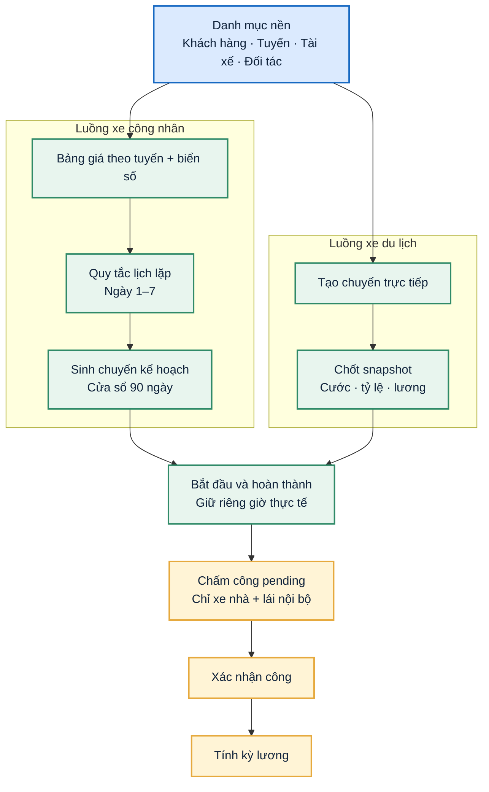

# Sổ tay tự học điều hành xe chạy và lương lái xe — Nguyễn Mạnh Trường

## 0. Mục tiêu và nguyên tắc học

Sau khi hoàn thành, Trường phải tự làm và tự giải thích được:

1. Khai báo bảng giá, lịch lặp và một chuyến xe công nhân ngoại lệ.
2. Phân biệt thời gian kế hoạch với thời gian thực tế; đưa một chuyến từ `planned` đến `completed`.
3. Tạo chuyến du lịch xe nhà, xe đối tác và thuê lái; kiểm tra snapshot cước/lương.
4. Giải thích vì sao hoàn thành lặp lại chỉ có một chấm công `pending`.
5. Xác nhận công, tính kỳ lương và lần được một dòng lương về chuyến gốc.
6. Dùng DevTools lần đường đi từ nút bấm đến service/backend/test.

Tài liệu này mô tả website hiện tại. Mọi số liệu tài chính, công nợ và báo cáo chỉ lấy từ chuyến có trạng thái `completed` khi chức năng tương ứng yêu cầu.

## 1. Từ điển nghiệp vụ

| Khái niệm | Ý nghĩa | Dữ liệu chính |
| --- | --- | --- |
| Xe chạy công nhân | Một lần chạy theo tuyến/ca cho khách hàng | `worker_vehicles` |
| Xe chạy du lịch | Một lần chạy theo hành trình du lịch/cá nhân | `tourist_vehicles` |
| Quy tắc lịch | Khuôn mẫu chạy công nhân dài hạn | `worker_vehicle_schedule_rules` và `..._days` |
| Bảng giá công nhân | Cước và lương theo tuyến, biển số, kỳ hiệu lực | `worker_vehicle_rates` |
| Snapshot | Giá/lương được chép vào chuyến lúc sinh hoặc lưu, không đổi theo danh mục về sau | các cột tiền trên chuyến |
| Xe nhà | Xe công ty, có thể dùng lái xe nội bộ | `is_company_vehicle = true` |
| Xe đối tác | Xe do đối tác cung cấp; có tiền thuê xe | `partner_id`, `partner_vehicle_cost` |
| Thuê lái | Lái xe ngoài; có tên và chi phí thuê | `is_hired_driver`, `hired_driver_name`, `hired_driver_cost` |
| Chấm công | Công chuyến chờ kế toán xác nhận | `driver_attendances` |

### Quy ước ngày chạy

`weekday` dùng ISO-8601, không phải cách đánh số ngày trong JavaScript:

| Giá trị | Ngày |
| --- | --- |
| 1 | Thứ Hai |
| 2 | Thứ Ba |
| 3 | Thứ Tư |
| 4 | Thứ Năm |
| 5 | Thứ Sáu |
| 6 | Thứ Bảy |
| 7 | Chủ nhật |

## 2. Bản đồ luồng nghiệp vụ



Điểm quan trọng: lịch lặp chỉ sinh chuyến công nhân. Chuyến du lịch luôn do điều hành tạo trực tiếp.

## 3. Bản đồ code và màn hình

| Việc | Frontend | API | Backend cần đọc |
| --- | --- | --- | --- |
| Danh sách/chuyến công nhân | `VehicleRunsPage.vue`, `WorkerVehicleForm.vue` | `/vehicle-operations/worker-vehicles` | `VehicleOperationService::createRun()` |
| Lịch lặp | `WorkerSchedulesPage.vue`, `WorkerScheduleForm.vue` | `/worker-vehicle-schedule-rules` | `saveRule()`, `generateRuns()` |
| Bảng giá | `WorkerRatesPage.vue` | `/worker-vehicle-rates` | `saveRate()`, `applicableRate()` |
| Xe du lịch | `TouristVehicleForm.vue`, `TouristVehicleDetail.vue` | `/tourist-vehicles` | `syncTouristWage()` |
| Chấm công/kỳ lương | `PayrollPage.vue`, `PayrollDetail.vue` | `/driver-payroll/*` | `DriverPayrollService` |

Tất cả request frontend xe chạy đi qua `HALINHTRAVEL-CLIENT/src/services/vehicle-operations.service.ts`. Route backend nằm tại `app/Modules/VehicleOperations/Routes/index.php`.

## 4. Xe công nhân: từ bảng giá tới chuyến hoàn tất

### 4.1. Tạo bảng giá trước

Một giá gồm `route_id`, `license_plate`, `freight_amount`, `driver_wage`, `effective_from`, `effective_to`.

```json
POST /api/vehicle-operations/worker-vehicle-rates
{
  "route_id": 3,
  "license_plate": "15B-123.45",
  "freight_amount": 1800000,
  "driver_wage": 280000,
  "effective_from": "2026-11-01",
  "effective_to": null
}
```

Luật cần nhớ:

- Cùng tuyến và biển số không được có hai khoảng giá chồng lấn.
- `effective_to`, nếu có, không được trước `effective_from`.
- Khi sinh chuyến, cước/lương được chép vào chuyến. Sửa bảng giá sau đó không sửa lịch sử chuyến cũ.

### 4.2. Tạo lịch lặp

Quy tắc chứa khách hàng, tuyến, ca, điểm đón/trả, xe/lái xe và các ngày chạy. Mỗi phần tử `days` có `weekday`, `pickup_time`, `return_time`.

```json
POST /api/vehicle-operations/worker-vehicle-schedule-rules
{
  "customer_id": 1,
  "route_id": 3,
  "shift_name": "Ca sáng",
  "effective_from": "2026-11-03",
  "pickup_location": "Cổng KCN",
  "dropoff_location": "Khu công nghiệp",
  "is_company_vehicle": true,
  "license_plate": "15B-123.45",
  "driver_id": 2,
  "is_hired_driver": false,
  "days": [
    { "weekday": 1, "pickup_time": "06:30", "return_time": "17:30" },
    { "weekday": 2, "pickup_time": "06:30", "return_time": "17:30" }
  ]
}
```

Khi lưu, backend kiểm tra giá hiệu lực tại ngày bắt đầu, kiểm tra chồng lấn với chuyến du lịch và đồng bộ chuyến `planned` trong cửa sổ 90 ngày. Chuyến `in_progress` hoặc `completed` là lịch sử vận hành, không bị lịch mới ghi đè.

### 4.3. Sinh lịch idempotent

`POST /worker-vehicle-schedule-rules/{id}/generate` nhận `from_date`, `to_date`. Một chuyến trùng `schedule_rule_id`, ngày và giờ đón không sinh lại. Nếu thiếu giá hoặc xung đột, ngày đó được đưa vào `skipped`.

Command `MaintainWorkerVehicleWindow` đảm bảo cửa sổ 90 ngày; nó có thể chạy nhiều lần mà không tạo bản ghi trùng.

### 4.4. Chuyến ngoại lệ

Điều hành có quyền tạo chuyến công nhân không thuộc lịch lặp. Chuyến đó có `schedule_rule_id = null`, nhưng vẫn phải có khách hàng, tuyến, ngày, giờ, điểm đón/trả, biển số và thông tin xe/lái hợp lệ. Khi lưu, dịch vụ tìm đúng bảng giá theo tuyến, biển số và ngày chạy để chốt cước/lương.

## 5. Xe du lịch và snapshot lương

Xe du lịch luôn có khách hàng, hành trình, kế hoạch giờ/điểm đón trả, biển số, cước và loại xe/lái.

| Trường hợp | Bắt buộc | Chấm công khi hoàn thành |
| --- | --- | --- |
| Xe nhà + lái nội bộ | biển số, `driver_id` | Có, tối đa một dòng pending |
| Xe đối tác | `partner_id`, `partner_vehicle_cost` | Không |
| Thuê lái | `hired_driver_name`, `hired_driver_cost` | Không |

Với xe nhà có lái nội bộ, backend lấy `tourism_commission_rate` của tài xế và lưu vào `driver_wage_rate`; lương mặc định là `freight_amount × driver_wage_rate`.

- Đổi tài xế: lấy tỷ lệ mới của tài xế được chọn và tính lại lương.
- Đổi cước: tính lại theo tỷ lệ snapshot nếu chưa chốt thủ công.
- Sửa trực tiếp lương: đánh dấu `driver_wage_is_overridden = true`.
- Tính lại: bỏ cờ chốt thủ công, dùng tỷ lệ snapshot đang có; không đọc lại hồ sơ tài xế.

Các khoản `driver_collected_amount`, `company_collected_amount`, `driver_remitted_amount`, `driver_expense_amount` là đối soát của chính chuyến, không phải khoản cộng/trừ tự động vào lương.

## 6. Trạng thái, xung đột và thời gian thực tế

| Trạng thái | Ý nghĩa | Thao tác hợp lệ |
| --- | --- | --- |
| `planned` | Chuyến kế hoạch | sửa, hủy, bắt đầu, hoàn thành |
| `in_progress` | Đã bắt đầu | hoàn thành |
| `completed` | Đã chốt vận hành | chỉ xem/đối chiếu |
| `cancelled` | Đã hủy | không được hoàn thành |

`run_date`, `pickup_time`, `return_time` là kế hoạch. `actual_started_at`, `actual_completed_at` là thực tế, không được ghi đè kế hoạch.

Hệ thống chặn hai chuyến chưa hủy nếu cùng biển số hoặc cùng lái xe có khoảng thời gian giao nhau, kể cả một chuyến công nhân và một chuyến du lịch.

## 7. Từ hoàn thành chuyến đến payroll

Khi hoàn thành xe nhà với lái nội bộ, backend dùng `firstOrCreate` theo chuyến và tài xế:

- Xe công nhân: `work_type = fixed_trip`, cơ sở tính là `driver_wage` đã snapshot.
- Xe du lịch: `work_type = tourism_trip`, cơ sở tính là cước, tỷ lệ là `driver_wage_rate`, kết quả là `driver_wage` snapshot.

Chấm công bắt đầu ở `pending`; kế toán xác nhận thành `confirmed`. Kỳ lương chỉ gom công `confirmed` trong kỳ.

```text
gross_salary = responsibility_allowance
             + fixed_trip_wage
             + tourism_commission
             + other_allowance

net_salary = gross_salary - advance_amount - deduction_amount
```

Vòng đời kỳ lương: `draft` → `calculated` → `approved` → `paid` → `locked`. Sau khi khóa, công liên quan chuyển `payroll_locked`.

## 8. Hướng dẫn thao tác trên website: làm theo đúng thứ tự

### Bước 0 — Kiểm tra quyền và dữ liệu nền

1. Đăng nhập, nhìn sidebar bên trái và mở **Quản lý danh mục**.
2. Lần lượt kiểm tra đã có **Khách hàng**, **Tuyến đường**, **Tài xế** và, nếu dùng xe đối tác, **Đối tác** chưa.
3. Mở Tài xế để xem lái xe nội bộ đang hoạt động và tỷ lệ lương du lịch của họ. Không tạo chuyến trước khi các danh mục này sẵn sàng.
4. Nếu không thấy nhóm **Quản lý chạy xe** hoặc nút tạo/sửa, dừng lại và kiểm tra quyền thay vì thử nhập dữ liệu bằng ID thủ công.

### Kịch bản A — Khai báo một tuyến công nhân chạy lặp

1. Sidebar → **Quản lý chạy xe** → **Xe chạy công nhân**. Đây là điểm vào duy nhất cho ba phần việc.
2. Trên thanh tab của trang, chọn **Bảng giá** trước. Nhấn **Thêm bảng giá**, chọn tuyến từ danh mục, nhập biển số, cước, lương lái, ngày hiệu lực rồi lưu.
3. Đọc lại dòng vừa tạo; bảo đảm ngày hiệu lực bao gồm ngày dự kiến chạy. Nếu bảng giá báo lỗi chồng lấn, sửa kỳ cũ hoặc chọn ngày bắt đầu khác.
4. Chuyển tab **Lịch lặp** → **Thêm lịch lặp**. Chọn khách hàng, tuyến, ca, điểm đón/trả, xe và lái xe.
5. Trong phần ngày chạy, thêm từng dòng ngày/giờ. Chọn `1` cho Thứ Hai … `7` cho Chủ nhật; không nhập số theo thứ tự Chủ nhật–Thứ Bảy.
6. Lưu lịch. Hệ thống sinh các chuyến trong 90 ngày; quay lại tab **Chuyến chạy**, lọc theo biển số/ngày để xem các dòng `planned` đã sinh.
7. Mở một dòng bằng nút xem chi tiết. Đối chiếu cước/lương trong phần tài chính với bảng giá đã khai báo; đó là snapshot của chuyến.

### Kịch bản B — Điều hành một chuyến công nhân thực tế

1. Tại tab **Chuyến chạy**, dùng bộ lọc ngày, trạng thái hoặc biển số để tìm chuyến hôm nay.
2. Nếu là trường hợp ngoài lịch, nhấn **Tạo xe chạy công nhân** và điền đủ kế hoạch, xe/lái và tài chính. Sau khi lưu, quay lại danh sách để kiểm tra mã chuyến.
3. Mở chi tiết chuyến `planned` → nhấn **Bắt đầu**. Chỉ điền giờ thực tế khác giờ hiện tại khi cần hiệu chỉnh.
4. Kiểm tra badge đổi thành `in_progress` và phần thời gian thực tế đã có giờ bắt đầu.
5. Khi kết thúc, nhấn **Hoàn thành**. Không dùng nút này cho chuyến đã hủy.
6. Reload trang chi tiết: trạng thái phải là `completed`, có `actual_completed_at`; phần chấm công chỉ xuất hiện cho xe nhà có lái nội bộ.

### Kịch bản C — Tạo và hoàn thành xe du lịch

1. Sidebar → **Quản lý chạy xe** → **Xe chạy du lịch** → **Tạo xe chạy du lịch**.
2. Điền phần kế hoạch trước: khách hàng, hành trình, ngày, giờ, điểm đón/trả.
3. Chọn đúng nguồn xe/lái: xe nhà + tài xế; hoặc xe đối tác + đối tác/tiền thuê xe; hoặc thuê lái + tên/chi phí.
4. Với xe nhà, xem phần snapshot lương: tỷ lệ hiển thị theo phần trăm, cước và lương được tự tính. Chỉ sửa lương khi thật sự muốn chốt thủ công.
5. Nhập các khoản đối soát thu/nộp/chi nếu có, lưu rồi mở chi tiết kiểm tra.
6. Thao tác **Bắt đầu** rồi **Hoàn thành** giống chuyến công nhân. Sau khi hoàn thành, kiểm tra attendance khi đó là xe nhà có lái nội bộ.

### Kịch bản D — Đi tới chấm công và kỳ lương

1. Sidebar → **Tài chính và nhân sự** → **Chấm công và lương**.
2. Mở tab chấm công, lọc theo lái xe/ngày, chọn attendance `pending` từ chuyến vừa hoàn thành rồi xác nhận.
3. Mở tab kỳ lương, tạo kỳ cho tháng đã kết thúc, nhấn tính lương; mở chi tiết kỳ để thấy công nhân và du lịch được tách nguồn.
4. Chỉ duyệt, đánh dấu đã trả và khóa khi đã đối chiếu các dòng công, tạm ứng và thực lĩnh.

## 9. Quy trình lần code và DevTools

1. Mở màn hình, xác định thao tác và quyền cần có.
2. DevTools → Network → lọc Fetch/XHR → thực hiện thao tác.
3. Ghi method, URL, payload, response và status code.
4. Tìm URL trong `vehicle-operations.service.ts` hoặc `driver-payroll.service.ts`.
5. Lần ngược page/form; lần xuôi route → controller → service → model/test.

| Mã lỗi | Cách đọc |
| --- | --- |
| 403 | Thiếu quyền view/manage hoặc schedule/rate tương ứng |
| 422 | Field thiếu, ngày/giờ sai, thiếu giá, hoặc trùng lịch |
| 409 | Sai trạng thái, chuyến đã hủy, quy tắc đã ngừng hoặc dữ liệu đã khóa |

## 10. Sáu lab bắt buộc

1. Tạo giá và thử tạo giá chồng kỳ; giải thích lỗi tại `effective_from`.
2. Tạo rule chạy Thứ Hai và Thứ Sáu, sinh 14 ngày; chạy lại cùng request và chứng minh không trùng.
3. Sửa rule, quan sát chỉ chuyến `planned` đổi/hủy.
4. Tạo chuyến du lịch xe nhà, đổi cước, chốt lương rồi tính lại.
5. Tạo hai chuyến giao giờ cùng biển số; ghi lại lỗi validation.
6. Hoàn thành một chuyến hai lần, xác nhận đúng một attendance; xác nhận công và tính tay lương tài xế.

## 11. Câu hỏi bảo vệ và checklist

1. Vì sao cước/lương phải snapshot vào chuyến?
2. Vì sao một rule có ngày chạy `1` là Thứ Hai?
3. Vì sao đồng bộ rule không được sửa chuyến đang chạy/đã hoàn thành?
4. Khi nào xe hoàn thành không sinh chấm công?
5. Một dòng `PayrollItemDetail` lần về chuyến công nhân hoặc du lịch bằng khóa nào?

Trước khi kết thúc tự học, Trường phải tự vẽ được sơ đồ từ rule/bảng giá tới attendance và kỳ lương, nêu đúng endpoint, quyền và ít nhất hai lỗi 422/409.

## 12. Lộ trình ba ngày

- **Ngày 1:** danh mục, bảng giá, rule, quy ước ngày 1–7 và lab 1–2.
- **Ngày 2:** xe công nhân/du lịch, xung đột, snapshot, start/complete và lab 3–5.
- **Ngày 3:** attendance, payroll, DevTools, lab 6 và trình bày 10 phút.
