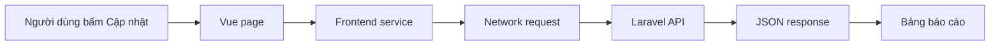
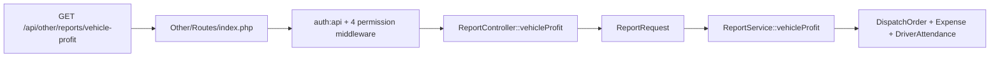
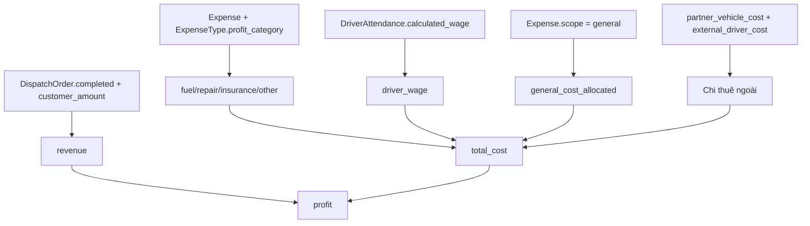
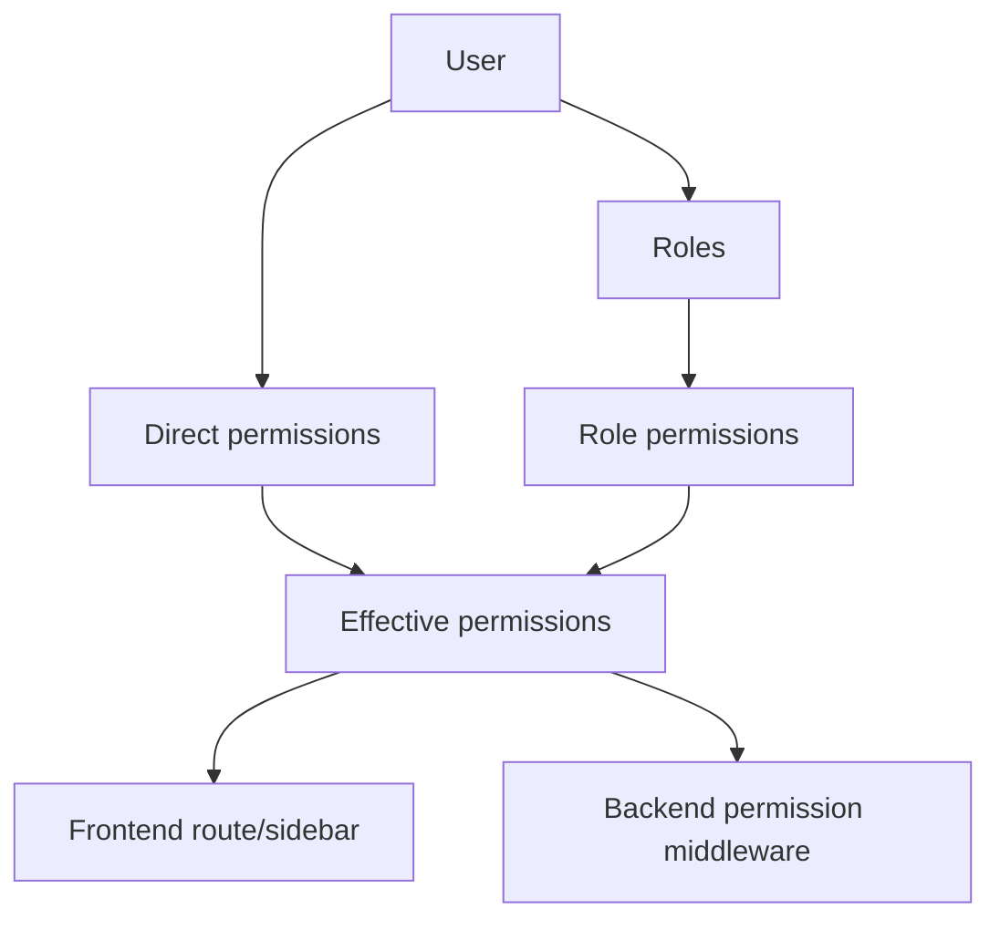

# Giáo án hướng dẫn nghiệp vụ của Nguyễn Nhật Quang

## 1. Mục đích và cách dùng

Tài liệu này dành cho người hướng dẫn. Dạy theo **luồng dữ liệu** thay vì theo thư mục mã nguồn:

```text
Ai được làm? → Dữ liệu gì cần có? → Ghi nhận phát sinh thế nào? → Báo cáo lấy số từ đâu?
```

Mỗi buổi có ba phần lặp lại:

1. **Nghiệp vụ**: học viên mô tả bằng tiếng Việt, chưa mở code.
2. **Thao tác**: mở giao diện và quan sát đầu vào/đầu ra.
3. **Lần mã nguồn**: giao diện → service frontend → route API → request → service backend → test.

Không chuyển phần tiếp theo nếu học viên chưa tự trả lời được câu hỏi chốt của phần trước.

## 2. Chuẩn bị trước buổi đầu

- Dùng môi trường phát triển có dữ liệu mẫu; không thao tác trên dữ liệu thật.
- Cho học viên đọc trước [sổ tay tự học](./nguyen-nhat-quang-so-tay-tu-hoc.md), phần 1 và 2.
- Chuẩn bị giấy hoặc bảng vẽ để học viên tự vẽ sơ đồ dữ liệu.
- Không cho học viên chạy migration, seeder, lệnh xóa hoặc khóa chứng từ trong lúc đang học.

## 3. Buổi 1 — Danh mục và bài toán chi phí

**Thời lượng:** 150–180 phút.

### Mục tiêu

- Phân biệt được danh mục với chứng từ phát sinh.
- Hiểu `vehicle`, `trip`, `general`.
- Biết loại chi phí ảnh hưởng thế nào đến báo cáo lợi nhuận xe.

### Phần 1: Kể câu chuyện nghiệp vụ (25 phút)

Đặt câu hỏi: “Muốn tính lời/lỗ của xe 15B-123.45 thì hệ thống cần biết những gì?”

Chờ học viên tự nêu xe, chuyến, doanh thu, xăng, sửa chữa, tài xế. Sau đó mới vẽ:

```text
Loại xe → Xe → Lệnh điều xe hoàn tất → Doanh thu
                         ↓
                 Chi phí / công tài xế
                         ↓
                 Lợi nhuận của xe
```

### Phần 2: Thao tác giao diện (35 phút)

Đi qua các menu theo thứ tự:

1. **Quản lý danh mục > Danh sách xe**.
2. **Quản lý danh mục > Tài xế**.
3. **Quản lý danh mục > Loại chi phí**.
4. **Tài chính và công nợ > Chi phí**.

Yêu cầu học viên tự đưa ra ba loại chi phí mẫu: dầu, phí cầu đường, văn phòng phẩm. Hỏi từng loại thuộc phạm vi nào và thuộc nhóm lợi nhuận nào.

### Phần 3: Lần code (45 phút)

Đưa học viên đi theo một thao tác “Tạo loại chi phí”, rồi “Tạo chi phí”. Không giải thích hết từng dòng.

| Tầng | Điểm cần mở | Điều cần thấy |
| --- | --- | --- |
| Trang loại chi phí | `D:/vue/halinhtravel-client/src/modules/master-data/expense-type/ExpenseTypePage.vue` | Danh sách và thao tác thêm/sửa/ngừng hoạt động. |
| Form loại chi phí | `D:/vue/halinhtravel-client/src/modules/master-data/expense-type/components/ExpenseTypeModal.vue` | Trường phạm vi và nhóm lợi nhuận. |
| Trang tài chính | `D:/vue/halinhtravel-client/src/modules/finance/FinancePage.vue` | Thẻ Chi phí và thao tác khóa/ngừng hoạt động. |
| Form chi phí | `D:/vue/halinhtravel-client/src/modules/finance/components/FinancialDocumentDialog.vue` | Khi chọn phạm vi, form hiện xe hoặc lệnh điều xe phù hợp. |
| API route | `D:/Laravel/halinhtravel-api/app/Modules/Finance/Routes/index.php` | Quyền xem/quản lý chi phí bảo vệ endpoint. |
| Validate nghiệp vụ | `D:/Laravel/halinhtravel-api/app/Modules/Finance/Services/FinanceService.php` — `validateExpense()` | Kiểm tra phạm vi loại chi phí, xe/chuyến, quyết toán lái xe. |

### Câu hỏi chốt buổi 1

1. Vì sao “Dầu” không được ghi thành chi phí chung?
2. Khi nào cần `vehicle_id`; khi nào cần `dispatch_order_id`?
3. Khóa chứng từ khác ngừng hoạt động chứng từ thế nào?

### Bài về nhà

Viết bảng gồm 8 loại chi phí mẫu, cột: mã, tên, phạm vi, nhóm lợi nhuận, ví dụ phát sinh.

## 4. Buổi 2 — Người dùng, vai trò, quyền và chứng từ

**Thời lượng:** 150–180 phút.

### Mục tiêu

- Hiểu user, role, permission và quyền hiệu lực.
- Biết phân tách quyền xem/quản lý.
- Hiểu phiếu chi là nguồn dữ liệu, báo cáo chỉ tổng hợp dữ liệu đó.

### Phần 1: Dạy theo tình huống (30 phút)

Nêu ba người: điều hành, kế toán, tài xế. Hỏi mỗi người nên nhìn thấy gì và không được làm gì.

Sau đó giới thiệu cặp quyền:

```text
expenses.view     → xem chi phí
expenses.manage   → tạo, sửa, khóa, ngừng hoạt động chi phí
```

Nhấn mạnh: menu ẩn không phải là cơ chế bảo mật duy nhất; API vẫn kiểm tra quyền.

### Phần 2: Thao tác giao diện (30 phút)

1. Mở **Quản lý hệ thống > Tài khoản**.
2. Mở chi tiết một tài khoản, quan sát ba phần: vai trò, quyền ngoại lệ, quyền hiệu lực.
3. Mở **Vai trò** và **Quyền** để thấy dữ liệu hệ thống/tùy chỉnh.
4. Quay lại màn hình chi phí, đối chiếu quyền cần có để xem và tạo chứng từ.

### Phần 3: Lần code (45 phút)

| Tầng | Điểm cần mở | Câu hỏi dẫn dắt |
| --- | --- | --- |
| Định nghĩa quyền | `D:/Laravel/halinhtravel-api/app/Shared/Enums/PermissionEnum.php` | Quyền nào liên quan trực tiếp nghiệp vụ của Quang? |
| Route | `D:/Laravel/halinhtravel-api/app/Modules/Auth/Routes/index.php` | Endpoint nào yêu cầu `users.manage`? |
| Service | `D:/Laravel/halinhtravel-api/app/Modules/Auth/Services/AccessManagementService.php` | Vì sao không thể gỡ admin cuối cùng? |
| Model | `D:/Laravel/halinhtravel-api/app/Modules/Auth/Models/User.php` | User lấy role và permission như thế nào? |
| Test | `D:/Laravel/halinhtravel-api/tests/Feature/Auth/AccessManagementTest.php` | Một test cấm thao tác giúp bảo vệ luật nghiệp vụ ra sao? |

### Phần 4: Bài thực hành đọc test (30 phút)

Cho học viên đọc [FinanceApiTest.php](D:/Laravel/halinhtravel-api/tests/Feature/Finance/FinanceApiTest.php), trả lời:

1. Trường hợp nào API trả `422`?
2. Chứng từ đã khóa thì sửa có kết quả gì?
3. Test mới về phạm vi loại chi phí đang bảo vệ điều gì?

### Câu hỏi chốt buổi 2

- User có nhiều vai trò thì quyền tính thế nào?
- Vì sao code kiểm tra quyền ở route chưa đủ để thay thế validation nghiệp vụ ở service?
- Vì sao một phiếu chi ngừng hoạt động không nên còn trong báo cáo?

## 5. Buổi 3 — Báo cáo và tính lợi nhuận

**Thời lượng:** 180 phút.

### Mục tiêu

- Tự tính tay lợi nhuận xe và đối chiếu với công thức hệ thống.
- Phân biệt lợi nhuận dồn tích và lợi nhuận tiền mặt.
- Lần được toàn bộ luồng màn hình báo cáo đến service tính toán.

### Phần 1: Tính tay trước khi mở code (35 phút)

Cho số liệu:

| Khoản | Số tiền |
| --- | ---: |
| Doanh thu xe | 100.000.000 |
| Dầu | 20.000.000 |
| Sửa chữa | 5.000.000 |
| Lương tài xế | 10.000.000 |
| Chi phí chung phân bổ | 2.000.000 |

Học viên tự ra kết quả 63.000.000 đồng. Nếu sai, quay lại giải thích từng khoản trước khi mở code.

### Phần 2: Thao tác và kiểm quyền (25 phút)

Mở lần lượt:

1. **Báo cáo > Thu chi, chi phí và công nợ**.
2. **Báo cáo > Lợi nhuận theo tháng**.
3. **Báo cáo > Lợi nhuận xe**.

Hỏi: tại sao người chỉ có `payrolls.view` không được mở báo cáo lợi nhuận? Đáp án: báo cáo còn cần dữ liệu lệnh điều xe, chi phí và chi trả đối tác.

### Phần 3: Lần code (60 phút)

| Tầng | Điểm cần mở | Điều phải giải thích được |
| --- | --- | --- |
| Route giao diện | `D:/vue/halinhtravel-client/src/modules/reports/report.route.ts` | Hai báo cáo lợi nhuận yêu cầu đủ bốn quyền nguồn. |
| Màn hình | `D:/vue/halinhtravel-client/src/modules/reports/ReportsPage.vue` | Chọn khoảng ngày/cơ sở tính và tải dữ liệu. |
| API client | `D:/vue/halinhtravel-client/src/services/report.service.ts` | Cách giao diện lấy/xuất báo cáo. |
| API route | `D:/Laravel/halinhtravel-api/app/Modules/Other/Routes/index.php` | Backend cũng bảo vệ báo cáo lợi nhuận bằng các quyền. |
| Controller | `D:/Laravel/halinhtravel-api/app/Modules/Other/Controllers/ReportController.php` | Controller chọn JSON, Excel hoặc Word. |
| Service | `D:/Laravel/halinhtravel-api/app/Modules/Other/Services/ReportService.php` | `expenses()`, `profitLoss()` và `vehicleProfit()` lấy và tổng hợp số liệu. |

### Phần 4: Đọc ba hàm quan trọng (35 phút)

1. `expenses()` — danh sách chi phí theo kỳ và bộ lọc.
2. `profitLoss()` — lợi nhuận mỗi tháng theo cơ sở dồn tích/tiền mặt.
3. `vehicleProfit()` — doanh thu và chi phí của từng xe; phân bổ chi phí chung.

Không yêu cầu học viên nhớ cú pháp Collection. Chỉ yêu cầu gạch chân:

- nguồn doanh thu;
- nguồn chi phí;
- điều kiện “đang hoạt động”; 
- công thức tổng chi phí;
- công thức lợi nhuận.

### Câu hỏi chốt buổi 3

1. Chi phí chung chia cho bao nhiêu xe?
2. Vì sao phiếu chi ngừng hoạt động bị loại khỏi báo cáo?
3. Dồn tích và tiền mặt khác nhau ở nguồn doanh thu/lương nào?
4. Lợi nhuận xe lấy lương từ công chuyến hay lấy toàn bộ lương tháng? Vì sao?

## 6. Bài đánh giá cuối

Cho học viên tự thuyết trình 10–15 phút theo thứ tự:

1. Ai làm được gì trong phần nghiệp vụ của mình.
2. Danh mục nào phải có trước khi tạo chi phí.
3. Ba phạm vi chi phí và một ví dụ mỗi loại.
4. Luồng từ chứng từ chi phí đến báo cáo.
5. Công thức lợi nhuận xe và một ví dụ số.
6. Một quy tắc hệ thống đã được test: phạm vi chi phí phải khớp loại chi phí, hoặc chứng từ khóa không thể sửa.

### Thang đánh giá nhanh

| Tiêu chí | Đạt khi |
| --- | --- |
| Nghiệp vụ | Dùng đúng các khái niệm xe, chuyến, chi phí chung, chứng từ. |
| Quyền | Phân biệt rõ `view` và `manage`; không coi frontend là lớp bảo mật duy nhất. |
| Dữ liệu | Biết dữ liệu nền nào cần có trước khi ghi nhận chi phí. |
| Báo cáo | Giải thích đúng nguồn dữ liệu và công thức lợi nhuận. |
| Code | Đi được ít nhất một luồng màn hình → API → service → test. |

## 7. Bài tập code sau khi hiểu nghiệp vụ

Chỉ giao khi học viên đã hoàn thành phần đánh giá cuối:

1. Viết thêm test bảo đảm chứng từ chi đã ngừng hoạt động không được cộng vào báo cáo dòng tiền.
2. Bổ sung một test cho báo cáo lợi nhuận xe với chi phí chung và xác nhận số được phân bổ đều.
3. Phân tích yêu cầu lọc báo cáo lợi nhuận xe theo biển số xe; trước khi sửa phải mô tả ảnh hưởng API, UI và test.

Không giao bài thêm enum, migration hoặc thay đổi công thức khi chưa có yêu cầu nghiệp vụ rõ ràng.

---

# Phần II — Giáo án kỹ thuật cầm tay chỉ việc (6 buổi)

## 8. Nguyên tắc đứng lớp

Mỗi buổi dài **105 phút**. Không giảng code theo kiểu đọc từng dòng từ trên xuống; luôn hỏi học viên đoán trước, rồi dùng giao diện và DevTools để chứng minh.

| Khoảng thời gian | Việc của người dạy | Việc của học viên |
| --- | --- | --- |
| 0–10 phút | Ôn câu hỏi buổi trước. | Trả lời không nhìn tài liệu. |
| 10–25 phút | Kể một tình huống nghiệp vụ. | Vẽ mũi tên dữ liệu lên giấy. |
| 25–45 phút | Demo giao diện/DevTools. | Ghi URL, params, status code. |
| 45–70 phút | Lần code cùng nhau. | Tự mở đúng file theo từ khóa. |
| 70–95 phút | Giao lab có hướng dẫn. | Tự lần, người dạy chỉ hỏi gợi mở. |
| 95–105 phút | Kiểm tra miệng và chốt bài tập. | Nêu URL, quyền, service, luật nghiệp vụ. |

### Quy tắc không được phá

- Không nói “nó tự chạy” hoặc “backend xử lý hết”; phải chỉ rõ file/hàm nào.
- Không chấp nhận “API báo cáo” mà không nêu URL đầy đủ.
- Không chấp nhận “có kiểm tra quyền” mà không nêu permission cụ thể.
- Không cho học viên sửa code trước khi lần xong luồng đọc.
- Chỉ dùng dữ liệu phát triển được phép; không khóa chứng từ hoặc chạy migration trong giờ học.

## 9. Buổi 1 — DevTools và bản đồ đường đi của một request

### Mục tiêu bắt buộc

Học viên nhìn một nút **Cập nhật** ở trang báo cáo và tự tìm được request `GET /api/other/reports/vehicle-profit`.

### Sơ đồ bạn vẽ trước lớp



### Kịch bản dạy chi tiết

1. Mở **Báo cáo > Lợi nhuận xe**. Không mở code.
2. Hỏi: “Bấm Cập nhật thì máy phải gửi cái gì ra ngoài?” Chờ học viên nói “API”.
3. Yêu cầu mở `F12` → **Network** → **Fetch/XHR**, sau đó bấm Cập nhật.
4. Chọn request `vehicle-profit`; yêu cầu học viên đọc to method, URL, status và query string.
5. Chỉ tab **Payload** hoặc **Headers**: `from_date`, `to_date` là đầu vào; không đọc hết header.
6. Chỉ tab **Response**: yêu cầu khoanh `metadata.totals` và `metadata.rows`.

### Dữ liệu ghi lên bảng

```http
GET /api/other/reports/vehicle-profit?from_date=2026-10-01&to_date=2026-10-31
```

| Mục | Câu nói cần nghe từ học viên |
| --- | --- |
| `GET` | “Đây là lấy dữ liệu báo cáo, không phải tạo dữ liệu.” |
| `from_date` / `to_date` | “Khoảng thời gian để service lọc lệnh và chi phí.” |
| `200` | “Request thành công; phải đọc JSON tiếp.” |
| `403` | “Đã đăng nhập nhưng thiếu quyền.” |
| `422` | “Dữ liệu request không thỏa validation.” |

### Lab trong giờ

- Học viên chụp hoặc ghi lại một request báo cáo bất kỳ.
- Gạch chân URL, params, status code, một số trong `totals` và một dòng trong `rows`.
- Nộp một câu: “Báo cáo này lấy dữ liệu trong khoảng … đến …”.

### Không chấp nhận câu trả lời chung chung

Không nhận câu “nó gọi API báo cáo”. Đáp án phải có dạng: “Trang Lợi nhuận xe gọi `GET /api/other/reports/vehicle-profit`, truyền `from_date` và `to_date`.”

### Bài về nhà

Lặp lại thao tác với **Báo cáo chi phí**; ghi URL và permission em đoán là cần có.

## 10. Buổi 2 — Frontend Vue: từ URL Network đến page và service

### Mục tiêu bắt buộc

Học viên tự đi được `report.route.ts` → `ReportsPage.vue` → `report.service.ts` và giải thích vì sao URL Network có đoạn `vehicle-profit`.

### Sơ đồ bạn vẽ trước lớp

```mermaid
flowchart TD
    A[report.route.ts] --> B[kind = vehicle-profit]
    B --> C[ReportsPage.vue]
    C --> D[slug]
    D --> E[ReportService.get]
    E --> F[/other/reports/vehicle-profit]
    F --> G[httpService.get]
```

### Thứ tự file phải mở

1. `D:\vue\halinhtravel-client\src\modules\reports\report.route.ts`
2. `D:\vue\halinhtravel-client\src\modules\reports\ReportsPage.vue`
3. `D:\vue\halinhtravel-client\src\services\report.service.ts`
4. `D:\vue\halinhtravel-client\src\router\index.ts`

### Code excerpt để chiếu

```ts
// route truyền props: { kind: 'vehicle-profit' }
const props = defineProps<{ kind: ReportKind }>()

const slug = computed(() => (props.kind === 'finance' ? financeTab.value : props.kind))

const query = useQuery({
  queryKey: computed(() => ['reports', slug.value, filters.value]),
  queryFn: () => ReportService.get(slug.value, filters.value),
})
```

### Lời dẫn gợi ý

> “Đừng sợ `useQuery`. Hôm nay chỉ cần biết nó nhận hai thứ: khóa để phân biệt dữ liệu và hàm để lấy dữ liệu. Hàm lấy dữ liệu gọi `ReportService.get`, vậy ta bấm F12 vào `ReportService.get`.”

Sau đó mở `report.service.ts`:

```ts
const baseUrl = '/other/reports'
return httpService.get(`${baseUrl}/${slug}`, { params: filters })
```

### Bài thực hành có hướng dẫn

Yêu cầu học viên tự điền bảng, không được copy.

| Câu hỏi | Đáp án kỳ vọng |
| --- | --- |
| `kind` của Lợi nhuận xe là gì? | `vehicle-profit`. |
| `slug` cuối cùng là gì? | `vehicle-profit`. |
| `baseUrl` là gì? | `/other/reports`. |
| URL service tạo ra là gì? | `/other/reports/vehicle-profit`. |
| `filters` đi vào đâu? | Query params của request. |

### Lỗi học viên hay mắc

- Nhầm `report.route.ts` là API route. Sửa bằng cách hỏi: “File này có `Route::get` hay chỉ có `path`, `name`, `component`?”
- Nghĩ `useQuery` là backend. Sửa bằng cách chỉ ra file đuôi `.vue` nằm trong frontend.
- Không hiểu `kind`. Sửa bằng cách quay về dòng `props` của route.

### Bài về nhà

Tự lần trang **Bảng lương lái xe** theo đúng ba file trên; ghi khác biệt về `kind` và permission.

## 11. Buổi 3 — Backend Laravel: route, controller, request và service

### Mục tiêu bắt buộc

Học viên tự đi từ URL `/api/other/reports/vehicle-profit` đến `ReportService::vehicleProfit()` và chỉ đúng bốn quyền backend yêu cầu.

### Sơ đồ bạn vẽ trước lớp



### Thứ tự file phải mở

1. `D:\Laravel\halinhtravel-api\app\Modules\Other\Routes\index.php`
2. `D:\Laravel\halinhtravel-api\app\Modules\Other\Controllers\ReportController.php`
3. `D:\Laravel\halinhtravel-api\app\Modules\Other\Requests\ReportRequest.php`
4. `D:\Laravel\halinhtravel-api\app\Modules\Other\Services\ReportService.php`

### Kịch bản dạy chi tiết

1. Cho học viên `Ctrl+Shift+F` tìm `vehicle-profit` ở backend.
2. Khoanh nguyên middleware route trước khi nhìn controller.
3. Hỏi: “Nếu có `auth:api` nhưng thiếu `expenses.view`, có vào controller không?” Đáp án: không, middleware trả 403 trước.
4. Mở controller và chỉ ra controller lấy `$request->filters()` rồi gọi service.
5. Mở `ReportRequest::rules()`, yêu cầu chỉ ra rule cho `from_date`, `to_date`, `basis`.
6. Cuối cùng mới mở `ReportService::vehicleProfit()`; yêu cầu gạch chân query lệnh, query chi phí và dòng tính `profit`.

### Bảng “tôi đang ở đâu?”

| Tầng | Dấu hiệu trong code | Vai trò |
| --- | --- | --- |
| Route | `Route::get`, `middleware` | Cửa vào, URL và quyền. |
| Controller | public method nhận `ReportRequest` | Điều phối request/response. |
| Request | `rules()` | Chặn input sai định dạng. |
| Service | hàm như `vehicleProfit()` | Nghiệp vụ, truy vấn, công thức. |
| Model | `belongsTo`, `hasMany`, casts | Nói dữ liệu liên quan với nhau ra sao. |
| Test | `getJson`, `postJson`, `assert...` | Chứng minh hành vi mong muốn. |

### Kiểm tra cuối buổi

Học viên phải nói đúng một câu đầy đủ:

> “Route `/reports/vehicle-profit` yêu cầu auth và bốn permission; `ReportController::vehicleProfit` dùng `ReportRequest` lọc input rồi gọi `ReportService::vehicleProfit` để tính dữ liệu.”

### Bài về nhà

Tìm endpoint `reports/profit-loss`; liệt kê điểm giống và khác với `vehicle-profit`.

## 12. Buổi 4 — Chi phí và lợi nhuận xe: tính tay trước, đọc code sau

### Mục tiêu bắt buộc

Học viên tính được lợi nhuận xe bằng giấy và chỉ ra đúng biến/nguồn dữ liệu trong `ReportService`.

### Dữ liệu bài tập

| Khoản | Số tiền |
| --- | ---: |
| Doanh thu xe | 100.000.000 |
| Dầu | 20.000.000 |
| Sửa chữa | 5.000.000 |
| Lương tài xế theo chuyến | 10.000.000 |
| Chi phí chung phân bổ | 2.000.000 |

Đáp án: tổng chi phí 37.000.000; lợi nhuận 63.000.000.

### Sơ đồ nguồn dữ liệu của các cột



### Kịch bản dạy `vehicleProfit()`

Yêu cầu học viên tìm lần lượt trong hàm:

1. Query `DispatchOrder`: điều kiện `is_active`, trạng thái hoàn tất, ngày hoàn tất.
2. Query `Expense`: điều kiện `is_active`, ngày chi, loại trừ chi thuê lái để tránh cộng trùng.
3. `$general` và `$allocation`: chi phí chung và quy tắc chia đều.
4. `$fuel`, `$repair`, `$insurance`, `$other`: nhóm lợi nhuận.
5. `$driverWage`: công tài xế theo chuyến.
6. `$cost` và `$profit`: công thức cuối.

### Phân biệt hai báo cáo lợi nhuận

| Báo cáo | Hàm | Đơn vị một dòng | Lương dùng |
| --- | --- | --- | --- |
| Lợi nhuận tháng | `profitLoss()` | Một tháng | Tổng lương kỳ hoặc đã chi, tùy `basis`. |
| Lợi nhuận xe | `vehicleProfit()` | Một xe | `calculated_wage` của công chuyến. |

### Bài thực hành

Cho học viên trả lời: “Nếu phiếu sửa chữa bị ngừng hoạt động, vì sao báo cáo đổi?” Câu trả lời đạt phải có: `Expense`, `is_active`, service báo cáo chỉ query chi phí hoạt động, lợi nhuận tăng 5.000.000 trong ví dụ.

### Bài về nhà

Viết một đoạn 8–10 câu giải thích dồn tích và tiền mặt trong `profitLoss()`; phải nêu nguồn doanh thu và nguồn lương của mỗi cách.

## 13. Buổi 5 — User, role, permission: frontend và backend chặn khác nhau

### Mục tiêu bắt buộc

Học viên giải thích được quyền hiệu lực, hai lớp chặn quyền, và luật “không được gỡ admin cuối cùng”.

### Sơ đồ bạn vẽ trước lớp



### File phải mở

1. `src/modules/organization/user/UserDetailPage.vue`
2. `src/modules/organization/org.route.ts`
3. `src/router/index.ts`
4. `app/Modules/Auth/Routes/index.php`
5. `app/Modules/Auth/Services/AccessManagementService.php`
6. `tests/Feature/Auth/AccessManagementTest.php`

### Lời dẫn gợi ý

> “Frontend route guard chỉ bảo vệ trải nghiệm: không cho người dùng đi nhầm trang. Backend middleware mới bảo vệ dữ liệu: kể cả tự gõ URL API, thiếu quyền vẫn bị 403.”

### Lab trong giờ

Học viên điền bảng sau cho báo cáo lợi nhuận xe.

| Lớp | File cần chứng minh | Điều kiện cần có |
| --- | --- | --- |
| Sidebar | `sidebar-data.ts` | `permissionsAll` gồm bốn quyền. |
| Frontend router | `router/index.ts` | Thiếu một quyền chuyển sang 403. |
| Backend route | `Other/Routes/index.php` | Bốn middleware `permission:`. |

### Lỗi học viên hay mắc

- Nhầm role với permission. Sửa bằng ví dụ: role `accountant` là nhóm; `expenses.manage` là một khả năng cụ thể.
- Nghĩ có role là chắc chắn có toàn quyền. Sửa bằng cách mở `getAllPermissions()`/quyền hiệu lực.
- Nghĩ xóa admin cuối là lỗi UI. Sửa bằng cách lần `ensureUserCanBeDeactivated()` trong service và test.

### Bài về nhà

Đọc `FinanceApiTest.php`, tóm tắt ba tình huống bị từ chối và status code kỳ vọng.

## 14. Buổi 6 — Capstone: tự điều tra một con số báo cáo

### Đề bài

Người hướng dẫn chỉ một số trên báo cáo lợi nhuận xe hoặc báo cáo chi phí. Học viên phải tự điều tra và trình bày trong 10–15 phút, không được hỏi “mở file nào trước?”.

### Mẫu trình bày bắt buộc

1. Tên màn hình và mục đích nghiệp vụ.
2. URL API, method, params và permission.
3. File frontend page và service đã tìm.
4. Backend route, controller, request và service.
5. Nguồn dữ liệu/tables qua model; không cần đọc SQL.
6. Công thức hoặc quy tắc nghiệp vụ của số đó.
7. Một case lỗi: 403, 422 hoặc chứng từ ngừng hoạt động.
8. Một test cần có hoặc test đã tồn tại.

### Rubric chấm nhanh

| Mục | Điểm | Đạt khi |
| --- | ---: | --- |
| DevTools/API | 20 | Nêu đúng method, URL, params và status. |
| Frontend | 15 | Đi được page → service → route guard. |
| Backend | 25 | Đi được route → controller → request → service. |
| Nghiệp vụ | 25 | Giải thích đúng công thức/quy tắc và dữ liệu nguồn. |
| Test/debug | 15 | Nêu được lỗi có thể xảy ra và cách lần đầu tiên. |

### Bài code chỉ giao sau capstone

1. Viết test bảo đảm phiếu chi đã ngừng hoạt động không được cộng vào báo cáo dòng tiền.
2. Viết test cho lợi nhuận xe có chi phí chung và xác nhận số phân bổ.
3. Phân tích, chưa cần code, yêu cầu lọc lợi nhuận xe theo biển số: API, UI, service và test cần đổi gì.

Không giao migration, enum mới hoặc thay đổi công thức nếu chưa có yêu cầu nghiệp vụ rõ ràng.

