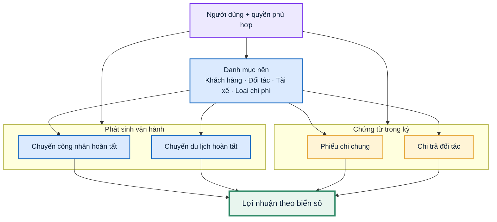

# Sổ tay tự học danh mục, quyền, phiếu chi và lợi nhuận xe — Nguyễn Nhật Quang

## 0. Đích đến

Quang phải tự quản lý được dữ liệu nền, phân quyền và chi phí; đồng thời giải thích được báo cáo lợi nhuận xe lấy số nào, theo kỳ nào và vì sao không tính từ chuyến chưa hoàn thành.

## 1. Bản đồ nghiệp vụ



Nguồn doanh thu là `freight_amount` của `worker_vehicles` và `tourist_vehicles` có trạng thái `completed`. Chứng từ lấy theo ngày phát sinh trong khoảng báo cáo.

## 2. Danh mục cần thuộc

| Danh mục | Dùng ở đâu | Điều cần kiểm tra |
| --- | --- | --- |
| Khách hàng | Hai loại chuyến, phiếu thu, công nợ | mã/tên, số dư đầu kỳ, hoạt động |
| Đối tác | Xe đối tác, chi trả đối tác, công nợ | mã/tên, số dư đầu kỳ |
| Tài xế | Xe nhà, attendance, payroll | loại tài xế, phụ cấp, tỷ lệ lương du lịch |
| Tuyến | Xe công nhân, rule, bảng giá | khách hàng, điểm đón/trả |
| Loại chi phí | Phiếu chi chung | tên/code, nhận diện “thuê lái” |

`tourism_commission_rate` ở tài xế là tỷ lệ mặc định cho chuyến du lịch xe nhà. Chuyến đã tạo giữ tỷ lệ/lương snapshot của chính nó.

## 3. Quyền và hai lớp bảo vệ

Sidebar hoặc route frontend chỉ giúp người dùng nhìn đúng màn hình. Backend vẫn kiểm tra permission cho từng API.

| Nhóm việc | Xem | Thay đổi |
| --- | --- | --- |
| Xe công nhân | `worker-vehicles.view` | `worker-vehicles.manage` |
| Lịch công nhân | — | `worker-vehicle-schedules.manage` |
| Bảng giá công nhân | `worker-vehicle-rates.view` | `worker-vehicle-rates.manage` |
| Xe du lịch | `tourist-vehicles.view` | `tourist-vehicles.manage` |
| Phiếu chi chung | `expenses.view` | `expenses.manage` |
| Chi trả đối tác | `partner-payments.view` | `partner-payments.manage` |
| Lương | `payrolls.view` | `payrolls.manage` |

Lợi nhuận xe cần đồng thời quyền xem xe công nhân, xe du lịch, phiếu chi, chi trả đối tác và payroll. Nếu response là 403, kiểm tra token/user permissions trước khi kết luận lỗi giao diện.

### Đổi mật khẩu

Trang Đổi mật khẩu là thao tác của tài khoản hiện đăng nhập. Luôn nhập mật khẩu hiện tại, mật khẩu mới và xác nhận mật khẩu mới. Không dùng màn quản lý user để thay thế quy trình này.

## 4. Phiếu chi chung

Phiếu chi chung là chứng từ độc lập, gồm:

```json
POST /api/finance/expenses
{
  "expense_type_id": 4,
  "expense_date": "2026-11-02",
  "amount": 750000,
  "payment_method": "bank_transfer",
  "recipient_name": "Gara Hải Phòng",
  "description": "Bảo dưỡng định kỳ"
}
```

Các trường tối thiểu: loại chi phí, ngày chi và số tiền không âm. Các thông tin phương thức, người nhận, diễn giải có thể bổ sung để đối soát.

### Chi trả thuê lái

Nếu `ExpenseType.code` hoặc tên loại chi phí thể hiện “hired_driver”/“thuê lái”, `hired_driver_name` là bắt buộc:

```json
{
  "expense_type_id": 7,
  "expense_date": "2026-11-02",
  "amount": 900000,
  "hired_driver_name": "Anh Nam",
  "recipient_name": "Anh Nam"
}
```

Đây là chứng từ đã chi. Chi phí thuê lái đã cam kết trên chuyến nằm ở `hired_driver_cost`; hai giá trị có vai trò khác nhau khi đối soát công nợ thuê lái.

### Khóa sổ và trạng thái dữ liệu

Chứng từ `is_locked = true` không thể sửa/xóa; backend trả 409. Xóa chứng từ là ngừng hoạt động (`is_active = false`), vì vậy báo cáo chỉ dùng chứng từ còn hoạt động.

## 5. Chi trả đối tác

Chi trả đối tác cũng là chứng từ độc lập, không gắn với một chuyến cụ thể.

```json
POST /api/finance/partner-payments
{
  "partner_id": 5,
  "paid_at": "2026-11-02",
  "amount": 2500000,
  "payment_method": "cash",
  "description": "Thanh toán thuê xe đợt 1"
}
```

Khoản phải trả phát sinh khi chuyến xe đối tác hoàn thành có `partner_vehicle_cost`; khoản đã trả lấy từ `partner_payments`.

## 6. Lợi nhuận xe

Route: `GET /api/other/reports/vehicle-profit?from_date=...&to_date=...`.

Mỗi biển số là một dòng tổng hợp. Công thức hiện hành:

```text
revenue = tổng freight_amount của hai loại chuyến completed
driver_wage = tổng driver_wage snapshot
partner_vehicle_cost = tổng partner_vehicle_cost snapshot
external_driver_cost = tổng hired_driver_cost snapshot
general_cost_allocated = tổng phiếu chi chung trong kỳ / số biển số có chuyến
total_cost = driver_wage + partner_vehicle_cost
           + external_driver_cost + general_cost_allocated
profit = revenue - total_cost
```

Các cột nhiên liệu, sửa chữa, bảo hiểm và chi khác hiện hiển thị `0` nếu chưa có cơ chế phân loại/phân bổ riêng theo biển số. Không tự suy diễn chi phí đó từ tên phiếu chi.

### Ví dụ tính tay

Xe `15B-123.45` có cước công nhân 1.800.000, cước du lịch 3.000.000, lương 580.000, thuê lái 400.000, không thuê xe. Có hai biển số hoạt động và tổng phiếu chi chung kỳ này là 1.000.000.

```text
revenue = 4.800.000
general_cost_allocated = 1.000.000 / 2 = 500.000
total_cost = 580.000 + 400.000 + 500.000 = 1.480.000
profit = 3.320.000
```

## 7. Báo cáo và Word export

Màn “Lợi nhuận xe” dùng `/other/reports/vehicle-profit`; thêm `format=docx` để tải Word. Người học cần biết phân biệt:

- API báo cáo trả `metadata` gồm `filters`, `generated_at`, `totals`, `rows`.
- API Finance danh sách chứng từ trả `metadata` là mảng.

Khi một bảng trống, trước hết kiểm tra khoảng ngày, trạng thái `completed`, `is_active`, quyền và request Network.

## 8. Hướng dẫn thao tác trên website: từ quyền tới lợi nhuận

### Kịch bản A — Chuẩn bị danh mục và quyền

1. Đăng nhập → sidebar **Quản lý danh mục**. Lần lượt mở Khách hàng, Đối tác, Tài xế, Tuyến đường, Loại chi phí.
2. Khi thêm/sửa tài xế, kiểm tra loại tài xế, phụ cấp trách nhiệm và **Tỷ lệ lương du lịch**. Tỷ lệ này chỉ là mặc định cho chuyến tạo sau đó.
3. Sidebar → **Quản lý hệ thống** → Quản lý người dùng/Quản lý vai trò/Quản lý phân quyền. Gán quyền xem trước, sau đó mới gán quyền quản lý cho người cần tạo/sửa.
4. Tự kiểm tra bằng cách đăng nhập tài khoản có ít quyền: sidebar có thể ẩn mục; nếu tự mở URL, backend vẫn phải trả 403.
5. Người dùng cần đổi mật khẩu đi tới **Quản lý hệ thống** → **Đổi mật khẩu**, nhập mật khẩu hiện tại, mật khẩu mới và xác nhận mới rồi lưu.

### Kịch bản B — Ghi phiếu chi chung hoặc chi thuê lái

1. Sidebar → **Tài chính và nhân sự** → **Thu chi và công nợ**.
2. Trên thanh tab, chọn **Phiếu chi chung** → nhấn nút thêm ở góc phải.
3. Chọn loại chi phí trước, rồi nhập ngày chi và số tiền; sau đó nhập phương thức, người nhận, diễn giải để đối soát.
4. Nếu chọn loại chi trả thuê lái, kiểm tra form xuất hiện trường tên lái thuê; điền tên trước khi lưu.
5. Sau khi lưu, tìm dòng vừa tạo bằng tìm kiếm/bộ lọc DataGrid. Dùng menu thao tác để sửa khi chưa khóa; dùng **Khóa** chỉ khi chứng từ đã chốt.
6. Thử sửa lại một chứng từ đã khóa để hiểu thông báo 409, sau đó chỉ xem chứ không kỳ vọng có thể cập nhật.

### Kịch bản C — Chi trả đối tác và kiểm tra công nợ

1. Trong cùng trang Tài chính, chuyển sang tab **Chi trả đối tác**.
2. Nhấn thêm, chọn đối tác từ danh mục, nhập ngày chi, số tiền, phương thức và diễn giải; lưu.
3. Chuyển tab **Công nợ**; đặt khoảng ngày, nhấn **Cập nhật**, rồi chọn tab con **Hãng vận tải**.
4. Tìm đối tác vừa chi. Đọc ba cột: dư đầu, phát sinh thuê xe, đã chi; kiểm tra dư cuối giảm đúng số chứng từ.

### Kịch bản D — Đọc lợi nhuận xe và xuất Word

1. Hoàn thành trước ít nhất một chuyến công nhân hoặc du lịch; nếu không, báo cáo sẽ không có doanh thu.
2. Sidebar → **Báo cáo** → **Lợi nhuận xe**. Nếu menu không hiện, kiểm tra các quyền cần thiết, không phải lỗi dữ liệu.
3. Chọn từ ngày/đến ngày bao trùm ngày hoàn thành thực tế và nhấn **Cập nhật**.
4. Đọc từng biển số: cước, lương, thuê xe, thuê lái, chi phí chung phân bổ, tổng chi và lợi nhuận.
5. Nhấn **Xuất Word** sau khi đã áp dụng bộ lọc; tên file tải về phải có khoảng ngày đang xem.

## 9. Bản đồ source và quy trình debug

| Câu hỏi | Mở file |
| --- | --- |
| Form/tabs tài chính | `HALINHTRAVEL-CLIENT/src/modules/finance/FinancePage.vue` |
| Service frontend | `src/services/finance.service.ts` |
| Sidebar/quyền route | `src/shared/layouts/sidebar-data.ts`, `src/modules/reports/reports.route.ts` |
| Luật chứng từ | `app/Modules/Finance/Services/FinanceService.php` |
| Báo cáo lợi nhuận | `app/Modules/Other/Services/RestoredReportService.php` |

Quy trình: thao tác UI → DevTools Network → service TypeScript → route Laravel → controller → service → model/test. Với lỗi 422 đọc field errors; với 409 kiểm `is_locked`; với 403 kiểm cả quyền frontend lẫn middleware API.

## 10. Sáu lab bắt buộc

1. Tạo một loại chi phí và giải thích nó được dùng ở form nào.
2. Tạo phiếu chi chung, khóa nó, thử sửa và ghi lại 409.
3. Tạo phiếu chi thuê lái thiếu tên, ghi lại validation; tạo lại đúng.
4. Tạo chi trả đối tác và đối chiếu công nợ chủ xe.
5. Tính tay lợi nhuận một biển số, so với báo cáo.
6. Gỡ một quyền cần cho báo cáo lợi nhuận, kiểm tra 403, cấp lại quyền và xuất Word.

## 11. Lộ trình 3 ngày và câu hỏi bảo vệ

- **Ngày 1:** danh mục, vai trò/quyền, đổi mật khẩu và lab 1.
- **Ngày 2:** phiếu chi, chi trả đối tác, khóa sổ và lab 2–4.
- **Ngày 3:** lợi nhuận, export Word, DevTools, lab 5–6.

Câu hỏi phải trả lời được: Vì sao lợi nhuận chỉ nhận chuyến hoàn thành? Vì sao chi phí thuê lái và phiếu chi thuê lái không cùng ý nghĩa? Tại sao một người có `payrolls.view` chưa chắc xem được lợi nhuận xe?
