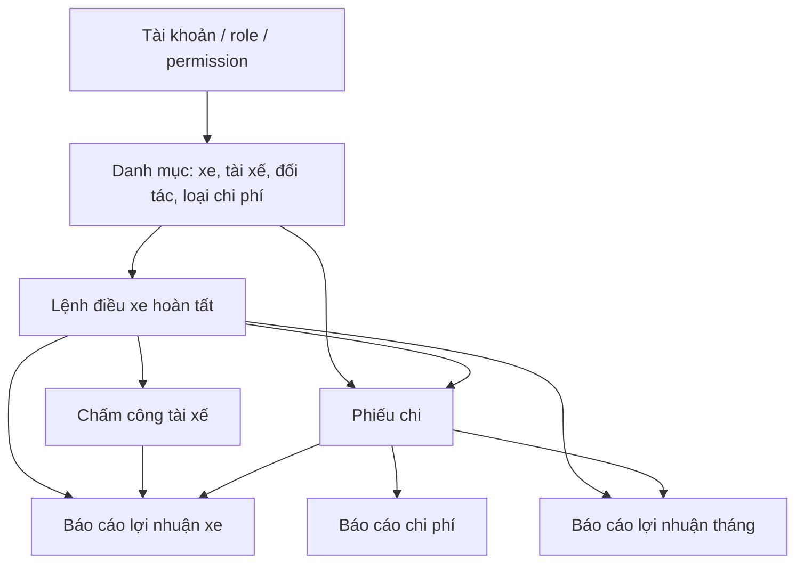
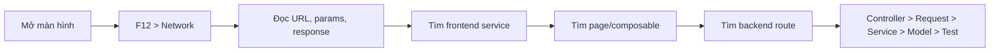
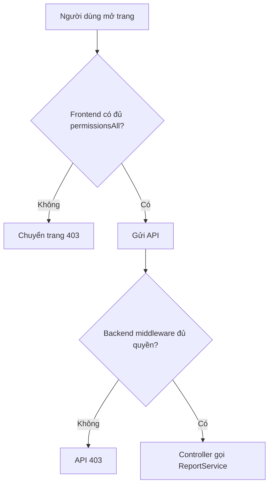
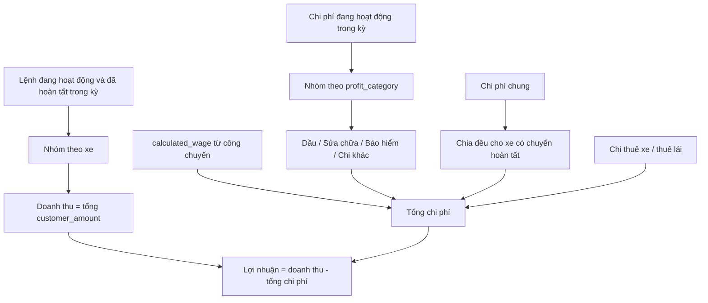

# Sổ tay tự học code và nghiệp vụ — Nguyễn Nhật Quang

## 1. Mục tiêu

Sau khi tự học xong tài liệu này, em cần làm được bốn việc:

1. Mô tả được dữ liệu đi từ danh mục đến báo cáo lợi nhuận.
2. Tạo được tài khoản, vai trò, quyền, danh mục và chứng từ chi phí trong môi trường phát triển.
3. Phân biệt được chi phí xe, chi phí chuyến và chi phí chung.
4. Giải thích được vì sao một xe lời hoặc lỗ trong một tháng.

Không cần học toàn bộ hệ thống thuê xe cùng lúc. Hãy đi theo đúng thứ tự tài liệu; mỗi phần sau dùng dữ liệu của phần trước.

## 2. Bản đồ nghiệp vụ

```text
Tài khoản, vai trò và quyền
        ↓
Danh mục: xe, tài xế, tuyến, đối tác, loại chi phí
        ↓
Lệnh điều xe hoàn tất và chấm công chuyến
        ↓
Phiếu thu, chi phí, chi trả đối tác, lương
        ↓
Báo cáo chi phí, công nợ, lợi nhuận theo tháng và theo xe
```

### Từ vựng phải nhớ

| Khái niệm | Ý nghĩa trong nghiệp vụ |
| --- | --- |
| Tài khoản | Người đăng nhập hệ thống. |
| Vai trò | Nhóm quyền theo công việc, ví dụ kế toán hoặc điều hành. |
| Quyền | Một khả năng cụ thể như xem chi phí hoặc quản lý xe. |
| Danh mục | Dữ liệu nền dùng lại trong nhiều nghiệp vụ: xe, tài xế, loại chi phí. |
| Lệnh điều xe | Một chuyến xe thực tế được giao xe và tài xế. |
| Chi phí xe | Chi phí gắn trực tiếp với một xe, ví dụ sửa chữa hoặc nhiên liệu. |
| Chi phí chuyến | Chi phí gắn với một lệnh điều xe cụ thể. |
| Chi phí chung | Chi phí không thuộc riêng xe hay chuyến nào, ví dụ văn phòng phẩm. |
| Chứng từ khóa | Chứng từ đã chốt, chỉ được xem, không sửa hoặc ngừng hoạt động. |

## 3. Phần A — Tài khoản và phân quyền

### Em cần tự thao tác

1. Mở **Quản lý hệ thống > Tài khoản**.
2. Xem một tài khoản: vai trò trực tiếp, quyền ngoại lệ và quyền hiệu lực.
3. Mở **Vai trò** để phân biệt vai trò hệ thống với vai trò tùy chỉnh.
4. Mở **Quyền** để quan sát quy tắc đặt mã như `expenses.view` và `expenses.manage`.

### Quy tắc cần tự giải thích

- Một tài khoản có quyền từ vai trò và có thể được cấp quyền trực tiếp.
- Quyền `view` cho phép xem; quyền `manage` cho phép tạo, sửa, khóa hoặc ngừng hoạt động theo từng nghiệp vụ.
- Không thể tự vô hiệu hóa tài khoản đang dùng.
- Hệ thống phải luôn còn ít nhất một quản trị viên đang hoạt động.
- Vai trò và quyền hệ thống chỉ dùng để tham khảo/cấp phát; không thể sửa hoặc xóa như dữ liệu tùy chỉnh.

### Câu hỏi tự kiểm tra

1. Vì sao không nên cấp toàn quyền cho tất cả nhân viên?
2. Kế toán cần các quyền nào để ghi nhận chi phí?
3. Vì sao giao diện có thể ẩn menu nhưng backend vẫn phải kiểm tra quyền?

## 4. Phần B — Danh mục phục vụ chi phí và lợi nhuận

Hãy đọc và thao tác theo thứ tự sau:

1. **Phân loại xe**: số chỗ và tỷ lệ hoa hồng tour.
2. **Danh sách xe**: biển số, loại xe, chủ sở hữu, ODO và trạng thái.
3. **Tài xế**: loại tài xế công ty/đối tác, bằng lái, ngày hiệu lực và lương cơ bản.
4. **Đối tác**: chủ xe, hãng vận tải, gara hoặc nhà cung cấp.
5. **Loại chi phí**: mã, tên, phạm vi và nhóm chi phí lợi nhuận.

### Loại chi phí là chìa khóa của báo cáo lợi nhuận

Khi tạo loại chi phí, phải chọn đúng hai thuộc tính:

| Thuộc tính | Giá trị | Ví dụ |
| --- | --- | --- |
| Phạm vi áp dụng | Xe | Dầu, sửa chữa định kỳ, bảo hiểm xe. |
| Phạm vi áp dụng | Chuyến xe | Phí cầu đường của một chuyến cụ thể. |
| Phạm vi áp dụng | Chung | Văn phòng phẩm, phần mềm, chi phí văn phòng. |
| Nhóm lợi nhuận | Dầu | Dùng vào cột chi phí dầu của báo cáo xe. |
| Nhóm lợi nhuận | Sửa chữa | Dùng vào cột sửa chữa. |
| Nhóm lợi nhuận | Bảo hiểm, đăng kiểm | Dùng vào cột bảo hiểm/đăng kiểm. |
| Nhóm lợi nhuận | Chi khác | Các khoản còn lại. |

Một phiếu chi phải dùng đúng phạm vi của loại chi phí. Ví dụ, loại “Nhiên liệu” khai báo cho **Xe** không thể được lưu thành chi phí **Chung**.

## 5. Phần C — Ghi nhận chi phí

Mở **Tài chính và công nợ > Chi phí**, sau đó tự thực hiện ba ví dụ ở môi trường phát triển.

### Ví dụ 1: Đổ xăng cho xe

- Chọn loại chi phí: Nhiên liệu.
- Phạm vi: Xe.
- Chọn đúng mã xe.
- Nhập ngày chi, số tiền, phương thức thanh toán và số hóa đơn nếu có.

### Ví dụ 2: Phí phát sinh cho một chuyến

- Chọn loại chi phí dành cho chuyến.
- Phạm vi: Chuyến xe.
- Chọn lệnh điều xe tương ứng.

### Ví dụ 3: Mua văn phòng phẩm

- Chọn loại chi phí chung.
- Phạm vi: Chi phí chung.
- Không chọn xe hoặc lệnh điều xe.

### Quy tắc quyết toán lái xe

| Loại quyết toán | Điều kiện chính |
| --- | --- |
| Chi phí thông thường | Có thể ghi theo phạm vi xe, chuyến hoặc chung. |
| Lái xe tự chi | Phải thuộc một chuyến đã hoàn tất và tài xế đó phải là tài xế được phân công; chỉ áp dụng lái xe công ty. |
| Chi thuê lái | Phải thuộc một chuyến đã hoàn tất và áp dụng cho lái xe ngoài. |

Sau khi khóa chứng từ, không được sửa hay ngừng hoạt động. Nếu chứng từ chưa khóa nhưng sai, có thể ngừng hoạt động; báo cáo sẽ không tính chứng từ đó.

## 6. Phần D — Đọc báo cáo

### Báo cáo chi phí

Vào **Báo cáo > Thu chi, chi phí và công nợ**, chọn thẻ **Chi phí**.

Tập trả lời các câu hỏi sau:

- Trong tháng này đã chi bao nhiêu?
- Chi phí nào thuộc xe nào?
- Khoản nào là chi phí chung?
- Chi phí nào đã ngừng hoạt động nên không còn ảnh hưởng tổng số?

### Báo cáo lợi nhuận theo tháng

Chọn **Báo cáo > Lợi nhuận theo tháng**. Có hai cơ sở tính:

| Cơ sở | Doanh thu | Lương |
| --- | --- | --- |
| Dồn tích | Giá trị lệnh điều xe đã hoàn tất trong tháng | Tổng lương phát sinh theo kỳ lương. |
| Tiền mặt | Phiếu thu thực nhận trong tháng | Lương thực nhận theo thời điểm đã chi. |

Chi phí của tháng gồm chi phí, chi trả đối tác và lương. Lợi nhuận bằng doanh thu trừ tổng chi phí.

### Báo cáo lợi nhuận xe

Chọn **Báo cáo > Lợi nhuận xe**. Với mỗi xe có lệnh hoàn tất trong khoảng ngày đã chọn:

```text
Lợi nhuận xe
= Doanh thu chuyến hoàn tất
- Dầu
- Sửa chữa
- Bảo hiểm/đăng kiểm
- Chi khác
- Lương tài xế theo chuyến
- Phần chi phí chung phân bổ
- Chi phí thuê xe và thuê lái (nếu có)
```

Chi phí chung được chia đều cho số xe có chuyến hoàn tất trong kỳ. Đây là quy tắc cần nêu rõ khi thuyết trình.

Để xem được hai báo cáo lợi nhuận, tài khoản phải có quyền xem lệnh điều xe, chi phí, chi trả đối tác và lương.

## 7. Lộ trình tự học trong 6 phiên

| Phiên | Thời lượng gợi ý | Việc làm | Sản phẩm phải nộp cho người hướng dẫn |
| --- | ---: | --- | --- |
| 1 | 60–90 phút | Đọc phần A, mở các màn hình tài khoản/vai trò/quyền. | Sơ đồ “tài khoản → vai trò → quyền”. |
| 2 | 60–90 phút | Đọc phần B, lập bảng 6 loại chi phí mẫu. | Bảng loại chi phí và phạm vi đúng. |
| 3 | 60–90 phút | Tạo ba ví dụ chi phí ở phần C. | Ảnh hoặc ghi chú về dữ liệu đã tạo trong môi trường phát triển. |
| 4 | 60 phút | Đọc luồng khóa/ngừng hoạt động chứng từ. | Giải thích khác nhau giữa khóa và ngừng hoạt động. |
| 5 | 60–90 phút | Đọc báo cáo chi phí và lợi nhuận theo tháng. | Bảng tính tay doanh thu, chi phí, lợi nhuận của một tháng. |
| 6 | 60–90 phút | Đọc báo cáo lợi nhuận xe. | Một ví dụ tính lợi nhuận xe bằng số tự chọn. |

## 8. Bài tập cuối

Cho tình huống sau trong tháng 10:

- Xe 15B-123.45 có doanh thu chuyến hoàn tất: 100.000.000 đồng.
- Dầu: 20.000.000 đồng; sửa chữa: 5.000.000 đồng; lương tài xế theo chuyến: 10.000.000 đồng.
- Chi phí chung của công ty là 6.000.000 đồng và tháng đó có ba xe chạy.

Em phải trả lời:

1. Xe nhận bao nhiêu chi phí chung? 
2. Tổng chi phí của xe là bao nhiêu?
3. Lợi nhuận xe là bao nhiêu?
4. Nếu phiếu sửa chữa bị ngừng hoạt động thì báo cáo thay đổi thế nào?

Đáp án kiểm tra: chi phí chung phân bổ là 2.000.000 đồng; tổng chi phí là 37.000.000 đồng; lợi nhuận là 63.000.000 đồng. Khi ngừng phiếu sửa chữa, chi phí giảm 5.000.000 đồng và lợi nhuận tăng tương ứng.

## 9. Nguyên tắc an toàn khi thực hành

- Chỉ tạo/sửa dữ liệu ở môi trường phát triển hoặc dữ liệu mẫu được cho phép.
- Không chạy migration, seeder, lệnh xóa dữ liệu hoặc khóa chứng từ khi chưa được hướng dẫn.
- Ghi lại: thao tác đã làm, dữ liệu đầu vào, kết quả nhìn thấy và câu hỏi chưa hiểu.

---

# Phần II — Tự lần code: từ nút bấm đến công thức

## 10. Bản đồ workspace dành cho người mới

| Khu vực | Đường dẫn | Câu hỏi mà khu vực này trả lời |
| --- | --- | --- |
| Frontend | `D:\vue\halinhtravel-client` | Người dùng nhìn thấy gì và bấm ở đâu? |
| Vue module | `src/modules/<nghiep-vu>` | Trang, route, form và state của một nghiệp vụ nằm đâu? |
| Frontend service | `src/services` | Frontend gửi API nào và truyền dữ liệu gì? |
| Backend | `D:\Laravel\halinhtravel-api` | Hệ thống kiểm tra quyền, validation và tính toán ra sao? |
| Laravel module | `app/Modules/<NghiepVu>` | Mã backend được chia theo Auth, MasterData, Finance, Other thế nào? |
| `Routes` | `Routes/index.php` | URL nào, quyền nào, controller nào? |
| `Controllers` | `Controllers` | Request được nhận và trả response ra sao? |
| `Requests` | `Requests` | Dữ liệu đầu vào nào hợp lệ? |
| `Services` | `Services` | Quy tắc nghiệp vụ và công thức nằm đâu? |
| `Models` | `Models` | Dữ liệu nào và quan hệ nào được dùng? |
| Tests | `tests/Feature`, `tests/Unit` | Hành vi đúng/sai nào được bảo vệ? |



## 11. Quy trình 7 bước để tự tìm đúng code

Đừng mở ngẫu nhiên file PHP. Với mọi chức năng, làm đủ bảy bước bên dưới.



| Bước | Thao tác | Câu hỏi phải trả lời trước khi sang bước sau |
| --- | --- | --- |
| 1 | Mở màn hình, thay đổi một bộ lọc hoặc bấm một nút. | Người dùng muốn xem/tạo/sửa cái gì? |
| 2 | `F12` → **Network** → chọn **Fetch/XHR**. | Khi bấm nút, request nào mới xuất hiện? |
| 3 | Mở request trong Network. | Method, URL, query params, status code, response là gì? |
| 4 | `Ctrl+Shift+F` tìm phần URL đặc trưng. | File frontend service nào gửi request? |
| 5 | Tìm nơi gọi service. | Page/composable nào giữ filter, loading và lỗi? |
| 6 | Tìm URL ở backend. | Route nào và middleware quyền nào bảo vệ endpoint? |
| 7 | Đi controller → request → service → model → test. | Công thức/luật thật nằm ở service nào? |

### Phím VS Code phải dùng

| Phím | Mục đích |
| --- | --- |
| `Ctrl+P` | Mở nhanh file, ví dụ gõ `ReportsPage.vue`. |
| `Ctrl+Shift+F` | Tìm toàn dự án chuỗi như `vehicle-profit`. |
| `F12` / Ctrl+Click | Đi đến định nghĩa hàm, import hoặc type. |
| `Shift+F12` | Tìm nơi một hàm hoặc service được gọi. |
| `Ctrl+G` | Đến dòng khi người hướng dẫn chỉ vị trí. |

## 12. Bài mẫu: Báo cáo lợi nhuận xe từ giao diện đến backend

### 12.1. Bắt đầu ở DevTools, không bắt đầu ở PHP

Mở **Báo cáo > Lợi nhuận xe**, chọn **Từ ngày**, **Đến ngày**, bấm **Cập nhật**. Sau đó mở DevTools.

1. Nhấn `F12`.
2. Chọn tab **Network**.
3. Chọn bộ lọc **Fetch/XHR**.
4. Bấm **Cập nhật** lần nữa.
5. Tìm request có tên `vehicle-profit`.

Mô phỏng request thành công:

```http
GET /api/other/reports/vehicle-profit?from_date=2026-10-01&to_date=2026-10-31
Authorization: Bearer <token>
```

| Param | Ý nghĩa |
| --- | --- |
| `from_date` | Ngày đầu của kỳ báo cáo; bắt buộc. |
| `to_date` | Ngày cuối kỳ; bắt buộc và không được trước `from_date`. |
| `format` | Khi xuất file, có thể là `docx`; không truyền thì xem JSON. |
| `vehicle_id` | Có trong request validation; chỉ có tác dụng nếu service báo cáo dùng bộ lọc này. |

Mô phỏng phần response cần đọc:

```json
{
  "metadata": {
    "totals": {
      "revenue": "100000000.00",
      "cost": "37000000.00",
      "profit": "63000000.00"
    },
    "rows": [
      {
        "vehicle_plate": "15B-123.45",
        "revenue": "100000000.00",
        "fuel_cost": "20000000.00",
        "driver_wage": "10000000.00",
        "general_cost_allocated": "2000000.00",
        "profit": "63000000.00"
      }
    ]
  }
}
```

`totals` là tổng của toàn kỳ. `rows` là chi tiết từng xe. `general_cost_allocated` là phần chi phí chung đã chia cho xe, không phải một phiếu chi gắn trực tiếp với xe đó.

### 12.2. Nếu request trả 403

```http
Status: 403 Forbidden
```

Làm lần lượt, không đoán:

1. Kiểm tra request có header `Authorization` không.
2. Kiểm tra tài khoản có bốn quyền: `dispatch-orders.view`, `expenses.view`, `partner-payments.view`, `payrolls.view`.
3. Mở frontend route xem `permissionsAll`.
4. Mở backend route xem các middleware `permission:` có trùng không.



### 12.3. Lần qua frontend

Mở file theo đúng thứ tự sau.

| Thứ tự | File | Từ khóa cần tìm | Điều phải hiểu |
| ---: | --- | --- | --- |
| 1 | `D:\vue\halinhtravel-client\src\modules\reports\report.route.ts` | `report-vehicle-profit` | Route, title và bốn quyền cần có. |
| 2 | `D:\vue\halinhtravel-client\src\modules\reports\ReportsPage.vue` | `slug`, `useQuery`, `filters` | Page chung lấy dữ liệu báo cáo ra sao. |
| 3 | `D:\vue\halinhtravel-client\src\services\report.service.ts` | `baseUrl`, `get` | URL `/other/reports/vehicle-profit` được ghép thế nào. |
| 4 | `D:\vue\halinhtravel-client\src\router\index.ts` | `permissionsAll` | Route guard làm gì khi thiếu quyền. |

Code Vue cần đọc:

```ts
// [1] Route truyền loại báo cáo vào page.
const props = defineProps<{ kind: ReportKind }>()

// [2] Với báo cáo thông thường, slug chính là kind.
const slug = computed(() => (props.kind === 'finance' ? financeTab.value : props.kind))

// [3] Vue Query gọi service và giữ trạng thái loading/error/cache.
const query = useQuery({
  queryKey: computed(() => ['reports', slug.value, filters.value]),
  queryFn: () => ReportService.get(slug.value, filters.value),
})
```

Giải thích: `[1]` nhận `vehicle-profit`; `[2]` tạo slug; `[3]` gọi service khi cần tải lại dữ liệu.

Code service cần đọc:

```ts
const baseUrl = '/other/reports'

get(slug: string, filters: ReportFilters): Promise<ReportResponse> {
  return httpService.get(`${baseUrl}/${slug}`, { params: filters })
}
```

Nối hai đoạn code sẽ suy ra URL trong Network: `/other/reports` + `/vehicle-profit`.

### 12.4. Lần qua backend

| Thứ tự | File | Tên cần mở | Câu trả lời phải có |
| ---: | --- | --- | --- |
| 1 | `app/Modules/Other/Routes/index.php` | `/reports/vehicle-profit` | Endpoint cần quyền nào? |
| 2 | `app/Modules/Other/Controllers/ReportController.php` | `vehicleProfit()` | Controller gọi service nào? |
| 3 | `app/Modules/Other/Requests/ReportRequest.php` | `rules()`, `filters()` | Input nào được chấp nhận? |
| 4 | `app/Modules/Other/Services/ReportService.php` | `vehicleProfit()` | Công thức mỗi dòng xe là gì? |
| 5 | `app/Modules/Dispatch/Models/DispatchOrder.php` | `tripAssignment`, `driverAttendance` | Xe và lương công chuyến đến từ đâu? |
| 6 | `app/Modules/Finance/Models/Expense.php` | `expenseType`, `vehicle`, `dispatchOrder` | Chi phí gắn xe/chuyến ra sao? |

Route rút gọn:

```php
Route::middleware([
    'auth:api',
    'permission:dispatch-orders.view',
    'permission:expenses.view',
    'permission:partner-payments.view',
    'permission:payrolls.view',
])->get('/reports/vehicle-profit', [ReportController::class, 'vehicleProfit']);
```

Controller chỉ điều phối. Service mới chứa công thức:

```php
public function vehicleProfit(ReportRequest $request): JsonResponse|BinaryFileResponse
{
    $data = $this->reports->vehicleProfit($request->filters());
    // JSON khi xem; Word khi format=docx.
}
```

### 12.5. Công thức trong `ReportService::vehicleProfit()`



Phải nói đúng bốn điểm:

1. Chỉ lệnh **đang hoạt động** và **đã hoàn tất** trong kỳ mới có doanh thu.
2. Chỉ chi phí **đang hoạt động** mới được cộng.
3. Lương trong lợi nhuận xe là `calculated_wage` theo chuyến, không phải nguyên bảng lương tháng.
4. Chi phí chung chia đều theo số xe có chuyến hoàn tất trong kỳ.

## 13. Lab tự lần code

Mỗi lab chỉ hoàn thành khi nộp đủ: sơ đồ luồng, URL API, quyền, hàm service tính toán và một ví dụ input/output.

### Lab 1 — Báo cáo lợi nhuận xe

- **Từ khóa tìm kiếm:** `vehicle-profit`, `ReportService.get`, `vehicleProfit`.
- **Mục tiêu:** lần được toàn bộ luồng ở mục 12 mà không xem đáp án.
- **Câu hỏi:** bốn quyền là gì; doanh thu lấy từ đâu; lương lấy từ đâu; chi phí chung chia thế nào?
- **Nộp:** sơ đồ 7 bước và response JSON đã chú thích.

### Lab 2 — Tạo loại chi phí và kiểm tra phạm vi

- **Từ khóa:** `ExpenseTypePage`, `ExpenseTypeModal`, `validateExpense`, `expense_type_id`.
- **File:** `ExpenseTypePage.vue`, `ExpenseTypeModal.vue`, `FinancialDocumentDialog.vue`, `FinanceService.php`, `FinanceApiTest.php`.
- **Câu hỏi:** frontend hiện trường xe/lệnh điều xe khi nào; backend kiểm tra phạm vi ở đâu; request sai bị trả mã nào?
- **Nộp:** bảng ba loại chi phí và mô tả request bị `422`.

Code nghiệp vụ rút gọn trong `FinanceService::validateExpense()`:

```php
// [1] Lấy loại chi phí còn hoạt động.
$expenseType = ExpenseType::query()->whereKey($data['expense_type_id'])
    ->where('is_active', true)->firstOrFail();

// [2] Đổi scope request thành giá trị hợp lệ.
$scope = ExpenseScopeEnum::from($data['scope']);

// [3] Chặn loại chi phí và phiếu chi dùng khác phạm vi.
if ($expenseType->scope?->value !== $scope->value) {
    abort(422, 'Phạm vi chi phí phải khớp với phạm vi của loại chi phí.');
}
```

### Lab 3 — Phiếu chi ảnh hưởng tới báo cáo

- **Từ khóa:** `createExpense`, `expenses`, `profitLoss`, `is_active`.
- **Câu hỏi:** chứng từ khóa có sửa được không; ngừng hoạt động khác xóa thế nào; báo cáo có tính chứng từ ngừng hoạt động không?
- **Nộp:** bảng trước/sau cho tổng chi phí và lợi nhuận khi một phiếu chi bị ngừng hoạt động.

### Lab 4 — Role, permission và hai lớp chặn quyền

- **Từ khóa:** `permissionsAll`, `beforeEach`, `syncUserRoles`, `syncUserPermissions`, `permission:`.
- **File:** `UserDetailPage.vue`, `org.route.ts`, `router/index.ts`, `Auth/Routes/index.php`, `AccessManagementService.php`, `AccessManagementTest.php`.
- **Câu hỏi:** quyền hiệu lực lấy từ đâu; vì sao menu ẩn chưa đủ an toàn; vì sao không được gỡ admin cuối cùng?
- **Nộp:** bảng role, quyền hiệu lực, menu thấy được, API gọi được và API bị `403`.

## 14. Cẩm nang tự debug

| Dấu hiệu | Nghĩa thường gặp | File/việc đầu tiên phải kiểm tra |
| --- | --- | --- |
| 404 | Sai URL/method hoặc route chưa tồn tại. | Copy URL Network, tìm chuỗi route ở backend. |
| 401 | Chưa đăng nhập hoặc token hết hạn. | Kiểm tra `Authorization`; gọi `/api/auth/me`. |
| 403 | Đăng nhập nhưng thiếu quyền. | So sánh `permissions` user với middleware route. |
| 422 | Input không hợp lệ. | Đọc `message/errors`, mở Form Request rồi service validation. |
| 500 | Lỗi code/truy vấn. | Ghi URL/payload; lần controller → service trong môi trường dev. |
| UI không đổi | Mutation lỗi hoặc cache chưa refresh. | Mở Network; tìm `invalidateQueries` trong composable. |

### Đọc feature test

Khi hiểu một quy tắc, tìm test gần nhất:

```text
tests/Feature/Finance/FinanceApiTest.php
tests/Feature/Auth/AccessManagementTest.php
```

Đọc theo thứ tự: **dữ liệu chuẩn bị** → **request gửi đi** → **assert kết quả**. Test trả lời chính xác cho câu hỏi: “dữ liệu sai thì hệ thống phải phản ứng thế nào?”.

## 15. Checklist tốt nghiệp tự học

- [ ] Tôi tìm được một API bằng DevTools Network.
- [ ] Tôi đọc được URL, params, status code và JSON response.
- [ ] Tôi lần được từ `ReportsPage.vue` đến `ReportService::vehicleProfit()`.
- [ ] Tôi phân biệt frontend route, frontend API service, backend route, controller, request, service, model và test.
- [ ] Tôi giải thích được `vehicle`, `trip`, `general` và validation phạm vi loại chi phí.
- [ ] Tôi tính tay được lợi nhuận xe và chỉ đúng nguồn dữ liệu trong code.
- [ ] Tôi biết file nào cần mở trước khi điều tra 403 và 422.

