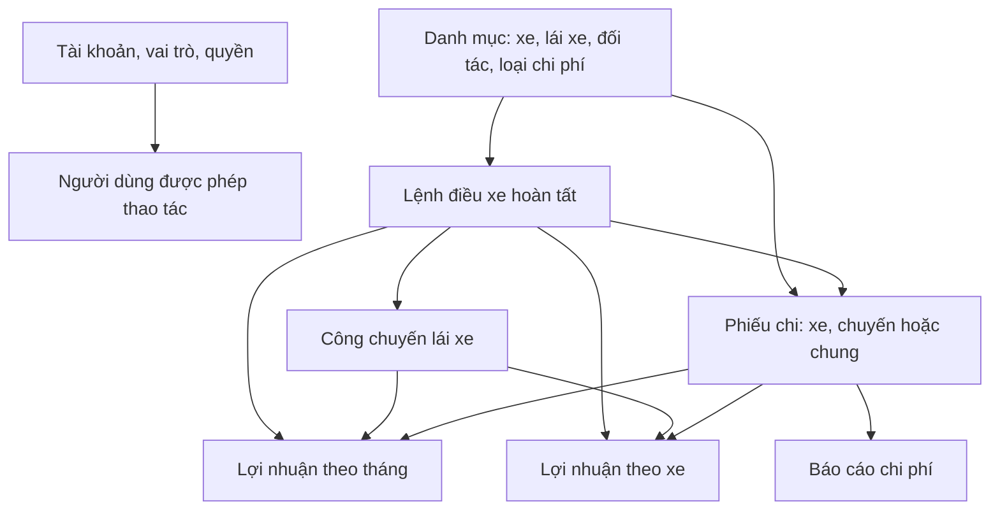
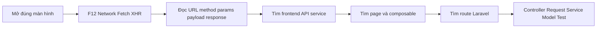
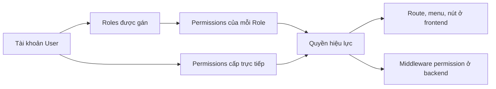
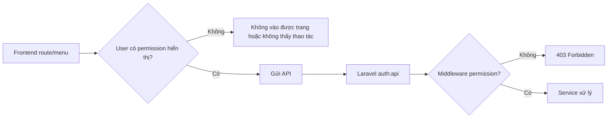
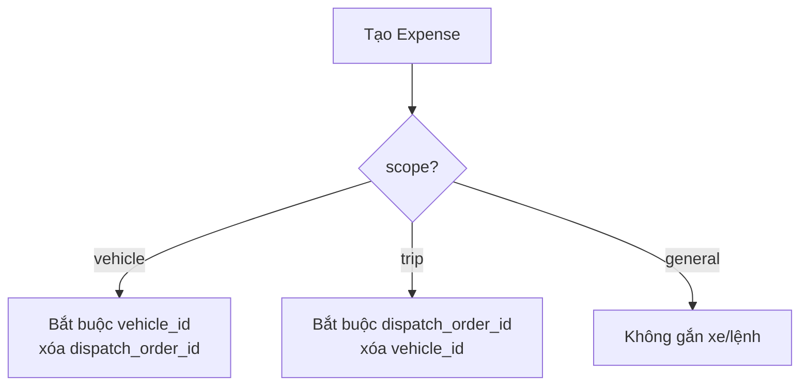
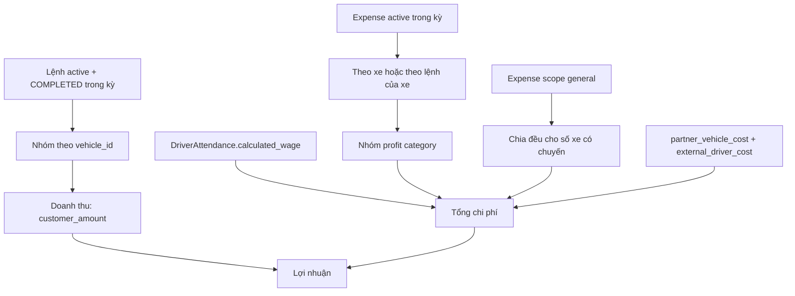
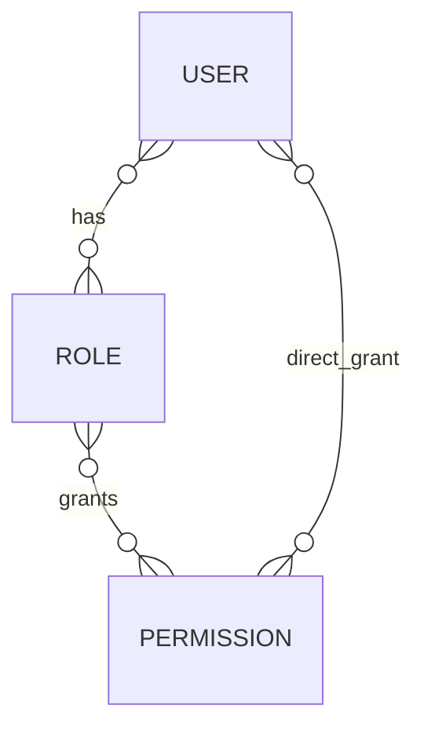
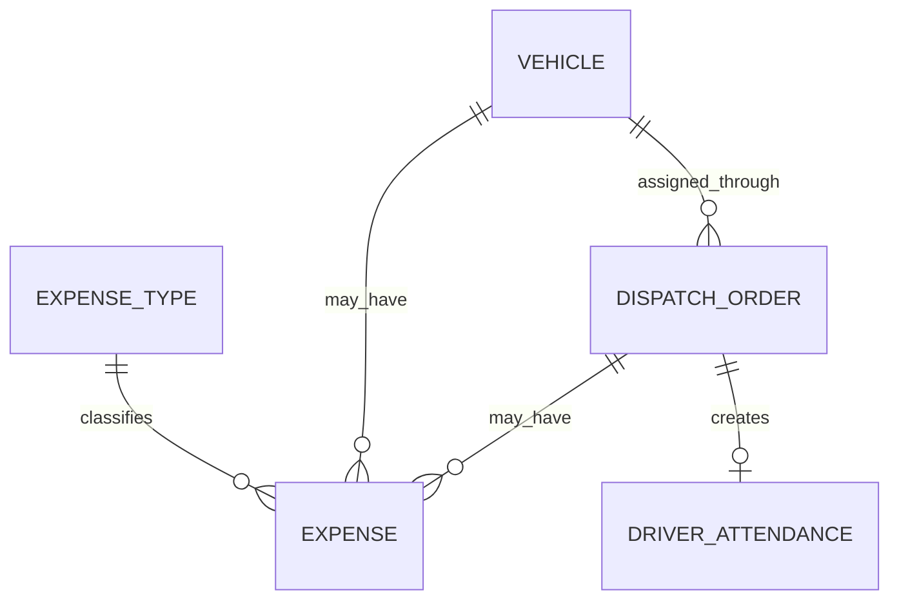

# Sổ tay tự học quy trình nghiệp vụ và lần code — Nguyễn Nhật Quang

> **Phạm vi phụ trách:** quản lý người dùng và phân quyền; khai báo danh mục; quản lý chi phí xe theo tháng và chi phí chung; tính lợi nhuận xe; báo cáo chi phí và lợi nhuận xe chạy.
>
> **Đối tượng:** người chưa biết Vue, Laravel, HTTP hay DevTools. Không học thuộc file. Hãy học cách trả lời câu hỏi “con số này từ chứng từ nào, bị điều kiện nào lọc, và do hàm nào tính?”.
>
> **An toàn:** mọi thao tác tạo/sửa/ngừng hoạt động/khóa chỉ làm trên môi trường phát triển được phép. Không chạy migration, seeder, lệnh xóa dữ liệu hoặc thao tác vào dữ liệu thật.

---

## 0. Đích đến sau khi học xong

Sau sổ tay này, Quang phải tự làm được tám việc sau:

1. Mở DevTools từ trang bất kỳ và lần được request đến đúng service backend.
2. Giải thích quyền hiệu lực của tài khoản gồm quyền từ role và quyền cấp trực tiếp.
3. Tạo một loại chi phí đúng phạm vi, rồi giải thích nó vào cột lợi nhuận nào.
4. Phân biệt chi phí xe, chi phí chuyến, chi phí chung và chi quyết toán lái xe.
5. Tự tính tay lợi nhuận tháng và lợi nhuận của một xe.
6. Đối chiếu được con số trong báo cáo với lệnh điều xe, phiếu chi, công chuyến và chi phí chung.
7. Tìm đúng nguyên nhân của lỗi `403`, `409`, `422`.
8. Trình bày phần mình phụ trách trước người hướng dẫn bằng URL API, permission, công thức và source thật, không nói chung chung.

---

## 1. Bản đồ nghiệp vụ: dữ liệu đi từ đâu đến báo cáo?



### 1.1. Từ điển cần thuộc

| Khái niệm | Nói đơn giản | Bản ghi/nguồn chính |
| --- | --- | --- |
| Tài khoản | Người đăng nhập ứng dụng | `User` |
| Vai trò | Một nhóm quyền theo công việc | `Role` |
| Quyền | Một thao tác cụ thể như xem hoặc quản lý chi phí | `Permission` |
| Quyền hiệu lực | Tổng quyền user nhận từ vai trò và được cấp trực tiếp | `getAllPermissions()` |
| Danh mục | Dữ liệu dùng lặp lại trong nhiều nghiệp vụ | Vehicle, Driver, Partner, Route, ExpenseType... |
| Loại chi phí | Quy định chi phí được gắn vào xe/chuyến/chung và nhóm lợi nhuận | `ExpenseType` |
| Phiếu chi | Một chứng từ chi tiêu | `Expense` |
| Lệnh điều xe hoàn tất | Một chuyến đã được xác nhận doanh thu/chi phí | `DispatchOrder` có `COMPLETED` |
| Công chuyến | Tiền công được tính cho một lệnh hoàn tất | `DriverAttendance` |
| Chi phí chung | Chi phí không thuộc riêng xe/chuyến | Expense scope `general` |
| Chi phí chung phân bổ | Phần chi phí chung được chia cho mỗi xe chạy trong kỳ | giá trị tính trong report |
| Lợi nhuận xe | Doanh thu xe trừ chi phí trực tiếp và chi phí phân bổ | `ReportService::vehicleProfit()` |

### 1.2. Ba báo cáo không được nhầm nhau

| Báo cáo | Trả lời câu hỏi gì? | Nguồn thời gian chính |
| --- | --- | --- |
| Chi phí | Đã ghi những phiếu chi nào, thuộc xe/chuyến/chung nào? | `Expense.expense_date` |
| Lợi nhuận tháng | Tổng doanh thu, tổng chi và lãi/lỗ từng tháng là bao nhiêu? | theo tháng; dồn tích hoặc tiền mặt |
| Lợi nhuận xe | Mỗi xe đang lời/lỗ bao nhiêu và vì cột chi phí nào? | `DispatchOrder.completed_at`, Expense date |

---

## 2. Bản đồ workspace: tôi đang ở đâu?

Mở hai thư mục bằng VS Code:

| Gốc | Vai trò |
| --- | --- |
| `D:\vue\halinhtravel-client` | Frontend Vue: người dùng nhìn, bấm và gửi request |
| `D:\Laravel\halinhtravel-api` | Backend Laravel: phân quyền, validation, công thức và dữ liệu |

### 2.1. Bản đồ lớp code

| Tôi muốn biết | Frontend cần mở | Backend cần mở | Dấu hiệu đã tìm đúng |
| --- | --- | --- | --- |
| Màn hình người dùng | `src/modules/organization`, `master-data`, `finance`, `reports` | — | Có title/menu/form/Datagrid tương ứng |
| API được gọi | `src/services/*.service.ts` | — | Có `httpService.get/post/patch/delete` |
| Cache và mutation | `*.composables.ts` | — | Có `useQuery`, `useMutation`, `invalidateQueries` |
| URL và frontend guard | `*.route.ts`, `src/router/index.ts` | — | Có `meta.permission` hoặc `permissionsAll` |
| Cổng API | — | `app/Modules/*/Routes/index.php` | Có `Route::...` và `permission:` |
| Nhận request | — | `Controllers` | Có `store`, `update`, `destroy`, `lock` |
| Kiểm dữ liệu nhập | — | `Requests` | Có `rules()` |
| Luật nghiệp vụ/công thức | — | `Services` | Có `validateExpense`, `profitLoss`, `vehicleProfit` |
| Quan hệ dữ liệu | — | `Models` | Có `belongsTo`, `hasMany`, casts |
| Hành vi được bảo vệ | — | `tests/Feature` | Có request và assert kết quả |

### 2.2. File trọng tâm của Quang

| Nghiệp vụ | Frontend | Backend |
| --- | --- | --- |
| User/role/permission | `modules/organization/**`, `services/user.service.ts`, `role.service.ts`, `permission.service.ts` | `Auth/Routes/index.php`, `Services/AccessManagementService.php` |
| Loại chi phí | `master-data/expense-type/**`, `services/expense-type.service.ts` | `MasterData/ExpenseType*`, `Routes/index.php` |
| Phiếu chi | `finance/FinancePage.vue`, `components/FinancialDocumentDialog.vue`, `services/finance.service.ts` | `Finance/ExpenseController.php`, `FinanceService.php` |
| Báo cáo | `reports/ReportsPage.vue`, `report.route.ts`, `services/report.service.ts` | `Other/ReportController.php`, `ReportRequest.php`, `ReportService.php` |
| Dữ liệu nguồn | — | DispatchOrder, Expense, DriverAttendance, Payroll, PartnerPayment, Receipt |

---

## 3. Quy trình 7 bước: từ nút bấm đến công thức



### Bước 1 — Viết việc mình định kiểm tra

Ví dụ:

```text
Tôi muốn xem lợi nhuận xe tháng 10.
Tôi dự đoán frontend gửi GET có from_date/to_date.
Backend chỉ lấy xe có lệnh điều xe đã hoàn tất.
```

Nếu không nói được mong đợi trước khi bấm, bạn sẽ nhìn Network mà không biết request nào đáng đọc.

### Bước 2 — Mở DevTools đúng cách

1. Nhấn `F12`.
2. Chọn **Network**.
3. Chọn bộ lọc **Fetch/XHR**.
4. Xóa request cũ.
5. Thực hiện một thao tác duy nhất: nhấn Cập nhật, Lưu, Khóa hoặc Ngừng hoạt động.

### Bước 3 — Đọc request như biên bản

| Vị trí DevTools | Câu hỏi phải trả lời |
| --- | --- |
| Request URL | API nào được gọi? |
| Request Method | Đây là đọc (`GET`), tạo (`POST`), sửa (`PATCH`/`PUT`) hay ngừng hoạt động (`DELETE`)? |
| Query String / Payload | Frontend gửi field nào, giá trị nào, ID nào? |
| Status Code | Thành công hay loại lỗi gì? |
| Response/Preview | Backend trả lại metadata/rows/totals nào? |

### Bước 4 — Tìm frontend service bằng URL

Ví dụ Network hiện:

```text
GET /api/other/reports/vehicle-profit?from_date=2026-10-01&to_date=2026-10-31
```

Ở `D:\vue\halinhtravel-client`, nhấn `Ctrl+Shift+F` và tìm `vehicle-profit`, sau đó mở:

```ts
// src/services/report.service.ts
const baseUrl = '/other/reports'

static get(slug: string, filters: ReportFilters) {
  return httpService.get(`${baseUrl}/${slug}`, { params: filters })
}
```

Không tìm từ “API” hoặc “GET” quá chung. Hãy tìm phần đặc trưng nhất của URL.

### Bước 5 — Lần về page/composable

Tại `ReportService.get`, nhấn `Shift+F12` hoặc tìm `ReportService.get`. Đường cần hiểu:

```text
report.route.ts (kind = vehicle-profit)
  → ReportsPage.vue
  → useQuery(... ReportService.get(slug, filters))
  → report.service.ts
```

### Bước 6 — Tìm route backend

Tại backend, tìm `/reports/vehicle-profit` trong `app/Modules/Other/Routes/index.php`:

```php
Route::middleware([
    'auth:api',
    'permission:dispatch-orders.view',
    'permission:expenses.view',
    'permission:partner-payments.view',
    'permission:payrolls.view',
])->get('/reports/vehicle-profit', [ReportController::class, 'vehicleProfit']);
```

Đọc thành lời: phải đăng nhập, có đủ bốn quyền, rồi controller gọi hàm báo cáo.

### Bước 7 — Đi hết chuỗi backend

```text
ReportController::vehicleProfit()
  → ReportRequest::filters()
  → ReportService::vehicleProfit()
  → DispatchOrder + Expense + DriverAttendance + Vehicle
  → report response
```

**Quy tắc:** controller chủ yếu nhận/trả request; công thức cần tìm ở Service.

### Phím VS Code phải dùng

| Phím | Khi nào dùng |
| --- | --- |
| `Ctrl+Shift+F` | Biết endpoint/tên hàm nhưng chưa biết file |
| `Ctrl+P` | Biết tên file gần đúng |
| `F12` | Đi tới định nghĩa hàm/class/type |
| `Alt+F12` | Xem nhanh định nghĩa mà không rời file |
| `Shift+F12` | Tìm nơi hàm được gọi |

---

## 4. Quản lý người dùng, vai trò và quyền

### 4.1. Sơ đồ quyền hiệu lực



Một user có ba danh sách phải phân biệt:

| Trường trả về | Nghĩa |
| --- | --- |
| `roles` | Tên các vai trò được gán |
| `direct_permissions` | Quyền cấp riêng trực tiếp cho user |
| `permissions` | Toàn bộ quyền hiệu lực: quyền role + quyền trực tiếp |

Trong source, `AccessManagementService::user()` dùng `getAllPermissions()` để tạo `permissions`. Vì vậy, không được nhìn `direct_permissions` trống rồi kết luận user không có quyền.

### 4.2. Các endpoint cần biết

| Việc | API | Quyền backend |
| --- | --- | --- |
| Xem users | `GET /api/auth/users`, `/all`, `/{id}` | `users.view` |
| Tạo/sửa/ngừng user | `POST`, `PUT`, `DELETE /api/auth/users...` | `users.manage` |
| Gán roles cho user | `PUT /api/auth/users/{id}/roles` | `users.manage` |
| Gán direct permissions | `PUT /api/auth/users/{id}/permissions` | `users.manage` |
| Quản lý roles | `/api/auth/roles...` | `roles.manage` |
| Xem permissions | `/api/auth/permissions...` | `permissions.view` |
| Quản lý custom permissions | `/api/auth/permissions...` | `permissions.manage` |

### 4.3. Những hàng rào an toàn phải giải thích được

| Quy tắc | Vì sao cần | Nơi kiểm tra |
| --- | --- | --- |
| Không tự ngừng hoạt động chính tài khoản đang dùng | Tránh tự khóa mình khỏi hệ thống | `ensureUserCanBeDeactivated()` |
| Phải còn ít nhất một admin active | Tránh mất quyền quản trị hệ thống | `activeAdminCount()` |
| Không tự gỡ role admin của chính mình | Tránh mất quyền trong phiên hiện tại | `syncUserRoles()` |
| Chỉ role đang active mới được gán | Không cấp role đã ngừng hoạt động | `activeRoles()` |
| Chỉ permission active mới được gán | Không cấp quyền đã ngừng hoạt động | `activePermissions()` |
| Không sửa/xóa role hệ thống qua update/delete | Bảo vệ bộ role chuẩn | `ensureCustomRole()` |
| Không sửa/xóa permission hệ thống | Bảo vệ mã quyền chuẩn được route sử dụng | `ensureCustomPermission()` |

**Tinh ý cần nhớ:** `syncRolePermissions()` trong source hiện không gọi `ensureCustomRole()`. Vì thế chỉ khẳng định những gì code thật chặn: cập nhật tên/xóa role hệ thống bị chặn; không tự suy ra mọi thao tác gán permission cho role system đều bị cấm nếu chưa đọc/kiểm thử endpoint đó.

### 4.4. Ví dụ Network: gán role cho user

```http
PUT /api/auth/users/16/roles
Content-Type: application/json

{ "role_ids": [2, 5] }
```

Luồng lần code:

```text
UserDetailPage.vue
  → useUserMutations / UserService.syncRoles()
  → PUT /auth/users/{id}/roles
  → Auth/Routes/index.php
  → UserController::syncRoles()
  → SyncRolesRequest
  → AccessManagementService::syncUserRoles()
  → User::syncRoles()
```

### 4.5. 403 có nghĩa gì ở đây?



Ẩn menu chỉ là trải nghiệm người dùng. Backend middleware mới là hàng rào cuối.

---

## 5. Danh mục: dữ liệu nền của chi phí và lợi nhuận

Quang không cần học mọi form danh mục trong một ngày. Học theo mức ảnh hưởng tới chi phí/lợi nhuận:

| Danh mục | Vì sao Quang phải hiểu | Quyền xem / quản lý |
| --- | --- | --- |
| Loại xe | Có tỷ lệ hoa hồng du lịch, dùng dữ liệu xe | `vehicle-types.view/manage` |
| Xe | Biển số, loại xe, chủ sở hữu, ODO; là đơn vị của báo cáo lợi nhuận xe | `vehicles.view/manage` |
| Lái xe | Công chuyến tạo lương trong lợi nhuận xe | `drivers.view/manage` |
| Đối tác | Chủ xe/hãng vận tải, liên quan chi trả đối tác | `partners.view/manage` |
| Tuyến và đơn giá tuyến | Là dữ liệu kế hoạch/đơn giá cho vận hành | `routes.*`, `route-rates.*` |
| Loại chi phí | Quyết định scope và profit category | `expense-types.view/manage` |

### 5.1. Loại chi phí là “bản đồ” của báo cáo

`ExpenseType` có hai thuộc tính nghiệp vụ quan trọng:

| Thuộc tính | Giá trị | Tác dụng |
| --- | --- | --- |
| `scope` | `vehicle` | Phiếu chi bắt buộc chọn xe |
| `scope` | `trip` | Phiếu chi bắt buộc chọn lệnh điều xe |
| `scope` | `general` | Phiếu chi không được gắn xe/lệnh |
| `profit_category` | `fuel` | Vào cột chi phí dầu của lợi nhuận xe |
| `profit_category` | `repair` | Vào cột sửa chữa |
| `profit_category` | `insurance_registration` | Vào cột bảo hiểm/đăng kiểm |
| `profit_category` | `other` hoặc trống | Vào cột chi phí khác |

Ví dụ đúng:

| Tên loại chi phí | Scope | Profit category | Vì sao |
| --- | --- | --- | --- |
| Nhiên liệu | `vehicle` | `fuel` | Xăng dầu gắn xe, cần lên cột dầu |
| Sửa lốp chuyến | `trip` | `repair` | Gắn một lệnh/chuyến cụ thể |
| Văn phòng phẩm | `general` | `other` | Không gắn riêng xe, sẽ phân bổ |
| Đăng kiểm | `vehicle` | `insurance_registration` | Theo dõi ở nhóm bảo hiểm/đăng kiểm |

### 5.2. Đường code tạo loại chi phí

```text
ExpenseTypePage.vue
  → ExpenseTypeModal.vue
  → useExpenseTypeMutation.ts
  → ExpenseTypeService.storeExpenseType()
  → POST /api/master-data/expense-types
  → MasterData/Routes/index.php
  → ExpenseTypeController::store()
  → CreateExpenseTypeRequest
  → ExpenseTypeService::create()
  → ExpenseType::create()
```

Payload mẫu:

```json
{
  "code": "FUEL",
  "name": "Nhiên liệu",
  "scope": "vehicle",
  "profit_category": "fuel"
}
```

---

## 6. Phiếu chi: ba phạm vi và ba trạng thái quyết toán

### 6.1. Ba phạm vi chi phí



| Scope | Dữ liệu phải có | Ví dụ |
| --- | --- | --- |
| `vehicle` | `vehicle_id` | Đổ dầu, sửa xe, bảo hiểm xe |
| `trip` | `dispatch_order_id` | Phí phát sinh của một chuyến |
| `general` | Không có xe/lệnh | Văn phòng phẩm, phần mềm, điện nước |

### 6.2. Ba loại quyết toán

| `settlement_type` | Ý nghĩa | Điều kiện đặc biệt |
| --- | --- | --- |
| `standard` | Chi phí bình thường | Tuân theo scope |
| `driver_reimbursement` | Lái xe công ty tự chi, công ty hoàn lại | Scope trip, lệnh completed, đúng lái xe company |
| `external_driver_payment` | Chi trả lái xe ngoài | Scope trip, lệnh completed, đúng lái xe partner |

### 6.3. Luật backend không được bỏ qua

```php
// FinanceService::validateExpense() (rút gọn)
$expenseType = ExpenseType::query()
    ->whereKey($data['expense_type_id'])
    ->where('is_active', true)
    ->firstOrFail();                                      // (1)

$scope = ExpenseScopeEnum::from($data['scope']);          // (2)
if ($expenseType->scope?->value !== $scope->value) {      // (3)
    abort(422, 'Phạm vi chi phí phải khớp với phạm vi của loại chi phí.');
}
```

1. Không thể dùng loại chi phí đã ngừng hoạt động.
2. `scope` request phải là một enum hợp lệ.
3. Frontend chọn sai scope vẫn bị backend chặn; frontend không phải nguồn tin cậy duy nhất.

Tiếp theo service ép dữ liệu đúng theo scope:

| Scope gửi lên | Service xử lý |
| --- | --- |
| `vehicle` | thiếu xe thì `422`; `dispatch_order_id` bị đặt `null` |
| `trip` | thiếu lệnh thì `422`; `vehicle_id` bị đặt `null` |
| `general` | cả `vehicle_id` và `dispatch_order_id` bị đặt `null` |

### 6.4. Ví dụ Network: tạo chi phí dầu cho xe

```http
POST /api/finance/expenses

{
  "expense_type_id": 4,
  "scope": "vehicle",
  "vehicle_id": 12,
  "expense_date": "2026-10-20",
  "amount": "1500000",
  "payment_method": "cash",
  "settlement_type": "standard",
  "document_no": "HD-XANG-001",
  "description": "Đổ dầu xe 15B-123.45"
}
```

Luồng code:

```text
FinancePage.vue (tab Chi phí chung)
  → FinancialDocumentDialog.vue
  → useFinanceMutations().createExpense
  → FinanceService.createExpense()
  → POST /api/finance/expenses
  → Finance/Routes/index.php
  → ExpenseController::store()
  → ExpenseRequest
  → FinanceService::createExpense()
  → FinanceService::validateExpense()
  → Expense::create()
```

### 6.5. Khóa khác ngừng hoạt động

| Thao tác | Dữ liệu thay đổi | Có sửa/xóa tiếp được? | Có được báo cáo tính? |
| --- | --- | --- | --- |
| Khóa | `is_locked = true` | Không, `assertMutable()` trả `409` | Có, nếu còn active |
| Ngừng hoạt động | `is_active = false` | Không thao tác tiếp như chứng từ active | Không; các report đang lọc `is_active = true` |

**Không gọi đây là delete dữ liệu:** endpoint `DELETE` trong dự án chủ yếu thực hiện ngừng hoạt động mềm, không phải xóa hàng khỏi database.

---

## 7. Báo cáo chi phí: kiểm chứng một phiếu chi đã vào báo cáo

### 7.1. Endpoint, quyền và bộ lọc

| Nội dung | Giá trị |
| --- | --- |
| UI | Báo cáo → Thu chi, chi phí và công nợ → thẻ Chi phí |
| API | `GET /api/other/reports/expenses` |
| Permission | `expenses.view` |
| Bắt buộc | `from_date`, `to_date` |
| Bộ lọc thêm | `expense_type_id`, `scope`, `vehicle_id`, `partner_id` |

Ví dụ:

```http
GET /api/other/reports/expenses?from_date=2026-10-01&to_date=2026-10-31&scope=vehicle&vehicle_id=12
```

### 7.2. Điều kiện báo cáo thực sự dùng

```php
Expense::query()
    ->where('is_active', true)                            // (1)
    ->whereBetween('expense_date', [$from, $to])          // (2)
    ->when($filters['expense_type_id'] ?? null, ...)      // (3)
    ->when($filters['scope'] ?? null, ...)                // (4)
    ->when($filters['vehicle_id'] ?? null, ...);          // (5)
```

1. Phiếu đã ngừng hoạt động không lên report.
2. Report chi phí dùng **ngày chi**, không dùng ngày tạo chứng từ.
3. Có thể lọc theo loại chi phí.
4. Có thể lọc xe/chuyến/chung.
5. Có thể chỉ kiểm tra một xe cụ thể.

### 7.3. Câu hỏi kiểm tra trước khi nói “báo cáo thiếu phiếu”

```text
1. Phiếu có is_active = true không?
2. expense_date có nằm trong from_date/to_date không?
3. scope và vehicle_id có đúng bộ lọc đang chọn không?
4. Account có expenses.view không?
5. Màn hình có gọi lại query sau khi mutation thành công không?
```

---

## 8. Lợi nhuận tháng: dồn tích và tiền mặt khác nhau thế nào?

### 8.1. Hai cơ sở tính

| Cơ sở | Doanh thu | Lương trong chi phí |
| --- | --- | --- |
| `accrual` (dồn tích) | Tổng `customer_amount` của lệnh active, completed trong tháng | Tổng `gross_salary` của kỳ lương có `to_date` trong tháng |
| `cash` (tiền mặt) | Tổng `Receipt.amount` active có ngày thu trong tháng | Tổng `net_salary` của kỳ lương có `paid_at` trong tháng |

Ở cả hai cơ sở, chi phí tháng gồm:

```text
Expense.amount active theo expense_date
+ PartnerPayment.amount active theo paid_at
+ payroll (gross hoặc net tùy basis)
```

```text
Profit = revenue − (expenses + partner_payments + payroll)
```

### 8.2. Ví dụ tính tay

| Thành phần tháng 10 | Dồn tích | Tiền mặt |
| --- | ---: | ---: |
| Doanh thu chuyến hoàn tất | 100.000.000 | — |
| Phiếu thu trong tháng | — | 85.000.000 |
| Phiếu chi | 20.000.000 | 20.000.000 |
| Chi đối tác | 10.000.000 | 10.000.000 |
| Lương gross / net | 15.000.000 | 12.000.000 |
| **Lợi nhuận** | **55.000.000** | **43.000.000** |

Không hỏi “cái nào đúng hơn”. Cả hai trả lời hai câu hỏi khác: dồn tích là hiệu quả nghiệp vụ phát sinh; tiền mặt là thu/chi theo tiền thực nhận/thực trả.

### 8.3. API và quyền

| API | Permission bắt buộc |
| --- | --- |
| `GET /api/other/reports/profit-loss` | `dispatch-orders.view`, `expenses.view`, `partner-payments.view`, `payrolls.view` |

Ví dụ:

```http
GET /api/other/reports/profit-loss?from_date=2026-10-01&to_date=2026-10-31&basis=accrual
```

---

## 9. Lợi nhuận xe: công thức quan trọng nhất của Quang

### 9.1. Dữ liệu đầu vào của một xe



### 9.2. Công thức

```text
Doanh thu xe
  = tổng customer_amount của lệnh completed gán cho xe trong kỳ

Tổng chi phí xe
  = dầu
  + sửa chữa
  + bảo hiểm/đăng kiểm
  + chi khác
  + lương công chuyến
  + chi phí chung phân bổ
  + chi phí thuê xe
  + chi phí thuê lái

Lợi nhuận xe = doanh thu xe − tổng chi phí xe
```

### 9.3. Nguồn của từng cột

| Cột trên report | Nguồn thực tế | Điều kiện |
| --- | --- | --- |
| `revenue` | `DispatchOrder.customer_amount` | Lệnh active, completed, trong kỳ, theo xe |
| `fuel_cost` | Expense có profit category `fuel` | Phiếu active; gắn xe hoặc lệnh của xe |
| `repair_cost` | Expense category `repair` | Như trên |
| `insurance_registration_cost` | Expense category `insurance_registration` | Như trên |
| `other_cost` | Expense category `other` hoặc không có category | Như trên |
| `driver_wage` | `DriverAttendance.calculated_wage` | Công gắn với lệnh của xe |
| `general_cost_allocated` | Tổng Expense scope `general` / số xe có lệnh hoàn tất | Chia đều, không theo số chuyến/doanh thu |
| `partner_vehicle_cost` | `DispatchOrder.partner_vehicle_cost` | Giá trị xác nhận trên lệnh |
| `external_driver_cost` | `DispatchOrder.external_driver_cost` | Giá trị xác nhận trên lệnh |
| `total_cost` | Tổng các dòng chi phí | — |
| `profit` | `revenue - total_cost` | — |

### 9.4. Hai điều dễ tính nhầm

1. **Lương xe không phải tổng lương tháng.** Report dùng `calculated_wage` của các công chuyến thuộc xe đó.
2. **Chi phí thuê lái không cộng hai lần.** `vehicleProfit()` loại các Expense có `settlement_type = external_driver_payment`, rồi dùng `DispatchOrder.external_driver_cost` làm dòng chi thuê lái. Nếu vừa cộng Expense này vừa cộng external driver cost sẽ bị double count.

### 9.5. Ví dụ tính tay hoàn chỉnh

Giả sử tháng 10 chỉ có hai xe completed. Xe `15B-123.45` có:

| Thành phần | Số tiền |
| --- | ---: |
| Doanh thu các lệnh hoàn tất | 100.000.000 |
| Dầu | 20.000.000 |
| Sửa chữa | 5.000.000 |
| Bảo hiểm/đăng kiểm | 1.000.000 |
| Chi khác | 2.000.000 |
| Lương công chuyến | 10.000.000 |
| Tổng chi phí chung toàn công ty | 6.000.000 |
| Số xe có chuyến hoàn tất | 2 |
| Chi phí thuê xe/lái | 0 |

```text
Chi phí chung phân bổ = 6.000.000 / 2 = 3.000.000
Tổng chi phí = 20 + 5 + 1 + 2 + 10 + 3 = 41.000.000
Lợi nhuận = 100.000.000 − 41.000.000 = 59.000.000
```

### 9.6. Code excerpt phải đọc được

```php
// ReportService::vehicleProfit() (rút gọn)
$general = $expenses->filter(fn (Expense $expense) =>
    $expense->scope?->value === 'general'
)->sum('amount');                                           // (1)
$allocation = $vehicleIds->count() ? $general / $vehicleIds->count() : 0; // (2)

$revenue = (float) $vehicleOrders->sum('customer_amount');  // (3)
$driverWage = (float) $vehicleOrders->sum(fn (DispatchOrder $order) =>
    $order->driverAttendance?->calculated_wage ?? 0
);                                                           // (4)
$cost = $fuel + $repair + $insurance + $other + $driverWage
    + $allocation + $externalVehicle + $externalDriver;      // (5)
$profit = $revenue - $cost;                                  // (6)
```

1. Lấy tổng phiếu chi chung trong kỳ.
2. Chia đều theo **số xe có completed order**, tránh chia 0.
3. Doanh thu là tổng giá trị lệnh, không phải tổng phiếu thu.
4. Lấy công chuyến, không lấy toàn payroll item.
5. Tổng hợp mọi cột chi phí.
6. Ra lợi nhuận cuối cùng.

### 9.7. URL và quyền

| Nội dung | Giá trị |
| --- | --- |
| Route frontend | `/reports/vehicle-profit` |
| API | `GET /api/other/reports/vehicle-profit` |
| Bắt buộc | `from_date`, `to_date` |
| Permission | `dispatch-orders.view`, `expenses.view`, `partner-payments.view`, `payrolls.view` |

---

## 10. Báo cáo từ UI đến backend: bài mẫu hoàn chỉnh

### 10.1. Request thành công

```http
GET /api/other/reports/vehicle-profit?from_date=2026-10-01&to_date=2026-10-31
Authorization: Bearer <token>
```

Mô phỏng dữ liệu cần đọc:

```json
{
  "metadata": {
    "filters": {
      "from_date": "2026-10-01",
      "to_date": "2026-10-31"
    },
    "totals": {
      "revenue": "100000000.00",
      "cost": "41000000.00",
      "profit": "59000000.00"
    },
    "rows": [
      {
        "vehicle_plate": "15B-123.45",
        "fuel_cost": "20000000.00",
        "general_cost_allocated": "3000000.00",
        "profit": "59000000.00"
      }
    ]
  }
}
```

### 10.2. Khi bị 403

```text
Status: 403 Forbidden
```

Kiểm tra theo thứ tự:

1. Request có `Authorization` không? Không có/đã hết hạn thường là `401`.
2. User đang login có bốn permission bắt buộc không?
3. Frontend `report.route.ts` có `permissionsAll` nào?
4. Backend `Other/Routes/index.php` có bốn middleware permission nào?

### 10.3. Khi bị 422

```text
GET .../vehicle-profit?from_date=2026-10-31&to_date=2026-10-01
Status: 422
```

Mở `ReportRequest::rules()`; `to_date` phải là date và `after_or_equal:from_date`.

### 10.4. Khi số liệu sai/lệch

Không nói “report lỗi” trước khi lập bảng sau:

| Kiểm tra | Câu hỏi |
| --- | --- |
| Lệnh | active? `COMPLETED`? `completed_at` đúng kỳ? xe được gán đúng? |
| Phiếu chi | active? `expense_date` đúng kỳ? scope/xe/lệnh đúng? |
| Loại chi phí | `profit_category` có đúng fuel/repair/... không? |
| Công chuyến | `DriverAttendance` có gắn đúng lệnh và `calculated_wage` chưa? |
| Chi phí chung | Có bao nhiêu xe có lệnh completed để chia? |
| Chi phí thuê ngoài | Có đang bị tính ở DispatchOrder và Expense cùng lúc không? |

---

## 11. Cẩm nang debug trong 60 giây

| Dấu hiệu | Khả năng cao | Việc đầu tiên |
| --- | --- | --- |
| Không có request Network | Nút/form không emit hoặc hàm submit chưa chạy | Mở Vue page/dialog, kiểm `@save`, `save()` |
| 404 | URL/method không có route | So service frontend với `Routes/index.php` |
| 401 | Token/login | Xem Authorization và `/api/auth/me` |
| 403 | Có login nhưng thiếu permission | So `permissions` user với middleware endpoint |
| 422 | Field sai/scope sai/rule nghiệp vụ không đạt | So payload → Form Request → Service validation |
| 409 | Trạng thái không cho phép sửa/khóa/ngừng | Kiểm `is_locked`, `is_active`, trạng thái record |
| 500 | Lỗi server | Ghi URL/payload, lần controller → service trong dev |
| Tạo xong bảng không đổi | Query cache chưa invalidated | Mở composable và tìm `invalidateQueries` |

### Mẫu lỗi 422: scope không khớp

```json
{
  "expense_type_id": 4,
  "scope": "general",
  "expense_date": "2026-10-20",
  "amount": "500000"
}
```

Nếu loại số 4 là Nhiên liệu với scope `vehicle`, backend trả:

```text
Phạm vi chi phí phải khớp với phạm vi của loại chi phí.
```

Đường điều tra: Payload → `ExpenseRequest` → `FinanceService::validateExpense()` → ExpenseType scope.

---

## 12. Sáu lab bắt buộc

Mỗi lab chỉ đạt khi nộp được: sơ đồ luồng, URL/method, permission, hàm service quyết định và một ví dụ input/output. Không nộp token, thông tin tài khoản thật hoặc dữ liệu nhạy cảm.

### Lab 1 — Tìm API từ trang lợi nhuận xe

**Mục tiêu:** lần full UI → API → Service.

**Từ khóa:** `vehicle-profit`, `ReportService.get`, `vehicleProfit`.

**Nộp:**

```text
URL + method:
Hai param bắt buộc:
Bốn permissions:
Frontend page/service:
Backend route/controller/request/service:
Ba nguồn dữ liệu của lợi nhuận xe:
```

### Lab 2 — Khai báo loại chi phí đúng để vào báo cáo

**Mục tiêu:** hiểu scope và profit category không phải hai thứ giống nhau.

1. Tạo/mô phỏng bốn loại: nhiên liệu, sửa chữa, đăng kiểm, văn phòng phẩm.
2. Ghi `scope` và `profit_category` cho từng loại.
3. So sánh payload frontend với `CreateExpenseTypeRequest`.

**Nộp:** bảng loại chi phí; endpoint; quyền; giải thích cột lợi nhuận xe nhận dữ liệu nào.

### Lab 3 — Tạo phiếu chi và kiểm báo cáo

**Mục tiêu:** chứng minh phiếu chi ảnh hưởng report theo `expense_date` và `is_active`.

1. Chỉ trên dev, tạo phiếu chi gắn xe hoặc chuyến.
2. Lọc report đúng ngày và xe.
3. Ngừng hoạt động phiếu (nếu được phép) rồi refetch report.

**Nộp:** bảng trước/sau gồm expense amount, cột lợi nhuận bị ảnh hưởng, lý do report không còn tính.

### Lab 4 — Đối chiếu công thức lợi nhuận xe

**Mục tiêu:** tự tính một hàng `vehicleProfit`.

| Thành phần | Record nguồn | Giá trị | Tính/không tính vì sao |
| --- | --- | ---: | --- |
| Doanh thu | Lệnh ... | ... | ... |
| Dầu | Phiếu chi ... | ... | ... |
| Lương công chuyến | Công ... | ... | ... |
| Chung phân bổ | Tổng chung / số xe | ... | ... |
| Tổng chi | Công thức | ... | ... |
| Lợi nhuận | Công thức | ... | ... |

### Lab 5 — Gán role/quyền rồi tìm hai lớp chặn

**Mục tiêu:** phân biệt `roles`, `direct_permissions`, `permissions`.

1. Xem một user trong User Detail.
2. Xem request gán role hoặc direct permission trên dev.
3. Đối chiếu frontend route và backend middleware của một report.

**Nộp:** sơ đồ quyền hiệu lực, endpoint gán role, một ví dụ 403 và giải thích nguyên nhân.

### Lab 6 — Bài bảo vệ 10 phút

**Chủ đề:** “Từ loại chi phí đến cột lợi nhuận xe”.

Phải trình bày đủ:

1. User cần permission gì để tạo loại chi phí, tạo chi phí, xem lợi nhuận xe?
2. Scope khác profit category thế nào?
3. Phiếu chi đi từ form đến `validateExpense()` ra sao?
4. `vehicleProfit()` lấy doanh thu, lương và chi phí chung ở đâu?
5. Hai tình huống làm một phiếu chi không lên report.
6. Một giới hạn/cần xác minh trong số liệu thuê lái để tránh double count.

---

## 13. Khung viết báo cáo đồ án cho phần Quang phụ trách

### 13.1. Mô tả bài toán

> Hệ thống quản lý tài khoản theo vai trò và quyền chi tiết, đồng thời quản lý danh mục vận hành và tài chính. Chi phí được khai báo theo phạm vi xe, chuyến hoặc chi phí chung; mỗi loại chi phí mang nhóm lợi nhuận để hệ thống tổng hợp đúng cột dầu, sửa chữa, bảo hiểm/đăng kiểm hoặc chi phí khác. Báo cáo lợi nhuận xe tổng hợp doanh thu lệnh hoàn tất, chi phí trực tiếp, lương công chuyến và chi phí chung phân bổ.

### 13.2. Sơ đồ quyền



Giải thích: quan hệ trực tiếp giữa user và permission là ngoại lệ bổ sung; quyền hiệu lực phải lấy cả hai nhánh.

### 13.3. Sơ đồ dữ liệu chi phí/lợi nhuận



### 13.4. Công thức bắt buộc đưa vào báo cáo

```text
Lợi nhuận xe = Doanh thu completed order − Tổng chi phí xe
Tổng chi phí xe = dầu + sửa chữa + bảo hiểm/đăng kiểm + khác
                  + lương công chuyến + chi phí chung phân bổ
                  + chi phí thuê xe + chi phí thuê lái
```

### 13.5. Bảng chức năng nên có trong báo cáo đồ án

| Chức năng | Đầu vào | Kiểm tra chính | Kết quả |
| --- | --- | --- | --- |
| Gán role/user | role IDs, permission IDs | role/permission active; giữ admin cuối | quyền hiệu lực user |
| Tạo loại chi phí | code, name, scope, category | enum/unique từ Request | loại chi phí nền |
| Tạo phiếu chi | type, scope, số tiền, liên kết | scope khớp type; quyết toán lái xe đúng lệnh | Expense active |
| Báo cáo chi phí | khoảng ngày, filter | chỉ active, theo expense date | danh sách/tổng chi |
| Lợi nhuận tháng | khoảng ngày, basis | dồn tích/tiền mặt | revenue/cost/profit tháng |
| Lợi nhuận xe | khoảng ngày | completed orders + active expenses | dòng lời/lỗ từng xe |

---

## 14. Checklist cuối cùng trước khi dạy hoặc bảo vệ

| Câu hỏi | Câu trả lời đạt phải có |
| --- | --- |
| Quyền hiệu lực là gì? | role permissions + direct permissions; tên hàm `getAllPermissions()` |
| User nào không được ngừng hoạt động? | chính user đang thao tác; admin active cuối cùng |
| Type expense khác Expense thế nào? | Type là danh mục/quy tắc; Expense là chứng từ phát sinh |
| Scope khác profit category thế nào? | Scope quyết định liên kết xe/chuyến/chung; category quyết định cột lợi nhuận |
| Report chi phí lấy ngày nào? | `expense_date` |
| Lợi nhuận xe chỉ lấy lệnh nào? | active + `COMPLETED` + `completed_at` trong kỳ |
| Chi phí chung phân bổ thế nào? | tổng general active / số xe có completed order |
| Lương trong lợi nhuận xe là gì? | `DriverAttendance.calculated_wage`, không phải tất cả lương tháng |
| 403 kiểm gì? | permission user, frontend guard, backend middleware |
| 422 scope mismatch tìm đâu? | payload → Request → `FinanceService::validateExpense()` |

---

## 15. Mốc source để tự kiểm chứng khi code đổi

Không dựa vào số dòng. Tìm theo endpoint và tên hàm:

- Frontend quyền: `D:\vue\halinhtravel-client\src\modules\organization\org.route.ts`, `user\UserPage.vue`, `UserDetailPage.vue`, `role\RolePage.vue`, `RoleDetailPage.vue`, `permission\PermissionPage.vue`; services `user.service.ts`, `role.service.ts`, `permission.service.ts`.
- Frontend danh mục/chi phí: `src\modules\master-data\expense-type\`, `src\modules\finance\FinancePage.vue`, `components\FinancialDocumentDialog.vue`, `src\services\expense-type.service.ts`, `finance.service.ts`.
- Frontend report: `src\modules\reports\ReportsPage.vue`, `report.route.ts`, `src\services\report.service.ts`.
- Backend Auth: `app\Modules\Auth\Routes\index.php`, `Services\AccessManagementService.php`, các Controller/Request/Model trong module.
- Backend tài chính/báo cáo: `app\Modules\Finance\Routes\index.php`, `Services\FinanceService.php`, `app\Modules\Other\Routes\index.php`, `Services\ReportService.php`, `Requests\ReportRequest.php`.
- Test tham khảo: `tests\Feature\Auth\AccessManagementTest.php`, `SpatiePermissionTest.php`, `tests\Feature\Finance\FinanceApiTest.php`.

> Khi một số liệu có vẻ sai, lần theo: **Network request → filters/payload → permission → is_active/is_locked → ngày nghiệp vụ → trạng thái lệnh → Service formula → test**. Đó là cách kiểm tra có bằng chứng, không phải đoán.
