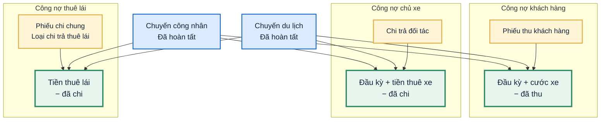

# Sổ tay tự học phiếu thu, công nợ và báo cáo chi tiết — Vũ Trung Đức

## 0. Đích đến

Đức phải tự tạo được chứng từ đúng, tự tính được ba loại công nợ, mở được chi tiết từng đối tượng và xuất Word. Mọi giải thích phải dựa trên chuyến xe công nhân/du lịch hoàn tất và chứng từ hiện có.

## 1. Bản đồ dòng tiền



Chỉ chuyến `completed` và còn hoạt động mới phát sinh công nợ. Ngày dùng cho chuyến là `actual_completed_at`, nếu dữ liệu cũ chưa có thì dùng `completed_at`.

## 2. Từ điển và công thức

| Công nợ | Phát sinh | Đã thanh toán | Số dư cuối |
| --- | --- | --- | --- |
| Khách hàng | `freight_amount` hai loại chuyến | phiếu thu khách hàng | đầu kỳ + phát sinh − đã thu |
| Chủ xe | `partner_vehicle_cost` hai loại chuyến | chi trả đối tác | đầu kỳ + phát sinh − đã chi |
| Thuê lái | `hired_driver_cost` hai loại chuyến | phiếu chi có tên lái thuê | phát sinh − đã chi |

Số dư đầu kỳ của khách hàng/chủ xe bao gồm số dư danh mục cộng phát sinh trước khoảng lọc trừ chứng từ trước khoảng lọc. Công nợ thuê lái không có số dư danh mục.

## 3. Phiếu thu khách hàng

Phiếu thu là chứng từ độc lập. Tạo từ tab **Phiếu thu** trong Tài chính và công nợ.

```json
POST /api/finance/receipts
{
  "customer_id": 1,
  "receipt_type": "other",
  "received_at": "2026-11-02",
  "amount": 1500000,
  "payment_method": "bank_transfer",
  "payer_name": "Công ty An Bình",
  "description": "Thanh toán cước tháng 11"
}
```

Các field bắt buộc: khách hàng, loại thu, ngày thu, số tiền không âm, phương thức. `payer_name` và diễn giải giúp đối soát. Khi khóa, chứng từ không sửa/xóa được; khi ngừng hoạt động, chứng từ không còn được tính vào công nợ.

## 4. Chi trả đối tác và chi thuê lái

### 4.1. Chi trả đối tác

`POST /api/finance/partner-payments` nhận đối tác, ngày chi, số tiền, phương thức, diễn giải. Nó làm giảm công nợ chủ xe, không phải giảm trực tiếp chi phí snapshot của một chuyến.

### 4.2. Chi thuê lái

Tạo tại **Phiếu chi chung**. Nếu loại chi phí có code/tên thể hiện thuê lái, phải có `hired_driver_name`. Khoản này làm giảm công nợ của chính tên lái thuê đó.

Đừng nhầm ba loại tiền:

- `hired_driver_cost` trên chuyến: nghĩa vụ chi phí đã chốt lúc vận hành.
- `partner_vehicle_cost` trên chuyến: nghĩa vụ thuê xe đối tác.
- `Expense.amount`: khoản tiền đã chi, dùng cho đối soát/chi phí theo ngày.

## 5. Đọc công nợ trên màn Tài chính

API Finance dùng ba endpoint độc lập:

| Tab | Endpoint | Response `metadata` |
| --- | --- | --- |
| Khách hàng | `/api/other/reports/customer-debts` | mảng `DebtRow[]` |
| Hãng vận tải | `/api/other/reports/partner-debts` | mảng `DebtRow[]` |
| Thuê lái | `/api/other/reports/external-driver-debts` | mảng `DebtRow[]` |

Đây là contract của tab Finance. Không đọc `.rows` từ response này. Nếu Network thành công nhưng giao diện báo `data is undefined`, kiểm tra service frontend có đang truy cập `.rows` sai hay không.

Các cột cần hiểu: `opening_balance`, `incurred_amount`, `received_amount`/`paid_amount`, `closing_balance`. Với công nợ khách hàng còn có `fixed_trip_amount` và `tourism_trip_amount` để nhìn nguồn phát sinh.

## 6. Báo cáo công nợ, drill-down và Word

Sidebar Báo cáo có hai trang riêng: Công nợ khách hàng và Công nợ chủ xe.

| Chức năng | Endpoint | Quyền |
| --- | --- | --- |
| Tổng hợp khách hàng | `/other/reports/customer-debt-summary` | `receipts.view` |
| Chi tiết khách hàng | `/other/reports/customer-debt-details` | `receipts.view` |
| Tổng hợp chủ xe | `/other/reports/partner-debt-summary` | `partner-payments.view` |
| Chi tiết chủ xe | `/other/reports/partner-debt-details` | `partner-payments.view` |

Report endpoint trả envelope: `filters`, `generated_at`, `totals`, `rows`. Chọn một dòng tổng hợp sẽ gửi `customer_id` hoặc `partner_id` để lấy sổ chi tiết. Thêm `format=docx` để tải Word tổng hợp hoặc Word chi tiết.

Một dòng chi tiết gồm ngày, số chứng từ, loại phát sinh, hành trình, biển số, giờ đón/về, Nợ, Có, số dư chạy và ghi chú. Dòng đầu kỳ là mốc tính, không phải một chứng từ mới.

## 7. Bảng lương lái xe trong Báo cáo

Trang Bảng lương lái xe dùng:

- `/other/reports/driver-payroll` để xem tổng hợp các `PayrollItem` theo kỳ/lái xe.
- `/other/reports/driver-payroll-details?payroll_id=...` để xem các `PayrollItemDetail`.

Chi tiết phải lần được nguồn bằng `worker_vehicle_id` hoặc `tourist_vehicle_id`, mã chuyến, ngày công, loại tính, cơ sở tính, tỷ lệ và số tiền. Chỉ attendance đã được xác nhận mới đi vào kỳ lương; báo cáo không tự tính lại lương từ đối soát thu/nộp/chi của chuyến du lịch.

## 8. Ví dụ tính tay công nợ khách hàng

Khách A có số dư đầu danh mục 2.000.000. Trước ngày 01/11 có thêm cước 500.000 và đã thu 200.000. Trong 01–02/11 có xe công nhân 1.800.000, xe du lịch 3.000.000, phiếu thu 1.000.000.

```text
opening_balance = 2.000.000 + 500.000 - 200.000 = 2.300.000
incurred_amount = 1.800.000 + 3.000.000 = 4.800.000
closing_balance = 2.300.000 + 4.800.000 - 1.000.000 = 6.100.000
```

Nếu số khác báo cáo, lần theo thứ tự: ngày hoàn thành thực tế → trạng thái completed → khách hàng trên chuyến → `is_active` → ngày và số tiền chứng từ.

## 9. Hướng dẫn thao tác trên website: chứng từ → công nợ → Word

### Kịch bản A — Ghi nhận một phiếu thu khách hàng

1. Sidebar → **Tài chính và nhân sự** → **Thu chi và công nợ**.
2. Tab mặc định là **Phiếu thu**. Nhấn nút thêm ở góc phải.
3. Chọn khách hàng từ danh mục, loại thu, ngày thu, số tiền và phương thức; bổ sung người nộp/diễn giải để sau này nhận diện chứng từ.
4. Nhấn lưu, sau đó dùng ô tìm kiếm của bảng để tìm mã phiếu thu. Mở menu thao tác để sửa khi chưa khóa hoặc khóa sau khi đã xác nhận số tiền.
5. Không thấy nút thêm/sửa nghĩa là thiếu `receipts.manage`; không xem được bảng nghĩa là thiếu `receipts.view`.

### Kịch bản B — Kiểm tra ba công nợ trên cùng một khoảng ngày

1. Trong Tài chính, chuyển tab **Công nợ**.
2. Chọn **Từ ngày** và **Đến ngày**, rồi nhấn **Cập nhật**. Luôn dùng cùng khoảng ngày khi đối chiếu ba tab.
3. Mở tab con **Khách hàng**, tìm khách vừa ghi phiếu thu và kiểm tra cột đã thu/dư cuối.
4. Mở **Hãng vận tải**, kiểm tra đối tác có xe đối tác đã hoàn thành hoặc đã có chi trả.
5. Mở **Thuê lái**, kiểm tra tên lái thuê có chi phí trên chuyến hoặc phiếu chi thuê lái.
6. Nếu một tab hiện lỗi tải dữ liệu, mở Network: API Finance trả mảng trực tiếp; giao diện phải dùng chính mảng đó để dựng DataGrid.

### Kịch bản C — Xem sổ chi tiết công nợ và xuất Word

1. Sidebar → **Báo cáo** → **Công nợ khách hàng** hoặc **Công nợ chủ xe**.
2. Chọn khoảng ngày, nhấn **Cập nhật**, dùng tìm kiếm/bộ lọc cột để tìm đối tượng.
3. Ở cột thao tác, nhấn **Xem chi tiết**. Bảng dưới xuất hiện các dòng phát sinh theo ngày và số dư chạy.
4. So tổng Nợ/Có/số dư cuối ở chi tiết với dòng tổng hợp phía trên.
5. Nhấn **Xuất Word** cho bảng tổng hợp; sau khi đã chọn dòng, nhấn **Xuất Word chi tiết** để tải sổ chi tiết đúng đối tượng.

### Kịch bản D — Truy một dòng lương về chuyến gốc

1. Sidebar → **Báo cáo** → **Bảng lương lái xe**, chọn khoảng ngày bao trùm kỳ lương và nhấn cập nhật.
2. Nhấn **Xem chi tiết** ở dòng kỳ lương. Đọc mã chuyến, ngày, loại tính, cơ sở tính, tỷ lệ và số tiền.
3. Nếu mã nguồn là công nhân, quay lại **Quản lý chạy xe** → **Xe chạy công nhân**; nếu là du lịch, mở **Xe chạy du lịch**. Tìm mã chuyến để đối chiếu biển số, lương snapshot và attendance.
4. Xuất Word tổng hợp hoặc chi tiết sau khi hoàn tất đối chiếu.

## 10. Bản đồ source và cách debug

| Mục tiêu | File nên mở |
| --- | --- |
| Form/tabs tài chính | `HALINHTRAVEL-CLIENT/src/modules/finance/FinancePage.vue` |
| Finance API client | `src/services/finance.service.ts` |
| Báo cáo/drill-down/export | `src/modules/reports/ReportsPage.vue`, `src/services/report.service.ts` |
| Công thức công nợ | `app/Modules/Other/Services/DebtReportService.php` |
| Mapping report/Word | `app/Modules/Other/Services/RestoredReportService.php`, `RestoredReportController.php` |

Luôn mở DevTools Network trước khi thao tác. Đọc method, URL, params, payload, status và `metadata`. 403 là quyền; 422 là field/kiểu dữ liệu không hợp lệ; 409 thường là chứng từ đã khóa.

## 11. Sáu lab bắt buộc

1. Tạo phiếu thu, khóa nó, thử sửa và giải thích 409.
2. Tạo chi trả đối tác, kiểm tra công nợ chủ xe thay đổi.
3. Tạo chi thuê lái thiếu tên rồi sửa payload đúng.
4. Tính tay một dòng công nợ khách hàng và kiểm tra báo cáo.
5. Mở drill-down khách hàng/chủ xe, đối chiếu số dư chạy với tổng hợp, xuất Word.
6. Mở bảng lương, truy một detail về đúng `worker_vehicle_id` hoặc `tourist_vehicle_id`.

## 12. Lộ trình 3 ngày và câu hỏi bảo vệ

- **Ngày 1:** phiếu thu, chi trả đối tác, phiếu chi chung, lab 1–3.
- **Ngày 2:** ba công thức công nợ, Network và lab 4.
- **Ngày 3:** report envelope, drill-down, Word export, payroll source và lab 5–6.

Câu hỏi phải trả lời được: Vì sao tab Finance không dùng `.rows`? Vì sao chỉ chuyến hoàn tất vào công nợ? Khác nhau giữa khoản phải trả trên chuyến và chứng từ đã chi là gì? Vì sao chi tiết lương phải giữ cả hai khóa nguồn chuyến?
