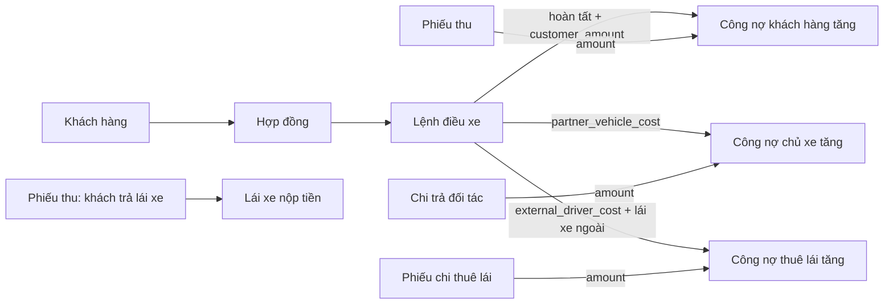
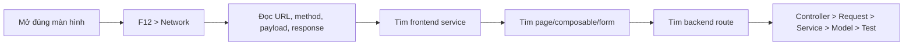
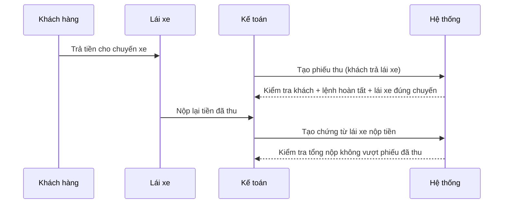
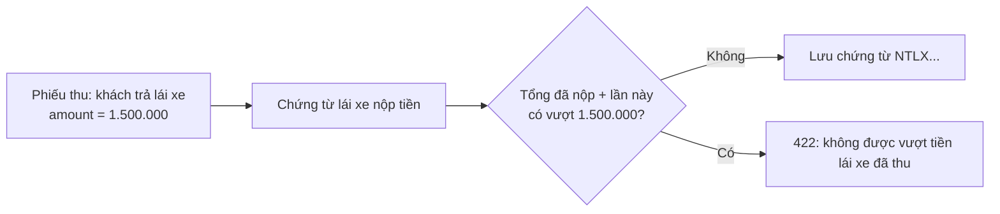
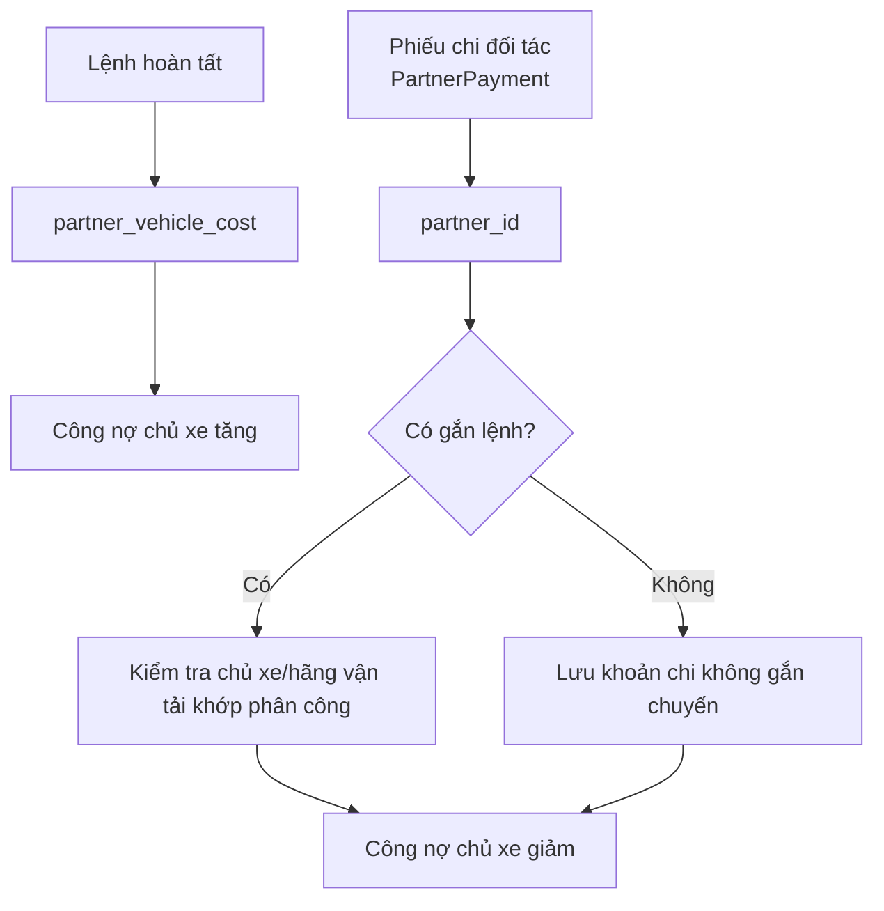
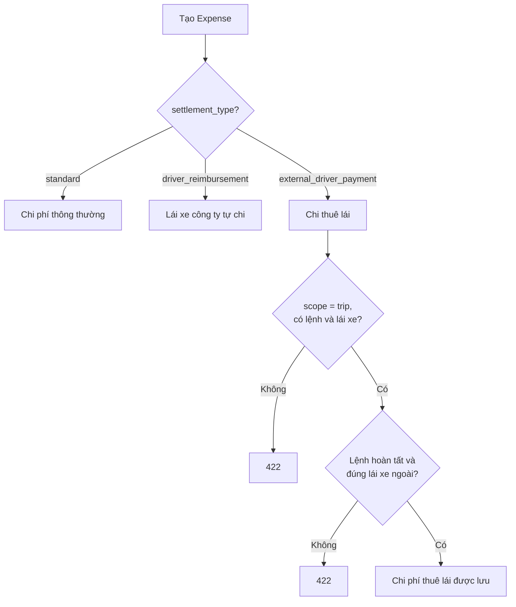
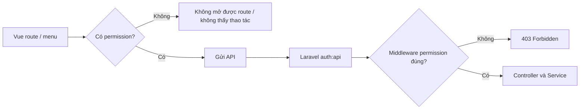

# Sổ tay tự học quy trình nghiệp vụ và lần code — Vũ Trung Đức

> **Phạm vi phụ trách:** thu tiền khách hàng; chi trả chủ xe; chi trả thuê lái xe; báo cáo công nợ phải thu khách hàng; công nợ phải trả chủ xe; công nợ phải trả thuê lái xe.
>
> **Dành cho người chưa biết gì:** chưa cần biết Vue, Laravel hay HTTP. Hãy làm theo đúng thứ tự, không học thuộc tên file. Mỗi lần gặp số liệu, nhiệm vụ của bạn là trả lời được: “Số này từ chứng từ nào, điều kiện nào, và được tính bằng hàm nào?”
>
> **An toàn:** toàn bộ thao tác tạo/sửa/xóa/khóa chứng từ chỉ được thực hiện trên môi trường phát triển. Không chạy migration, seeder, hay thử dữ liệu trên môi trường thật khi chưa được phép.

---

## 0. Đích đến sau khi học xong

Bạn hoàn thành sổ tay khi tự mình làm được sáu việc sau, không cần người khác chỉ file:

1. Từ màn hình **Tài chính và công nợ**, mở DevTools và lần được request tạo phiếu thu.
2. Phân biệt chính xác khách trả công ty với khách trả trực tiếp cho lái xe; biết vì sao trường hợp thứ hai phải có lệnh điều xe và lái xe.
3. Giải thích chi trả chủ xe và chi thuê lái là hai chứng từ/nguồn công nợ khác nhau.
4. Tính tay số dư cuối kỳ công nợ của một khách hàng, một chủ xe và một lái xe thuê.
5. Lần được đường đi `Vue page → composable → API service → Laravel route → controller → request → service → model`.
6. Đọc được một lỗi `403`, `409`, `422` hoặc `500` và khoanh đúng phía cần kiểm tra.

---

## 1. Từ điển nghiệp vụ trước khi đọc code

Đừng mở code ngay. Đọc bảng này đến khi phân biệt được các khái niệm bằng lời của chính mình.

| Khái niệm | Nói đơn giản | Chứng từ / dữ liệu ghi nhận | Ảnh hưởng chính |
| --- | --- | --- | --- |
| Phiếu thu | Công ty ghi nhận đã nhận tiền từ khách | `Receipt` | Giảm công nợ phải thu khách hàng |
| Khách trả công ty | Khách nộp tiền trực tiếp cho công ty | Phiếu thu có `settlement_type = standard` | Giảm công nợ khách hàng; xuất hiện là khoản thu trong báo cáo thu chi |
| Khách trả lái xe | Khách đưa tiền cho lái xe đang chạy chuyến | Phiếu thu có `settlement_type = driver_direct_collection` | Giảm công nợ khách hàng, đồng thời phải theo dõi lái xe nộp lại tiền |
| Lái xe nộp tiền | Lái xe nộp lại phần tiền đã thu hộ khách | `DriverCashRemittance` | Đối chiếu với phiếu khách trả trực tiếp; là dòng tiền công ty nhận từ lái xe |
| Chi trả chủ xe | Công ty trả tiền cho chủ xe/hãng vận tải | `PartnerPayment` | Giảm công nợ phải trả chủ xe |
| Chi thuê lái | Công ty trả chi phí cho lái xe ngoài | `Expense` có `settlement_type = external_driver_payment` | Giảm công nợ phải trả thuê lái |
| Lệnh điều xe hoàn tất | Chuyến đã hoàn tất và được xác nhận số tiền | `DispatchOrder` có `status = completed` | Là nguồn phát sinh doanh thu khách hàng, chi phí chủ xe hoặc chi phí thuê lái |
| Công nợ đầu kỳ | Khoản còn nợ trước ngày bắt đầu lọc | `opening_balance` của khách/chủ xe, cộng trừ các phát sinh trước kỳ | Điểm xuất phát để tính kỳ báo cáo |
| Phát sinh | Khoản nợ mới trong khoảng ngày đang xem | Lệnh điều xe hoàn tất | Làm tăng công nợ |
| Đã thu / đã trả | Khoản tiền đã nhận từ khách / đã chi cho bên phải trả | Phiếu thu / phiếu chi | Làm giảm công nợ |
| Khóa chứng từ | Chốt chứng từ không cho sửa hoặc ngừng hoạt động | `is_locked = true` | Bảo vệ số liệu đã đối soát |
| Ngừng hoạt động | Loại chứng từ khỏi danh sách nghiệp vụ đang hoạt động | `is_active = false` | Không còn được tính trong các báo cáo này |

### 1.1. Ba công nợ là ba bài toán riêng

| Báo cáo | Ai đang nợ ai? | Phát sinh nợ từ đâu? | Giảm nợ bởi đâu? |
| --- | --- | --- | --- |
| Công nợ khách hàng | Khách hàng nợ công ty | `customer_amount` của lệnh hoàn tất | `Receipt.amount` của khách đó |
| Công nợ chủ xe | Công ty nợ chủ xe/hãng vận tải | `partner_vehicle_cost` của lệnh hoàn tất | `PartnerPayment.amount` cho chủ xe đó |
| Công nợ thuê lái | Công ty nợ lái xe ngoài | `external_driver_cost` của lệnh hoàn tất, khi lái xe thuộc loại ngoài | `Expense.amount` có quyết toán `external_driver_payment` cho lái xe đó |

**Lỗi tư duy hay gặp:**

- Phiếu thu khách trả trực tiếp cho lái xe vẫn **giảm nợ khách hàng**. Việc lái xe chưa nộp lại tiền là một bài toán tiền mặt/đối soát lái xe, không làm khách hàng tự nhiên còn nợ.
- Chi trả chủ xe không được dùng để trả cho lái xe thuê. Chủ xe dùng `PartnerPayment`; lái xe thuê dùng `Expense` với loại quyết toán riêng.
- Chỉ lệnh điều xe **hoàn tất**, còn hoạt động mới sinh doanh thu/chi phí vào ba báo cáo công nợ.

---

## 2. Bản đồ workspace: tôi đang đứng ở đâu?

Mở hai thư mục bằng VS Code (có thể mở hai cửa sổ riêng):

| Gốc | Vai trò | Khi tự học nghiệp vụ Đức, mở ở đâu? |
| --- | --- | --- |
| `D:\vue\halinhtravel-client` | Frontend Vue: thứ người dùng bấm và nhìn thấy | `src/modules/finance`, `src/modules/reports`, `src/services` |
| `D:\Laravel\halinhtravel-api` | Backend Laravel: kiểm tra dữ liệu và tính nghiệp vụ | `app/Modules/Finance`, `app/Modules/Other`, `app/Modules/Dispatch`, `tests/Feature` |

### 2.1. Bản đồ từng lớp code

| Tôi đang tìm gì? | Frontend | Backend | Dấu hiệu đã tìm đúng |
| --- | --- | --- | --- |
| Trang người dùng mở | `src/modules/finance/FinancePage.vue` | — | Có tiêu đề **Tài chính và công nợ**, các tab Phiếu thu/Chi trả đối tác/Lái xe nộp tiền/Công nợ nhanh |
| Hộp nhập chứng từ | `components/FinancialDocumentDialog.vue`, `DriverCashRemittanceDialog.vue` | — | Có form, nút Lưu và các trường nhập |
| Nơi lấy/gửi API | `src/services/finance.service.ts` | — | Có `httpService.get/post/patch/delete` |
| Cầu nối dữ liệu màn hình | `finance.composables.ts` | — | Có `useQuery`, `useMutation`, `invalidateQueries` |
| Đường dẫn web frontend | `finance.route.ts`, `report.route.ts` | — | Có `path`, `name`, `meta.permission` |
| Cổng API | — | `app/Modules/Finance/Routes/index.php`, `app/Modules/Other/Routes/index.php` | Có `Route::get/post/...` và middleware permission |
| Nhận request | — | `Controllers/ReceiptController.php`, `PartnerPaymentController.php`, `DriverCashRemittanceController.php`, `Other/Controllers/ReportController.php` | Hàm `store`, `update`, `lock` hoặc hàm báo cáo |
| Kiểm tra dữ liệu nhập | — | `Requests/ReceiptRequest.php`, `PartnerPaymentRequest.php`, `DriverCashRemittanceRequest.php`, `Other/Requests/ReportRequest.php` | Hàm `rules()` |
| Luật nghiệp vụ thật | — | `Finance/Services/FinanceService.php`, `Other/Services/DebtReportService.php` | Các hàm `validate...`, `customerDebts`, `partnerDebts`, `externalDriverDebts` |
| Dữ liệu/quan hệ | — | `Models/Receipt.php`, `PartnerPayment.php`, `DriverCashRemittance.php`, `Dispatch/Models/DispatchOrder.php` | `$fillable`, `casts()`, quan hệ `belongsTo` |
| Bằng chứng tự động | — | `tests/Feature/Finance/FinanceApiTest.php` | Test tạo/khóa phiếu thu, kiểm tra lỗi 422 |

### 2.2. Sơ đồ lớn: một chuyến đi tới công nợ



Đọc mũi tên như một câu tiếng Việt: “Lệnh hoàn tất, có `customer_amount`, làm công nợ khách hàng tăng.”

---

## 3. Quy trình lần code chuẩn: luôn đi theo 7 bước

Học thuộc **quy trình**, không học thuộc file. Quy trình này dùng được cho mọi màn hình.



### Bước 1 — Mở đúng màn hình và mô tả việc mình sắp làm

Ví dụ với tạo phiếu thu: mở **Tài chính và nhân sự → Thu chi và công nợ → Phiếu thu → Tạo phiếu thu**.

Trước khi bấm lưu, viết vào sổ:

```text
Tôi muốn hệ thống ghi nhận khách A trả 2.000.000 đồng.
Tôi dự đoán: frontend sẽ gửi POST; backend sẽ tạo phiếu thu;
công nợ khách A sẽ giảm khi xem báo cáo.
```

### Bước 2 — Mở DevTools Network trước khi thao tác

1. Nhấn `F12`.
2. Chọn tab **Network**.
3. Tích **Preserve log** nếu có để không mất request khi trang đổi.
4. Chọn bộ lọc **Fetch/XHR**.
5. Nhấn biểu tượng xóa danh sách request.
6. Thực hiện **một** thao tác: mở trang, nhấn Lưu, Khóa, hay Cập nhật báo cáo.

### Bước 3 — Đọc request như một biên bản

Chọn request vừa xuất hiện, nhìn lần lượt:

| Vị trí trong DevTools | Câu phải trả lời |
| --- | --- |
| `Headers → Request URL` | API nào đang được gọi? |
| `Headers → Request Method` | Đọc/lưu/sửa/xóa? (`GET`/`POST`/`PATCH`/`DELETE`) |
| `Payload` | Form đã gửi những trường nào? ID nào? |
| `Status Code` | Thành công hay lỗi? |
| `Response/Preview` | Backend trả lại số chứng từ, số tiền, trạng thái gì? |

### Bước 4 — Từ URL, tìm frontend API service

Ví dụ Network hiện:

```text
POST /api/finance/receipts
```

Trong frontend, nhấn `Ctrl+Shift+F`, tìm đúng phần cuối URL: `finance/receipts`. Kết quả cần đến là:

```ts
// src/services/finance.service.ts
static createReceipt(payload: ReceiptPayload) {
  return httpService.post<Receipt, ReceiptPayload>(`${financeUrl}/receipts`, payload)
}
```

Đừng tìm `POST` chung chung. Tìm chuỗi đặc trưng nhất trong Network sẽ nhanh hơn.

### Bước 5 — Lần ngược về page, form và composable

Tại `finance.service.ts`, tìm `createReceipt`. Bạn sẽ thấy:

```text
FinanceService.createReceipt
    ← useFinanceMutations().createReceipt
    ← FinancePage.vue / hàm save()
    ← FinancialDocumentDialog.vue / emit('save', payload)
```

Mẹo VS Code:

| Phím tắt | Làm gì | Dùng lúc nào |
| --- | --- | --- |
| `Ctrl+Shift+F` | Tìm trong toàn bộ source | Biết chuỗi/endpoint/hàm nhưng không biết file |
| `Ctrl+F` | Tìm trong file đang mở | Đã vào đúng file |
| `F12` | Go to Definition | Đang đứng trên tên hàm/type/import |
| `Alt+F12` | Peek Definition | Xem nhanh mà không rời file |
| `Shift+F12` | Find All References | Muốn biết hàm đang được gọi từ đâu |
| `Ctrl+P` | Mở file theo tên | Đã biết gần đúng tên file |

### Bước 6 — Từ URL, tìm route backend

Với `/api/finance/receipts`, trong backend tìm `/receipts` tại `app/Modules/Finance/Routes/index.php`:

```php
Route::middleware(['auth:api', 'permission:'.PermissionEnum::RECEIPTS_MANAGE->value])
    ->group(function (): void {
        Route::post('/receipts', [ReceiptController::class, 'store']);
    });
```

Đọc thành lời:

1. Phải đăng nhập (`auth:api`).
2. Phải có quyền `receipts.manage`.
3. Khi gửi POST `/finance/receipts`, Laravel gọi `ReceiptController::store()`.

### Bước 7 — Đi hết controller → request → service → model → test

Với phiếu thu, thứ tự đọc đúng là:

```text
ReceiptController::store()
  → ReceiptRequest::validated()
  → FinanceService::createReceipt()
  → FinanceService::validateReceipt()
  → Receipt::create()
  → FinanceService::receiptData()
  → tests/Feature/Finance/FinanceApiTest.php
```

Không nhảy thẳng vào model rồi đoán nghiệp vụ. **Nghiệp vụ nằm chủ yếu trong Service.**

---

## 4. Luồng 1 — Thu tiền khách hàng

### 4.1. Có hai cách thu, không được nhầm

| Cách thu | `settlement_type` | Lái xe có bắt buộc không? | Lệnh điều xe có bắt buộc không? | Ý nghĩa |
| --- | --- | --- | --- | --- |
| Khách nộp công ty | `standard` | Không | Không, trừ khi muốn liên kết chuyến | Công ty nhận tiền trực tiếp |
| Khách trả trực tiếp cho lái xe | `driver_direct_collection` | Có | Có | Lái xe thu hộ tiền của khách trong một chuyến đã hoàn tất |

### 4.2. Luồng nghiệp vụ bằng hình



### 4.3. Những dữ liệu cần có khi tạo phiếu thu

| Trường trên form/API | Ý nghĩa | Bắt buộc khi nào? | Backend kiểm tra ở đâu? |
| --- | --- | --- | --- |
| `customer_id` | Khách đã trả tiền | Luôn bắt buộc | `ReceiptRequest`, `validateReceipt()` |
| `receipt_type` | `deposit`, `contract_payment`, hoặc `other` | Luôn bắt buộc | `ReceiptRequest` |
| `received_at` | Ngày/giờ thu | Luôn bắt buộc | `ReceiptRequest` |
| `amount` | Số tiền thu | Luôn bắt buộc, không âm | `ReceiptRequest` |
| `payment_method` | `cash` hoặc `bank_transfer` | Luôn bắt buộc | `ReceiptRequest` |
| `contract_id` | Hợp đồng liên quan | Bắt buộc với `deposit` / `contract_payment` | `validateReceipt()` |
| `settlement_type` | Thu công ty hay lái xe thu hộ | Không gửi thì mặc định `standard` | `validateReceipt()` |
| `dispatch_order_id` | Lệnh điều xe | Bắt buộc khi khách trả lái xe | `validateReceipt()` |
| `driver_id` | Lái xe thu hộ | Bắt buộc khi khách trả lái xe | `validateReceipt()` |

### 4.4. Bài mẫu: tạo phiếu khách trả công ty

**Tình huống:** Hợp đồng `HD...` của khách A trị giá 10.000.000. Khách chuyển khoản 3.000.000.

Trong DevTools bạn kỳ vọng thấy:

```http
POST /api/finance/receipts
Authorization: Bearer <token>
Content-Type: application/json

{
  "customer_id": 12,
  "contract_id": 31,
  "receipt_type": "contract_payment",
  "settlement_type": "standard",
  "received_at": "2026-10-20",
  "amount": "3000000",
  "payment_method": "bank_transfer",
  "payer_name": "Công ty Khách A",
  "description": "Thanh toán đợt 1"
}
```

Mô phỏng phần dữ liệu trả về thành công (tên bọc phản hồi có thể xem trực tiếp tại Network; hãy quan tâm các trường dưới):

```json
{
  "receipt_no": "PT202600001",
  "receipt_type": "contract_payment",
  "settlement_type": "standard",
  "amount": "3000000.00",
  "contract_total": "10000000.00",
  "received_total": "3000000.00",
  "outstanding_amount": "7000000.00",
  "is_locked": false,
  "is_active": true
}
```

**Ba câu tự kiểm:**

1. `outstanding_amount` ở đây là phần còn phải thu của **hợp đồng**, không thay thế bảng công nợ theo kỳ.
2. Nếu tổng tất cả phiếu thu đang hoạt động của hợp đồng vượt 10.000.000, request bị `422`.
3. Nếu khóa phiếu, không thể sửa hoặc ngừng hoạt động nữa; backend trả `409` khi cố làm vậy.

### 4.5. Bài mẫu: khách trả trực tiếp cho lái xe

**Điều kiện bắt buộc trước khi tạo:**

1. Lệnh điều xe đang hoạt động và đã `completed`.
2. Lệnh thuộc đúng khách hàng đã chọn.
3. Lái xe chọn trên phiếu chính là lái xe được phân công cho lệnh.
4. Nếu chọn hợp đồng, hợp đồng phải khớp hợp đồng của lệnh.

Payload có điểm khác biệt:

```json
{
  "customer_id": 12,
  "receipt_type": "other",
  "settlement_type": "driver_direct_collection",
  "dispatch_order_id": 81,
  "driver_id": 22,
  "received_at": "2026-10-20",
  "amount": "1500000",
  "payment_method": "cash"
}
```

Vì sao form tự đổi loại thu thành `other` nếu bạn chọn quyết toán qua lái xe mà chưa gắn hợp đồng? Xem `FinancialDocumentDialog.vue`, hàm `syncSettlementReferences()`. Đây là **hỗ trợ giao diện**; luật bắt buộc vẫn nằm trong `FinanceService::validateReceipt()`.

### 4.6. Lái xe nộp lại tiền: không tạo phiếu thu thứ hai

Khi khách đã trả lái xe, **không tạo thêm một phiếu thu khách hàng**. Hãy tạo chứng từ **Lái xe nộp tiền** và chọn chính phiếu khách trả trực tiếp ban đầu.



Ví dụ payload:

```http
POST /api/finance/driver-cash-remittances

{
  "receipt_id": 105,
  "dispatch_order_id": 81,
  "driver_id": 22,
  "remitted_at": "2026-10-21",
  "amount": "1000000",
  "payment_method": "cash",
  "description": "Nộp đợt 1 tiền khách trả trực tiếp"
}
```

Backend ở `FinanceService::validateDriverCashRemittance()` kiểm tra bốn điều:

1. `receipt_id` phải là phiếu thu còn hoạt động và có `driver_direct_collection`.
2. `dispatch_order_id` và `driver_id` trên chứng từ nộp phải khớp với phiếu thu đã chọn.
3. Tổng các lần nộp tiền đang hoạt động không được vượt `Receipt.amount`.
4. Không được ghi nhận ngày nộp nằm trong kỳ lương đã khóa.

### 4.7. Code ngắn cần hiểu: từ form đến backend

```ts
// FinancialDocumentDialog.vue (rút gọn)
emit('save', {
  customer_id: form.customer_id,                 // (1)
  settlement_type: form.settlement_type,         // (2)
  dispatch_order_id: form.dispatch_order_id || null, // (3)
  driver_id: requiresDriverSettlement.value ? form.driver_id : null, // (4)
  received_at: form.date,
  amount: String(form.amount),
})
```

1. Form không gửi tên khách; gửi ID để backend tự kiểm tra bản ghi thật.
2. Đây là lựa chọn xác định “khách trả công ty” hay “khách trả lái xe”.
3. Với thu công ty, lệnh có thể để trống; với thu qua lái xe, backend bắt buộc có.
4. Không phải khách trả qua lái xe thì frontend gửi `null`; backend còn kiểm tra lại để không tin hoàn toàn frontend.

```php
// FinanceService::validateReceipt() (rút gọn)
if ($settlement === ReceiptSettlementTypeEnum::DRIVER_DIRECT_COLLECTION) {
    if (empty($data['dispatch_order_id']) || empty($data['driver_id'])) { // (1)
        abort(422, 'Thu khách trả trực tiếp yêu cầu lệnh điều xe và lái xe.');
    }
    if ($order->status !== DispatchOrderStatusEnum::COMPLETED) { // (2)
        abort(422, 'Chỉ lệnh điều xe đã hoàn tất ...');
    }
    if ((int) $order->tripAssignment?->driver_id !== (int) $data['driver_id']) { // (3)
        abort(422, 'Khách hàng hoặc lái xe không khớp với lệnh điều xe.');
    }
}
```

1. Thiếu ID liên kết là sai quy tắc nghiệp vụ, không chỉ sai form.
2. Không lấy tiền của một chuyến chưa hoàn tất để đối soát.
3. Không cho chọn tùy tiện một lái xe khác để số liệu tiền/lương lệch.

---

## 5. Luồng 2 — Chi trả chủ xe / hãng vận tải

### 5.1. Khi nào dùng “Chi trả đối tác”?

Dùng khi công ty phải trả cho đối tác đã cung cấp xe/chuyến. Màn hình gọi là **Chi trả đối tác**, dữ liệu backend là `PartnerPayment`, endpoint là `/api/finance/partner-payments`.

Đây không phải “chi phí chung”. Nó có quan hệ với **chủ xe/hãng vận tải** và có thể gắn với một lệnh điều xe cụ thể.

### 5.2. Quy tắc quan trọng nhất

Nếu có nhập `dispatch_order_id`, đối tác chọn trên phiếu chi phải khớp đối tác trên phân công lệnh:

```text
lệnh điều xe
  → trip assignment
  → partner_id (nếu có)
  hoặc vehicle.partner_id
  → phải bằng partner_id đang chi trả
```

Nếu không khớp, backend trả `409` với thông điệp đối tác không khớp phân công của lệnh điều xe.

### 5.3. Luồng dữ liệu



### 5.4. Payload cần biết

```http
POST /api/finance/partner-payments

{
  "partner_id": 7,
  "dispatch_order_id": 81,
  "paid_at": "2026-10-22",
  "amount": "2500000",
  "payment_method": "bank_transfer",
  "description": "Thanh toán chuyến ngày 20/10"
}
```

| Trường | Có bắt buộc? | Ghi nhớ |
| --- | --- | --- |
| `partner_id` | Có | Phải là đối tác đang hoạt động |
| `dispatch_order_id` | Không | Nếu có thì đối tác phải đúng với phân công lệnh |
| `paid_at` | Có | Là ngày báo cáo lấy để tính “đã trả” |
| `amount` | Có, không âm | Làm giảm công nợ chủ xe |
| `payment_method` | Có | `cash` hoặc `bank_transfer` |
| `description` | Không | Diễn giải chứng từ |

### 5.5. Đọc code theo đúng đường

```text
FinancePage.vue
  tab payments
  → FinancialDocumentDialog.vue (kind = partner-payment)
  → FinancePage.vue / save()
  → useFinanceMutations().createPartnerPayment
  → FinanceService.createPartnerPayment()
  → POST /api/finance/partner-payments
  → Finance/Routes/index.php
  → PartnerPaymentController::store()
  → PartnerPaymentRequest
  → FinanceService::createPartnerPayment()
  → FinanceService::validatePartnerPayment()
  → PartnerPayment::create()
```

**Bài tự hỏi:** ở đoạn nào hệ thống sinh mã `CTDT...`? Trả lời: trong `FinanceService::createPartnerPayment()`, gọi `nextCode(..., 'CTDT')`; form không tự sinh mã.

---

## 6. Luồng 3 — Chi trả thuê lái xe

### 6.1. Vì sao chi thuê lái không dùng Chi trả đối tác?

Một khoản chi thuê lái là chi phí gắn với **lái xe ngoài**, không phải `PartnerPayment`. Source dùng:

```text
Expense
settlement_type = external_driver_payment
scope = trip
dispatch_order_id + driver_id
```

Nó được tạo trong tab **Chi phí chung** nhưng thực chất có quy tắc quyết toán chuyến. Tên tab không quyết định nghiệp vụ; các trường gửi đi mới quyết định.

### 6.2. Điều kiện ghi nhận chi thuê lái

Trong `FinanceService::validateExpense()`:

1. Chi phí phải có loại chi phí đang hoạt động, và `scope` gửi lên phải khớp scope của loại đó.
2. Với `external_driver_payment`, bắt buộc là `scope = trip`, có lệnh điều xe và lái xe.
3. Lệnh phải hoàn tất và lái xe phải đúng lái xe được phân công cho lệnh.
4. Lái xe phải thuộc loại `partner` (lái xe ngoài), không phải lái xe công ty.

### 6.3. Sơ đồ quyết định



### 6.4. Ví dụ request

```http
POST /api/finance/expenses

{
  "expense_type_id": 5,
  "scope": "trip",
  "dispatch_order_id": 81,
  "driver_id": 45,
  "expense_date": "2026-10-22",
  "amount": "900000",
  "payment_method": "cash",
  "settlement_type": "external_driver_payment",
  "document_no": "PC-TL-001",
  "description": "Chi tiền công lái xe thuê chuyến 81"
}
```

**Đừng quên:** `expense_type_id` phải là loại chi phí có scope `trip`; nếu chọn loại scope `vehicle` hoặc `general` rồi gửi `trip`, backend trả `422` “Phạm vi chi phí phải khớp với phạm vi của loại chi phí.”

### 6.5. Đường code phải lần được

```text
FinancePage.vue (tab expenses)
  → FinancialDocumentDialog.vue
  → FinanceService.createExpense()
  → POST /api/finance/expenses
  → ExpenseController::store()
  → ExpenseRequest
  → FinanceService::createExpense()
  → FinanceService::validateExpense()
  → Expense::create()
  → DebtReportService::externalDriverDebts()
```

---

## 7. Công nợ: công thức phải tự tính tay được

### 7.1. Công thức chung

```text
Số dư cuối kỳ = Số dư đầu kỳ + Phát sinh trong kỳ − Đã thu / đã trả trong kỳ
```

Tất cả ba báo cáo đều theo khuôn này; chỉ thay nguồn **phát sinh** và **đã thu/đã trả**.

### 7.2. Công nợ khách hàng

```text
Số dư đầu kỳ
  = opening_balance của khách
  + tổng customer_amount của lệnh hoàn tất trước from_date
  − tổng phiếu thu đang hoạt động trước from_date

Phát sinh kỳ
  = tổng customer_amount của lệnh hoàn tất trong [from_date, to_date]

Đã thu kỳ
  = tổng Receipt.amount đang hoạt động của khách trong [from_date, to_date]

Số dư cuối kỳ = đầu kỳ + phát sinh − đã thu
```

**Ví dụ tay:**

| Thành phần | Số tiền |
| --- | ---: |
| Công nợ đầu kỳ khai báo | 1.000.000 |
| Lệnh hoàn tất trước kỳ | 2.000.000 |
| Phiếu thu trước kỳ | 500.000 |
| Đầu kỳ thực tế | 2.500.000 |
| Lệnh hoàn tất trong kỳ | 4.000.000 |
| Phiếu thu trong kỳ (kể cả khách trả lái xe) | 3.000.000 |
| **Cuối kỳ** | **3.500.000** |

Tính: `1.000.000 + 2.000.000 − 500.000 + 4.000.000 − 3.000.000 = 3.500.000`.

**Chỗ code:** `DebtReportService::customerDebts()`.

### 7.3. Công nợ chủ xe

```text
Đầu kỳ
  = opening_balance của chủ xe
  + partner_vehicle_cost của lệnh hoàn tất trước kỳ
  − PartnerPayment.amount trước kỳ

Phát sinh = partner_vehicle_cost của lệnh hoàn tất trong kỳ
Đã trả = PartnerPayment.amount trong kỳ
Cuối kỳ = đầu kỳ + phát sinh − đã trả
```

Chỉ một đối tác được đưa vào công nợ của lệnh khi hàm `carrierPartnerId()` tìm được `tripAssignment.partner_id`; nếu không có, nó dùng `tripAssignment.vehicle.partner_id`.

### 7.4. Công nợ thuê lái

```text
Đầu kỳ = chi thuê lái của lệnh hoàn tất trước kỳ − phiếu chi thuê lái trước kỳ
Phát sinh = external_driver_cost của lệnh hoàn tất trong kỳ
Đã trả = Expense.amount có settlement_type = external_driver_payment trong kỳ
Cuối kỳ = đầu kỳ + phát sinh − đã trả
```

Chỉ xét lái xe có loại `partner` và lệnh có `external_driver_cost > 0`.

### 7.5. Khung response công nợ — cần đọc được từng cột

```json
{
  "filters": { "from_date": "2026-10-01", "to_date": "2026-10-31" },
  "generated_at": "2026-10-31T...",
  "rows": [
    {
      "customer_id": 12,
      "code": "KH001",
      "name": "Khách A",
      "opening_balance": "2500000.00",
      "incurred_amount": "4000000.00",
      "received_amount": "3000000.00",
      "closing_balance": "3500000.00"
    }
  ]
}
```

Không hỏi “con số đúng không?” một cách chung chung. Hỏi theo cách kiểm tra được:

```text
opening_balance đã gồm những lệnh/phiếu nào trước 01/10?
incurred_amount lấy những lệnh completed nào từ 01/10 đến 31/10?
received_amount có phiếu nào is_active = false bị loại không?
```

---

## 8. Từ màn hình báo cáo lần ra đúng code

### 8.1. Báo cáo nằm ở hai nơi

| Muốn xem | Nơi trên giao diện | Endpoint | Permission backend |
| --- | --- | --- | --- |
| Công nợ khách hàng | Báo cáo → Công nợ khách hàng; hoặc Tài chính → Công nợ nhanh → Khách hàng | `GET /api/other/reports/customer-debts` | `receipts.view` |
| Chi tiết công nợ khách hàng | Chọn dòng khách trên trang báo cáo rồi xem/xuất chi tiết | `GET /api/other/reports/customer-debt-details` | `receipts.view` |
| Công nợ chủ xe | Báo cáo → Công nợ chủ xe; hoặc Tài chính → Công nợ nhanh → Hãng vận tải | `GET /api/other/reports/partner-debts` | `partner-payments.view` |
| Chi tiết công nợ chủ xe | Chọn dòng chủ xe trên trang báo cáo rồi xem/xuất chi tiết | `GET /api/other/reports/partner-debt-details` | `partner-payments.view` |
| Công nợ thuê lái | Tài chính → Công nợ nhanh → Thuê lái | `GET /api/other/reports/external-driver-debts` | `expenses.view` |

### 8.2. Bài mẫu truy vết công nợ khách hàng từ DevTools

1. Mở **Báo cáo → Công nợ khách hàng** hoặc **Tài chính → Công nợ nhanh → Khách hàng**.
2. Chọn Từ ngày, Đến ngày; nhấn **Cập nhật** nếu ở Công nợ nhanh.
3. Trong Network, tìm request:

```text
GET /api/other/reports/customer-debts?from_date=2026-10-01&to_date=2026-10-31
```

4. Tìm `customer-debts` trong frontend. Có hai đường giao diện:

```text
FinancePage.vue
  → useCustomerDebtsQuery()
  → FinanceService.getCustomerDebts()
  → GET /other/reports/customer-debts

ReportsPage.vue
  → ReportService.get('customer-debts', filters)
  → GET /other/reports/customer-debts
```

5. Sang backend, mở `app/Modules/Other/Routes/index.php`, tìm `customer-debts`.
6. Theo `ReportController::customerDebts()` đến `DebtReportService::customerDebts()`.
7. Đặt breakpoint hoặc chỉ đọc các biến: `$customerOrders`, `$customerReceipts`, `$opening`, `$incurred`, `$received`.

### 8.3. Code excerpt: công thức thật của customer debt

```php
// DebtReportService::customerDebts() (rút gọn)
$customerOrders = $orders->filter(/* lệnh thuộc khách này */);        // (1)
$customerReceipts = $receipts->where('customer_id', $customer->id);   // (2)
$opening = (float) $customer->opening_balance                          // (3)
    + $this->sumBefore($customerOrders, 'customer_amount', 'completed_at', $fromDate)
    - $this->sumBefore($customerReceipts, 'amount', 'received_at', $fromDate);
$incurred = $this->sumInPeriod($customerOrders, 'customer_amount', 'completed_at', $fromDate, $toDate); // (4)
$received = $this->sumInPeriod($customerReceipts, 'amount', 'received_at', $fromDate, $toDate);          // (5)
$closing = $opening + $incurred - $received;                         // (6)
```

1. `$orders` ban đầu chỉ gồm lệnh đang hoạt động và đã hoàn tất.
2. `$receipts` ban đầu chỉ gồm phiếu thu đang hoạt động.
3. Đầu kỳ không chỉ là số nhập ở danh mục khách: nó cộng/trừ lịch sử trước kỳ.
4. Lệnh hoàn tất làm khách nợ công ty nhiều hơn.
5. Tất cả loại phiếu thu đang hoạt động của khách đều giảm số phải thu, kể cả khách trả qua lái xe.
6. Đây là công thức cuối cùng của từng hàng báo cáo.

### 8.4. Chi tiết công nợ là sổ cái, không phải bảng tổng hợp

Khi xem chi tiết khách/chủ xe, service tạo hai loại dòng:

| Báo cáo chi tiết | Dòng Nợ (`debit`) | Dòng Có (`credit`) |
| --- | --- | --- |
| Khách hàng | Lệnh hoàn tất: `customer_amount` | Phiếu thu: `amount` |
| Chủ xe | Lệnh hoàn tất: `partner_vehicle_cost` | Chi trả đối tác: `amount` |

Sau đó dữ liệu được sắp theo ngày và chạy số dư lũy kế:

```text
balance mới = balance trước + debit − credit
```

---

## 9. Phân quyền: màn hình chặn một lần, API chặn một lần nữa

### 9.1. Quyền cần biết

| Việc | Đọc/xem | Tạo, sửa, khóa, ngừng hoạt động |
| --- | --- | --- |
| Phiếu thu và lái xe nộp tiền | `receipts.view` | `receipts.manage` |
| Chi trả chủ xe | `partner-payments.view` | `partner-payments.manage` |
| Chi phí, bao gồm chi thuê lái | `expenses.view` | `expenses.manage` |
| Báo cáo công nợ khách | `receipts.view` | Không có thao tác ghi dữ liệu |
| Báo cáo công nợ chủ xe | `partner-payments.view` | Không có thao tác ghi dữ liệu |
| Báo cáo công nợ thuê lái | `expenses.view` | Không có thao tác ghi dữ liệu |

### 9.2. Hai lớp bảo vệ



Frontend `finance.route.ts` đặt route Tài chính với `meta.permission = 'receipts.view'`. Nhưng backend mới là hàng rào cuối: `Finance/Routes/index.php` kiểm soát từng endpoint theo đúng quyền xem hoặc quản lý.

**Lưu ý thiết kế hiện tại:** nút tạo trên `FinancePage.vue` dùng biến `canManage`, chỉ cần người dùng có **một** trong ba quyền quản lý (`receipts.manage`, `expenses.manage`, `partner-payments.manage`) là nút có thể hiện. API sẽ vẫn trả `403` nếu người dùng làm thao tác thuộc nhóm quyền họ không có. Khi debug “nút có nhưng bấm lỗi”, kiểm tra chính xác permission của endpoint trong backend.

---

## 10. DevTools Network: ba kết quả phải nhận ra ngay

### 10.1. Request thành công

```text
Status: 201 Created
Request: POST /api/finance/partner-payments
Ý nghĩa: Backend đã tạo phiếu chi đối tác.
Việc tiếp theo: kiểm response có payment_no, partner_id, amount, is_locked = false.
```

### 10.2. `403 Forbidden` — thiếu quyền

```text
Status: 403 Forbidden
Request: POST /api/finance/receipts
Payload: đúng dữ liệu nhưng vẫn bị chặn
Ý nghĩa: đăng nhập rồi nhưng tài khoản thiếu receipts.manage.
Nơi đối chiếu: Finance/Routes/index.php → middleware permission.
```

### 10.3. `422 Unprocessable Content` — dữ liệu qua được HTTP nhưng sai quy tắc

```json
{
  "message": "Thu khách trả trực tiếp yêu cầu lệnh điều xe và lái xe."
}
```

Đi theo thứ tự:

1. Xem `Payload`: có thiếu `dispatch_order_id` hoặc `driver_id` không?
2. Mở `ReceiptRequest::rules()` xem có sai kiểu/sai trường bắt buộc không.
3. Mở `FinanceService::validateReceipt()` tìm nguyên văn thông điệp lỗi.
4. Đọc điều kiện bao quanh `abort(422, ...)` để hiểu luật nghiệp vụ.

### 10.4. `409 Conflict` — trạng thái không còn cho phép

| Lỗi kiểu 409 | Ý nghĩa thường gặp | File cần mở |
| --- | --- | --- |
| “Chứng từ đã khóa...” | Cố sửa/xóa chứng từ bị khóa | `FinanceService::assertMutable()` |
| “Chứng từ đã ngừng hoạt động...” | Cố thao tác với chứng từ inactive | `FinanceService::assertMutable()` |
| “Đối tác không khớp...” | Chi trả chủ xe nhưng chọn sai partner của chuyến | `FinanceService::validatePartnerPayment()` |

### 10.5. Bảng khoanh vùng lỗi trong 60 giây

| Dấu hiệu | Khoanh vùng đầu tiên | Việc phải làm |
| --- | --- | --- |
| Không có request trong Network | Frontend event/form | Kiểm tra nút submit, `@save`, hàm `save()` |
| URL 404 | Service/route API | So endpoint trong `finance.service.ts` với route Laravel |
| 401 | Đăng nhập/token | Kiểm tra request có Authorization; không sửa nghiệp vụ vội |
| 403 | Permission | Đọc middleware route backend và quyền tài khoản |
| 422 | Payload/quy tắc | So payload với Request rồi Service validation |
| 409 | Trạng thái/đối tượng liên kết | Kiểm is_locked, is_active, partner/driver khớp lệnh |
| 500 | Backend exception | Xem log môi trường dev, sau đó route/controller/service/model |
| Tạo xong nhưng bảng chưa đổi | Query cache | Mở `useFinanceMutations()` xem `invalidateQueries(['finance'])` |
| Báo cáo thiếu một chứng từ | Điều kiện báo cáo | Kiểm `is_active`, ngày chứng từ, trạng thái lệnh, ID chủ thể |

---

## 11. Sáu lab bắt buộc: không đọc đáp án trước

Mỗi lab làm trên môi trường dev. Mỗi lab phải nộp ảnh Network hoặc bản chép URL/payload/response đã che token và dữ liệu nhạy cảm.

### Lab 1 — Tìm API từ trang Phiếu thu

**Mục tiêu:** biết màn hình, service, API route và permission liên quan.

1. Mở tab **Phiếu thu** và reload trang.
2. Network → Fetch/XHR → ghi lại request lấy danh sách.
3. Tìm endpoint trong `src/services/finance.service.ts`.
4. Lần đến `Finance/Routes/index.php`.

**Từ khóa VS Code:** `getReceipts`, `/receipts`, `receipts.view`.

**Phải trả lời:**

```text
URL API:
HTTP method:
Frontend service method:
Backend controller method:
Permission xem danh sách:
Danh sách đã loại bản ghi nào (is_active ra sao):
```

**Đáp án tự đối chiếu:** `GET /api/finance/receipts` → `FinanceService.getReceipts()` → `ReceiptController::index()` → `receipts.view`; service backend chỉ lấy `is_active = true`.

### Lab 2 — Tạo phiếu thu hợp đồng và giải thích chống thu vượt

**Mục tiêu:** hiểu `contract_payment` và luật không vượt giá trị hợp đồng.

1. Chỉ trên môi trường dev, chọn một khách và hợp đồng phù hợp.
2. Điền phiếu thu loại **Thanh toán hợp đồng**.
3. Trước khi lưu, mở Network và dự đoán payload.
4. Sau khi lưu, tìm `contract_total`, `received_total`, `outstanding_amount` trong response.
5. Đọc test `test_receipt_cannot_exceed_contract_value`.

**Từ khóa:** `contract_payment`, `Tổng thu không được vượt`, `received_total`.

**Nộp:** payload đã che dữ liệu nhạy cảm; công thức còn phải thu; tên hàm ngăn thu vượt; trạng thái HTTP khi cố vượt.

### Lab 3 — Khách trả lái xe, sau đó lái xe nộp tiền

**Mục tiêu:** phân biệt hai chứng từ, không ghi trùng doanh thu thu tiền.

1. Chọn lệnh hoàn tất có lái xe được phân công và khách đúng hợp đồng.
2. Tạo phiếu thu `driver_direct_collection`.
3. Mở tab **Lái xe nộp tiền**, chọn đúng phiếu ở bước 2 và tạo chứng từ nộp một phần.
4. Thử (hoặc mô phỏng ở payload) số nộp khiến tổng nộp vượt số lái xe đã thu; quan sát `422`.

**Từ khóa:** `driver_direct_collection`, `validateDriverCashRemittance`, `NTLX`.

**Nộp:** sơ đồ hai chứng từ; hai endpoint; ba khóa liên kết `receipt_id`, `dispatch_order_id`, `driver_id`; điều kiện chống nộp vượt.

### Lab 4 — Chi trả chủ xe và lỗi đối tác không khớp

**Mục tiêu:** hiểu quan hệ partner với lệnh điều xe.

1. Xem một lệnh điều xe có chủ xe/hãng vận tải.
2. Tạo hoặc mô phỏng payload chi trả cùng `partner_id`.
3. So sánh `partner_id` trên payload với partner lấy từ phân công lệnh.
4. Tìm chính xác câu `abort(409, ...)` trong service.

**Từ khóa:** `validatePartnerPayment`, `partner_vehicle_cost`, `carrierPartnerId`.

**Nộp:** URL, quyền manage, tên hàm validation, lý do mã lỗi `409` thay vì `422`.

### Lab 5 — Chi thuê lái và kiểm tra điều kiện lái xe ngoài

**Mục tiêu:** hiểu vì sao đây là `Expense`, không phải `PartnerPayment`.

1. Mở tab **Chi phí chung → Tạo chi phí**.
2. Đọc `FinancialDocumentDialog.vue`, tìm `requiresDriverSettlement` và `syncSettlementReferences()`.
3. So payload với phần `validateExpense()` backend.
4. Lần từ `external_driver_payment` đến `DebtReportService::externalDriverDebts()`.

**Từ khóa:** `external_driver_payment`, `OwnershipTypeEnum::PARTNER`, `externalDriverDebts`.

**Nộp:** bảng 4 điều kiện bắt buộc, endpoint, report endpoint, và giải thích vì sao phải `scope = trip`.

### Lab 6 — Tính tay rồi đối chiếu báo cáo công nợ

**Mục tiêu:** chứng minh đã hiểu số liệu, không chỉ biết bấm nút.

1. Chọn một khách/chủ xe/lái xe thuê có dữ liệu dev.
2. Ghi các lệnh hoàn tất và chứng từ trước kỳ, trong kỳ.
3. Lập bảng: đầu kỳ, phát sinh, đã thu/đã trả, cuối kỳ.
4. Gọi báo cáo với cùng `from_date`, `to_date` và đối chiếu từng cột.
5. Nếu lệch, dùng `is_active`, ngày chứng từ, `completed_at`, loại lái xe, partner để giải thích.

**Nộp mẫu:**

| Thành phần | Chứng từ/nguồn | Giá trị | Vì sao tính/không tính |
| --- | --- | ---: | --- |
| Đầu kỳ | ... | ... | ... |
| Phát sinh | ... | ... | ... |
| Đã thu / trả | ... | ... | ... |
| Cuối kỳ | Công thức | ... | ... |

---

## 12. Kiểm tra cuối sổ tay: trình bày một luồng hoàn chỉnh

Chọn **một** trong ba đề: phiếu thu khách hàng, chi trả chủ xe, chi thuê lái. Không được trình bày chung chung. Bài trình bày phải đủ tám ý:

1. Người dùng mở màn hình nào, tab nào, bấm nút nào?
2. Request URL, method, permission cần có?
3. Payload có các trường nghiệp vụ nào và vì sao?
4. Frontend file nào phát request?
5. Backend route, controller và Request nào nhận request?
6. Hàm Service nào kiểm tra luật; nêu ít nhất hai luật thật.
7. Model/chứng từ nào được tạo; mã chứng từ được sinh ở đâu?
8. Báo cáo công nợ nào thay đổi, công thức thay đổi ra sao, và test/source nào chứng minh?

### Mẫu trả lời tối thiểu đạt

```text
Tôi chọn “khách trả trực tiếp cho lái xe”.
UI: Tài chính và công nợ → Phiếu thu → Tạo phiếu thu.
API: POST /api/finance/receipts; quyền receipts.manage.
Payload bắt buộc có customer_id, receipt_type, received_at, amount,
payment_method; riêng settlement_type driver_direct_collection phải có dispatch_order_id và driver_id.
Frontend: FinancialDocumentDialog.vue phát emit save; FinancePage.vue gọi mutation;
FinanceService.createReceipt gửi POST.
Backend: Finance Routes → ReceiptController::store → ReceiptRequest →
FinanceService::createReceipt/validateReceipt → Receipt.
Luật: lệnh phải completed; lái xe và khách phải khớp lệnh.
Báo cáo: customerDebts giảm received_amount, nên giảm closing_balance.
```

Nếu thiếu URL, permission, tên hàm Service hoặc công thức, bài chưa đạt.

---

## 13. Phụ lục: lộ trình đọc source trong 3 ngày tự học

### Ngày 1 — Hiểu chứng từ, không sửa code

1. Đọc mục 1–4 của sổ tay.
2. Làm Lab 1 và Lab 2.
3. Mở lần lượt `FinancePage.vue`, `finance.composables.ts`, `finance.service.ts`, `Finance/Routes/index.php`, `ReceiptController.php`, `ReceiptRequest.php`, `FinanceService.php`.
4. Đọc `FinanceApiTest.php`, không cần chạy test nếu máy chưa cài dependency.

### Ngày 2 — Hiểu tiền qua lái xe và chủ xe

1. Làm Lab 3 và Lab 4.
2. Vẽ lại hai sơ đồ: khách → lái xe → công ty; công ty → chủ xe.
3. Đọc hai hàm `validateDriverCashRemittance()` và `validatePartnerPayment()`.
4. Tự giải thích vì sao một cái lỗi `422`, một cái có thể lỗi `409`.

### Ngày 3 — Hiểu chi thuê lái và báo cáo

1. Làm Lab 5 và Lab 6.
2. Đọc `DebtReportService.php` theo ba hàm: `customerDebts`, `partnerDebts`, `externalDriverDebts`.
3. Đọc thêm `customerDebtDetails` và `partnerDebtDetails` để thấy sổ chi tiết hình thành từ dòng Nợ/Có.
4. Trình bày bài kiểm tra cuối sổ tay trong 10 phút, không nhìn file.

---

## 14. Mốc source dùng để tự kiểm tra tài liệu

Tài liệu này bám vào các thành phần hiện có sau; khi code thay đổi, hãy kiểm tra lại theo tên hàm/endpoint thay vì dựa vào số dòng:

- Frontend: `D:\vue\halinhtravel-client\src\modules\finance\FinancePage.vue`, `components\FinancialDocumentDialog.vue`, `components\DriverCashRemittanceDialog.vue`, `finance.composables.ts`, `finance.route.ts`, `src\services\finance.service.ts`.
- Báo cáo frontend: `D:\vue\halinhtravel-client\src\modules\reports\ReportsPage.vue`, `report.route.ts`, `report-detail.config.ts`.
- Backend: `app\Modules\Finance\Routes\index.php`, `Services\FinanceService.php`, các Controller/Request/Model cùng module.
- Báo cáo backend: `app\Modules\Other\Routes\index.php`, `Controllers\ReportController.php`, `Services\DebtReportService.php`.
- Test tham khảo: `tests\Feature\Finance\FinanceApiTest.php`.

> Khi một số liệu bất thường, đừng nói “report sai”. Hãy lần theo chuỗi: **ngày lọc → chứng từ active/locked → lệnh completed → ID khách/chủ xe/lái xe → hàm công thức**. Đó là cách một người hiểu nghiệp vụ kiểm tra phần mềm.
